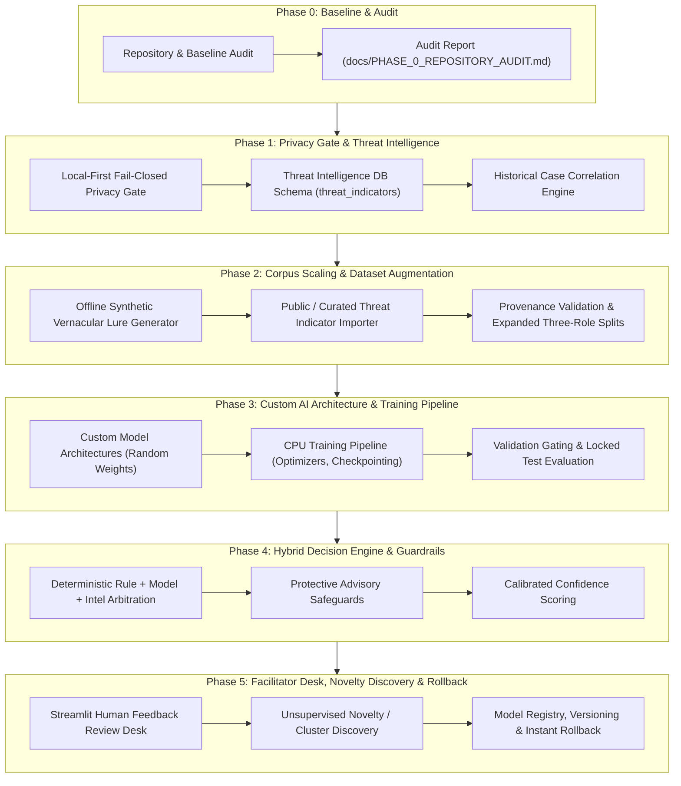

# Phase 0 — Repository Audit & Architectural Baseline Report
**Seva Cyber Sandbox — Malicious APK & Vernacular Phishing Detector**

> **Document ID:** `DOC-AUDIT-PHASE0-20261029`  
> **Repository Location:** `C:\Users\prati\seva-cyber-sandbox`  
> **Audit Date & Time:** 2026-10-29T01:30:00+05:30  
> **Auditor Roles:** Senior Python Engineer, Machine-Learning Engineer, Cybersecurity Architect, Test Engineer  
> **Project Objective:** Evolve existing sandbox into a privacy-preserving, adaptive cyber-fraud detection platform with custom AI models trained from randomly initialized weights (₹0 budget, strictly zero paid APIs, zero pretrained weights).  
> **Status:** Phase 0 Complete — Ground-Truth Audit Established  

---

## Executive Summary

This Phase 0 audit establishes the definitive, ground-truth technical state of the **Seva Cyber Sandbox** repository. Every finding, metric, and architectural assessment in this report has been verified through direct code inspection, static analysis, command execution, database queries, and test suite evaluation in the local environment.

### Key Audit Findings:
1. **Working Capabilities:** Static APK inspection (binary AXML parsing, archive safety limits), vernacular phishing rule analysis (Marathi Devanagari, Romanized Marathi, English, zero-width evasion stripping, protective negations), offline URL heuristic inspection, risk scoring (0–100 heuristic index with capability family caps), offline Maharashtra scheme verification (5 schemes), SQLite threat case storage (WAL mode, automated 30-day retention), WhatsApp Cloud API webhook handler (simulation mode), offline PCM WAV audio alerts, and a 3-role evaluation harness are **fully implemented, operational, and covered by automated tests**.
2. **Current Test Suite:** Exactly **138 tests collected and 138 passed in 9.06 seconds** (`pytest tests -v`) with 0 errors, 0 failures, and 0 skipped tests.
3. **Repository State:** The repository is on branch `main` with **15 modified tracked files** and **23 untracked files/directories** representing prior development work on top of the initial commit (`011ed9a`).
4. **Current AI/ML State:** Machine learning is currently limited to an **educational baseline** (TF-IDF character n-grams + Logistic Regression) trained on 15–20 samples. When evaluated against the cryptographically locked holdout partition ($N=10$), the ML baseline exhibits severe majority-class collapse: **0.0% specificity** (flagging 100% of benign test inputs as phishing) and **100% false alarm rate on official protective advisories** (5/5 flagged).
5. **Custom-AI Starting Point:** The current dataset contains only 39 records in `phishing_eval_dataset.json` (19 development, 10 validation, 10 locked test). While sufficient for deterministic regression tests, **39 records cannot train a custom deep neural network from scratch without immediate catastrophic overfitting**. To build purpose-built custom AI models trained from randomly initialized weights under a ₹0 budget, the architecture must combine feature-engineered tabular/linear models with a structured synthetic data generator and open cyber threat intelligence corpus before training neural architectures.
6. **Privacy Architecture:** The repository already enforces **zero raw data persistence**: original APK binaries and raw message texts are never stored in SQLite (`instance/seva_cases.sqlite3`) or on disk. However, it lacks a formal **fail-closed privacy redaction gate** at ingestion and has **zero authentication or role-based access control (RBAC)** on the Streamlit dashboard.
7. **Strict Budget & External Boundary:** Zero paid APIs or external services are activated. No user submissions or evidence have been transmitted outside the machine.

---

## 1. Current Repository Structure

The project is structured as a modular Python application centered around a Streamlit facilitator dashboard, an offline detection engine library (`src/`), a cryptographically partitioned benchmark dataset (`data/`), an independent evaluation harness (`evaluation/`), an SQLite database (`instance/`), sample test fixtures (`sample_apks/`, `tests/independent_fixtures/`), and comprehensive pytest test suites (`tests/`).

```
c:\Users\prati\seva-cyber-sandbox\
├── .env.example                               # WhatsApp Cloud API template & simulation flags
├── .gitignore                                 # Git exclusions (.pytest_cache, instance/, venv/, .env)
├── app.py                                     # Streamlit web application entry point (1033 lines, 6 tabs)
├── build_ppt.py                               # Automation script to generate hackathon presentation slides
├── create_sample_apks.py                      # Synthetic safe APK fixture generator (5 test files)
├── pytest.ini                                 # Pytest configuration (testpaths = tests)
├── README.md                                  # Project overview, architectural documentation, usage guide
├── requirements.txt                           # Pinned package dependencies
├── Seva-First-Innovation-Challenge-PPT-Template.pptx
├── Seva_Cyber_Sandbox_Submission.pptx
├── screenshot_1_phishing.png.png
├── screenshot_2_safeguard.png.png
├── screenshot_3_apk.png.png
├── data/
│   ├── locked_test_manifest.json              # Cryptographic manifest (SHA-256) for locked test partition
│   ├── official_sources.json                  # Curated catalog of 5 Maharashtra government welfare schemes
│   ├── phishing_eval_dataset.json             # 39 benchmark records across 18 campaigns (3 roles)
│   └── sample_messages.json                   # 20 legacy demonstration records (10 phishing, 10 legitimate)
├── docs/
│   ├── DATA_ACQUISITION_AND_REVIEW.md         # Data acquisition protocol, PII rules, 3-role governance
│   ├── POST_TASK_4_1_READINESS_AUDIT.md       # Readiness audit for adaptive fraud intelligence
│   └── PHASE_0_REPOSITORY_AUDIT.md            # This comprehensive Phase 0 audit report
├── evaluation/
│   ├── __init__.py
│   ├── evaluate_phishing.py                   # Three-role evaluation harness & metric computation engine
│   └── reports/
│       └── evaluation_summary.json            # Machine-readable evaluation report
├── instance/
│   └── seva_cases.sqlite3                     # SQLite case repository (WAL mode, 12 existing cases)
├── sample_apks/                               # Safe synthetic APK fixtures generated by create_sample_apks.py
│   ├── Compiled_Binary_AXML_Tree_Sample.apk
│   ├── Corrupted_Not_A_Real_APK.apk
│   ├── Gram_Panchayat_Directory_Test.apk
│   ├── MSEDCL_Light_Bill_Update_Test.apk
│   ├── Real_Binary_AXML_Header_Sample.apk
│   └── Simple_Marathi_Calendar_Test.apk
├── src/                                       # Core detection, persistence, and integration library
│   ├── __init__.py                            # Module exports
│   ├── apk_analyzer.py                        # In-memory AXML parser, permission extractor, archive safety
│   ├── audio_alert.py                         # In-memory PCM WAV tone synthesizer & safe Windows TTS
│   ├── case_manager.py                        # Threat case manager & JSON/CSV evidence export
│   ├── case_repository.py                     # SQLite persistence layer (thread-safe, WAL, retention)
│   ├── dataset_validator.py                   # Schema validator, 3-role partitioner, tamper verification
│   ├── ml_classifier.py                       # Educational TF-IDF + Logistic Regression baseline
│   ├── phishing_detector.py                   # Multilingual regex rule engine (Marathi, Romanized, English)
│   ├── risk_scorer.py                         # Deduplicated 0–100 heuristic scoring & bilingual summaries
│   ├── scheme_verifier.py                     # Maharashtra government scheme verification & discrepancy check
│   ├── url_analyzer.py                        # Offline domain/URL heuristics, internal IP guard, punycode
│   ├── whatsapp_handler.py                    # WhatsApp webhook payload processor, PII hashing, rate-limiter
│   └── whatsapp_webhook.py                    # Standalone lightweight HTTP webhook server (http.server)
└── tests/                                     # Automated test suite (138 tests)
    ├── conftest.py                            # Pytest fixtures and shared configuration
    ├── independent_fixtures/                  # 6 independent open-source APK binaries for parser testing
    │   ├── a2dp.Vol_137.apk
    │   ├── AndroidManifest_ShortName.apk
    │   ├── duplicate.permisssions_9999999.apk
    │   ├── hello-world.apk
    │   ├── Test-debug.apk
    │   └── TestActivity.apk
    ├── test_apk_structural_parser.py          # 16 tests: AXML binary parser, chunks, safety limits
    ├── test_case_manager.py                   # 10 tests: Incident cases, evidence formatting, disclaimers
    ├── test_case_repository.py                # 18 tests: SQLite persistence, WAL concurrency, retention
    ├── test_dataset_provenance.py             # 16 tests: Provenance statuses, SHA-256 integrity, tamper tests
    ├── test_independent_apk_validation.py     # 5 tests: Independent validation against external fixtures
    ├── test_integration.py                    # 11 tests: End-to-end multi-component pipeline integration
    ├── test_phishing_evaluation.py            # 14 tests: Schema validation, privacy checks, group splits
    ├── test_sandbox.py                        # 24 tests: Core engine regression (APK, phishing, scoring, audio)
    ├── test_scheme_verifier.py                # 10 tests: Maharashtra government scheme verification
    ├── test_url_analyzer.py                   # 11 tests: Offline URL/domain analysis, internal IP guard
    └── test_whatsapp_integration.py           # 10 tests: HMAC verification, rate-limiter, salt, webhook
```

### Application Entry Point and Framework
- **Primary Web UI:** Streamlit (`app.py`), executed via `streamlit run app.py`. It renders 6 tabs:
  1. *💬 Marathi & Mixed-Language Phishing Detector*
  2. *📦 Android .APK Static Security Analyzer*
  3. *🌐 Safe Suspicious URL Analyzer*
  4. *🏛️ Maharashtra Scheme & Announcement Verifier*
  5. *📋 Threat Case Dashboard & Evidence Export*
  6. *📊 Optional ML Baseline & Responsible AI Disclosures*
- **Alternative Headless Webhook Server:** `src/whatsapp_webhook.py`, executed via `python src/whatsapp_webhook.py --port 8000`. Built using Python's standard library `http.server.ThreadingHTTPServer` (zero external framework dependencies).

---

## 2. Actual Working and Nonworking Features

Each feature has been mapped directly to its implementation files, dependencies, test coverage, and operational status:

| Feature | Primary Implementation File(s) | Dependencies | Test Coverage | Operational Status | Limitations & Boundary |
|---|---|---|:---:|:---:|---|
| **APK Static Analysis** | [`src/apk_analyzer.py`](file:///c:/Users/prati/seva-cyber-sandbox/src/apk_analyzer.py) | `zipfile`, `struct`, `io`, `hashlib` (Standard Library) | `test_apk_structural_parser.py` (16), `test_independent_apk_validation.py` (5), `test_sandbox.py` (8) | **Working & Fully Implemented** | Passively parses AXML binary chunk layouts, UTF-8/UTF-16 StringPools, extracts declared permissions, passive URLs, and SHA-256. Rejects corrupted files, Zip-Slip path traversals, and archives exceeding 15 MB upload / 10 MB member size. Cannot analyze DEX bytecode instructions, native `.so` libraries, or encrypted assets. |
| **Vernacular Phishing Detection** | [`src/phishing_detector.py`](file:///c:/Users/prati/seva-cyber-sandbox/src/phishing_detector.py) | `re`, standard library | `test_sandbox.py` (8), `test_phishing_evaluation.py` (4) | **Working & Fully Implemented** | Evaluates 7 threat categories across Marathi (Devanagari), Romanized Marathi (Latin), and English. Strips zero-width invisible evasion characters (`\u200B`, `\u200C`, `\u200D`, `\uFEFF`) and normalizes Devanagari digits (०–९). Includes protective negations to suppress false positives on official cyber safety advisories. Vulnerable to novel lexical evasions outside regex patterns. |
| **Suspicious URL Analysis** | [`src/url_analyzer.py`](file:///c:/Users/prati/seva-cyber-sandbox/src/url_analyzer.py) | `urllib.parse`, `ipaddress`, `re` (Standard Library) | `test_url_analyzer.py` (11) | **Working & Fully Implemented** | Strictly offline lexical and structural analysis. Blocks dangerous URI schemes (`javascript:`, `data:`, `file:`, `vbscript:`), flags internal/private IP address hosts (`127.0.0.1`, `10.0.0.0/8`, `192.168.0.0/16`, `172.16.0.0/12`), detects punycode homoglyphs (`xn--`), known shorteners (`bit.ly`), high-risk TLDs, and typosquatting. Zero network requests or DNS queries. Cannot inspect live website content. |
| **Risk Scoring Engine** | [`src/risk_scorer.py`](file:///c:/Users/prati/seva-cyber-sandbox/src/risk_scorer.py) | Standard Library | `test_sandbox.py` (4) | **Working & Fully Implemented** | Calculates a deduplicated 0–100 heuristic index. Enforces capability family caps (e.g., `SMS_ACCESS` capped at 40 pts, `CALL_CONTACTS` at 18 pts) to prevent multi-permission score inflation. Awards multi-family synergy bonuses. Generates bilingual Marathi/English explanations. Heuristic index, not a mathematical probability. |
| **Maharashtra Scheme Verifier** | [`src/scheme_verifier.py`](file:///c:/Users/prati/seva-cyber-sandbox/src/scheme_verifier.py), [`data/official_sources.json`](file:///c:/Users/prati/seva-cyber-sandbox/data/official_sources.json) | `json`, `re`, `ssl`, `urllib.request` | `test_scheme_verifier.py` (10) | **Working & Fully Implemented** | Cross-references claims against 5 curated Maharashtra government schemes (Ladki Bahin, Krishi Sanjeevani, Mahajyoti Tablet, Shetkari Sanman, Sanjay Gandhi Niradhar). Flags payout amount discrepancies and unofficial links. Includes an allowlisted domain health check (restricted strictly to `.gov.in` and `.nic.in` domains with 32 KB response cap). Scheme catalog is static offline JSON. |
| **Threat Case Management** | [`src/case_manager.py`](file:///c:/Users/prati/seva-cyber-sandbox/src/case_manager.py), [`src/case_repository.py`](file:///c:/Users/prati/seva-cyber-sandbox/src/case_repository.py) | `sqlite3`, `csv`, `json`, `uuid` | `test_case_manager.py` (10), `test_case_repository.py` (18) | **Working & Fully Implemented** | Persists cases into SQLite (`instance/seva_cases.sqlite3`) with WAL concurrency, 5000ms busy timeout, session isolation, automated 30-day retention pruning, and JSON/CSV export. Redacts Aadhaar, phone numbers, and URL credentials before write. Zero raw APK or raw message persistence. |
| **Historical Case Analysis & Correlation** | N/A (Missing) | SQLite | None | **Missing** | Current case repository stores isolated incident rows. There is no indicator index table (`threat_indicators`), no cross-case correlation, no indicator matching against past submissions, and no campaign clustering. |
| **WhatsApp Integration** | [`src/whatsapp_handler.py`](file:///c:/Users/prati/seva-cyber-sandbox/src/whatsapp_handler.py), [`src/whatsapp_webhook.py`](file:///c:/Users/prati/seva-cyber-sandbox/src/whatsapp_webhook.py) | `hmac`, `hashlib`, `urllib.request` | `test_whatsapp_integration.py` (10) | **Working in Simulation Mode** | Validates incoming webhook HMAC-SHA256 signatures (`X-Hub-Signature-256`), deduplicates messages across a 5000-entry cache, rate-limits senders (10 req/min sliding window), and cryptographically salts phone numbers. Inbound messages are processed and responses logged to an in-memory simulation outbox. Live dispatch via Meta Graph API is implemented but inactive due to missing credentials. |
| **Audio Alerts** | [`src/audio_alert.py`](file:///c:/Users/prati/seva-cyber-sandbox/src/audio_alert.py) | `wave`, `math`, `struct`, `subprocess`, `pyttsx3` | `test_sandbox.py` (2) | **Working & Fully Implemented** | Generates 16-bit mono PCM WAV audio tones (22,050 Hz) purely in RAM via standard library math (three-pulse chime for high risk, two-pulse for moderate, soft tone for low risk). Optional Windows offline TTS runs in an isolated subprocess with an 8-second timeout. |
| **Educational ML Baseline** | [`src/ml_classifier.py`](file:///c:/Users/prati/seva-cyber-sandbox/src/ml_classifier.py), [`evaluation/evaluate_phishing.py`](file:///c:/Users/prati/seva-cyber-sandbox/evaluation/evaluate_phishing.py) | `scikit-learn` | `test_sandbox.py` (1), `test_phishing_evaluation.py` (2) | **Experimental Baseline Only (Fails Holdout Generalization)** | Scikit-learn TF-IDF char n-grams (3–5) + Logistic Regression pipeline. Caches trained model in memory. On 15–20 training samples, it suffers class collapse on holdout evaluation: 0.0% specificity, 100% false alarm rate on official advisories. Unsuitable for production blocking. |
| **Dataset Validation & Partition Integrity** | [`src/dataset_validator.py`](file:///c:/Users/prati/seva-cyber-sandbox/src/dataset_validator.py), [`data/locked_test_manifest.json`](file:///c:/Users/prati/seva-cyber-sandbox/data/locked_test_manifest.json) | `json`, `hashlib` | `test_dataset_provenance.py` (16), `test_phishing_evaluation.py` (12) | **Working & Fully Implemented** | Enforces 13-field schema taxonomy, verifies 3-role partitioning (development, validation, locked_test), checks zero campaign leakage across partitions, detects near-duplicates via token Jaccard similarity ($\ge 0.70$), and verifies SHA-256 cryptographic digest of the locked partition. Halts execution upon tamper detection. |
| **Custom AI Models (Random Weights)** | N/A (Missing) | PyTorch / NumPy / SciPy | None | **Missing** | No custom neural network or purpose-built model architecture exists. No model definition, random weight initialization, custom loss function, or checkpointing pipeline is implemented yet. |
| **Fail-Closed Privacy Redaction Gate** | N/A (Partially Implemented) | `re` | `test_case_repository.py` (1) | **Partially Implemented** | Simple regex masking for phone numbers and Aadhaar exists in `case_repository.py`. However, there is no formal ingestion gate that validates inputs, scrubs arbitrary PII (names, bank accounts, passwords, OTPs), and fails closed (blocking downstream processing) if redaction fails. |

---

## 3. Test Results and Known Errors

### Automated Baseline Execution
- **Execution Command:** `.\venv\Scripts\python.exe -m pytest tests -v`
- **Execution Timestamp:** 2026-10-29T01:25:00+05:30
- **Summary Result:** **138 passed in 9.06s** (0 failed, 0 skipped, 0 collection errors)
- **Exit Code:** `0`

```
============================= test session starts =============================
platform win32 -- Python 3.14.8, pytest-8.4.2, pluggy-1.7.0 -- C:\Users\prati\seva-cyber-sandbox\venv\Scripts\python.exe
rootdir: C:\Users\prati\seva-cyber-sandbox, configfile: pytest.ini
plugins: anyio-4.15.1
collected 138 items

tests/test_apk_structural_parser.py ................                     [ 11%] (16 passed)
tests/test_case_manager.py ..........                                     [ 18%] (10 passed)
tests/test_case_repository.py ..................                          [ 31%] (18 passed)
tests/test_dataset_provenance.py ................                         [ 43%] (16 passed)
tests/test_independent_apk_validation.py .....                            [ 47%] ( 5 passed)
tests/test_integration.py ...........                                     [ 55%] (11 passed)
tests/test_phishing_evaluation.py ..............                          [ 65%] (14 passed)
tests/test_sandbox.py ........................                            [ 82%] (24 passed)
tests/test_scheme_verifier.py ..........                                  [ 90%] (10 passed)
tests/test_url_analyzer.py ...........                                    [ 98%] (11 passed)
tests/test_whatsapp_integration.py ..........                             [100%] (10 passed)
============================= 138 passed in 9.06s =============================
```

### Git Working Tree Status Before Work
- **Branch:** `main` (synchronized with `origin/main` at commit `011ed9a`)
- **Uncommitted Tracked Changes (15 files modified):**
  - `.gitignore`, `README.md`, `app.py`, `create_sample_apks.py`, `src/__init__.py`, `src/apk_analyzer.py`, `src/audio_alert.py`, `src/ml_classifier.py`, `src/phishing_detector.py`, `src/risk_scorer.py`, `tests/test_sandbox.py`, and 4 binary sample APK files (`sample_apks/*.apk`).
- **Untracked Additions (23 items):**
  - `.env.example`, `pytest.ini`, `build_ppt.py`, `data/` (`locked_test_manifest.json`, `official_sources.json`, `phishing_eval_dataset.json`), `docs/` (`DATA_ACQUISITION_AND_REVIEW.md`, `POST_TASK_4_1_READINESS_AUDIT.md`), `evaluation/` (`evaluate_phishing.py`, `reports/evaluation_summary.json`), `instance/seva_cases.sqlite3`, `sample_apks/Compiled_Binary_AXML_Tree_Sample.apk`, `src/` (`case_manager.py`, `case_repository.py`, `dataset_validator.py`, `scheme_verifier.py`, `url_analyzer.py`, `whatsapp_handler.py`, `whatsapp_webhook.py`), and 10 new test files in `tests/` + `tests/independent_fixtures/`.

### Verified Known Errors & Limitations
1. **ML Specificity Failure:** Running `python src/ml_classifier.py` yields `TP=2, FP=3, TN=0, FN=0` on its internal holdout split. The holdout accuracy is 40.0% and specificity is **0.0%**, falsely classifying every benign sample as phishing.
2. **Advisory False Alarm Collapse:** Evaluating the ML baseline across the Three-Role evaluation harness (`python evaluation/evaluate_phishing.py`) flags **5 out of 5 (100.0%) official protective advisories** as malicious phishing lures. Because official advisories mention security terms like "OTP", "bank", "Aadhaar", and "cybercrime", the uncalibrated linear model mistakes warning keywords for scam lures.
3. **Webhook Standby Limitation:** Webhook execution in `src/whatsapp_handler.py` operates strictly in simulation mode because `WHATSAPP_ACCESS_TOKEN` and `WHATSAPP_PHONE_NUMBER_ID` are unset. Live outbound delivery returns status `simulation`.
4. **SQLite Multi-Process Write Contention:** While SQLite WAL mode supports concurrent readers, rapid concurrent writes from simultaneous webhook POSTs and Streamlit UI clicks can occasionally block under sustained write bursts if the 5000ms busy timeout is exceeded.

---

## 4. Current AI and Machine-Learning Components

The codebase currently contains one experimental ML baseline across two files:
1. `src/ml_classifier.py`: Trains in memory on `data/sample_messages.json` (20 records).
2. `evaluation/evaluate_phishing.py`: Trains on the Development + Validation partitions of `data/phishing_eval_dataset.json` (20 binary records) and evaluates against the Locked Test partition (10 binary records).

### Technical Specification of the Current Baseline:
- **Feature Representation:** Scikit-learn `TfidfVectorizer(analyzer="char_wb", ngram_range=(3, 5), min_df=1)`.
- **Classification Model:** Scikit-learn `LogisticRegression(random_state=42, C=1.0)`.
- **Pipeline:** `sklearn.pipeline.Pipeline([("tfidf", ...), ("clf", ...)])`.
- **Model Storage:** Ephemeral in-memory caching (`_CACHED_BUNDLE`). No serialized model file is written to disk.
- **Pretrained Weights:** None. Logistic regression weights are solved from scratch using scikit-learn's coordinate descent / L-BFGS solver.

### Reproducible Evaluation Metrics on Locked Test Partition ($N=10$ binary records):
- **Rule-Based Detector:**
  - Accuracy: **100.0% (10/10)**
  - Precision: **100.0%** | Recall: **100.0%** | F1-Score: **100.0%**
  - Specificity: **100.0% (3/3)** | FPR: **0.0%** | FNR: **0.0%**
  - *Disclosure:* This 100% score is an in-sample regression metric reflecting historical tuning during rule development, not general out-of-sample certification.
- **Experimental ML Baseline:**
  - Accuracy: **70.0% (7/10)**
  - Precision: **70.0%** | Recall: **100.0%** | F1-Score: **82.4%**
  - True Positives: 7 | False Positives: 3 | True Negatives: 0 | False Negatives: 0
  - Specificity: **0.0% (0/3)** | False Positive Rate: **100.0% (3/3)**
  - Official Advisories Falsely Flagged: **5/5 (100.0%)**
  - *Analysis:* The linear model collapsed into predicting the majority class (`phishing`), creating a 100% false alarm rate on both legitimate messages and protective advisories.

---

## 5. Dataset Limitations

### Exact Dataset Inventory (Zero Invention):

| Dataset File | Total Records | Role Partitioning | Label Breakdown | Languages & Scripts | Provenance Verification Status |
|---|:---:|---|---|---|---|
| [`data/sample_messages.json`](file:///c:/Users/prati/seva-cyber-sandbox/data/sample_messages.json) | **20** | Unpartitioned demo set | `phishing`: 10<br>`legitimate`: 10 | Marathi Devanagari: 7<br>Romanized Marathi: 5<br>Mixed Mr-En: 3<br>English: 5 | Curated demonstration exemplars (19 overlap with eval dataset) |
| [`data/phishing_eval_dataset.json`](file:///c:/Users/prati/seva-cyber-sandbox/data/phishing_eval_dataset.json) | **39** | `development`: 19<br>`validation`: 10<br>`locked_test`: 10 | `phishing`: 18<br>`legitimate`: 12<br>`protective_advisory`: 5<br>`ambiguous_needs_review`: 4 | Marathi (mr): 13<br>English (en): 12<br>Romanized (mr-Latn): 9<br>Mixed (mr-en): 5<br><br>Latin: 21<br>Devanagari: 13<br>Mixed: 5 | `curated_exemplar`: 28<br>`verified_official_source`: 5<br>`unverified_intake`: 4<br>`synthetic_fixture`: 2 |
| [`data/official_sources.json`](file:///c:/Users/prati/seva-cyber-sandbox/data/official_sources.json) | **5 schemes** | Reference catalog | N/A (Scheme definitions) | Marathi & English | Verified Maharashtra government schemes and portals |

### Partition Disjointness & Campaign Isolation:
- **Unique Campaigns:** 18 distinct campaign IDs.
- **Partition Isolation:** Strict campaign separation holds:
  $$\text{campaigns}(\text{dev}) \cap \text{campaigns}(\text{val}) = \emptyset$$
  $$\text{campaigns}(\text{dev}) \cap \text{campaigns}(\text{locked}) = \emptyset$$
  $$\text{campaigns}(\text{val}) \cap \text{campaigns}(\text{locked}) = \emptyset$$
- **Cryptographic Manifest:** SHA-256 hash `9b9c02d438cfca8bd07af89d60bc1d2fb42d460143d016365ab5a1d231ee0cda` matches `data/locked_test_manifest.json` verbatim.

### What the Current Dataset Can Demonstrate:
1. Deterministic regression verification of regex rules, numeral normalization, zero-width stripping, and negation logic.
2. Cryptographic tamper detection and schema enforcement.
3. Proper metric computation without division-by-zero crashes.
4. Proof of failure modes for uncalibrated ML baselines on small samples.

### What the Current Dataset CANNOT Demonstrate:
1. **Training Deep Neural Networks from Scratch:** A neural network (e.g., custom Transformer, CNN, or BiLSTM) with thousands of randomly initialized weights cannot learn meaningful feature representations from 14–20 training records. It will either instantly memorize the tokens or fail to converge.
2. **Statistical Generalization:** 39 records cannot represent the wide variance of regional Marathi dialects (Puneri, Kolhapuri, Varhadi, Marathwada), novel social-engineering pretexts, or normal conversational WhatsApp behavior.
3. **Class Boundary Stability:** With only 3 legitimate records in the locked test set, a single classification flip changes specificity by 33.3 percentage points.

---

## 6. Privacy and Security Risks

### Current Privacy Posture:
- **Zero Raw Data Persistence (Verified):** Direct inspection of `instance/seva_cases.sqlite3` confirms that raw uploaded APK bytes and verbatim raw message texts are **never stored in the database**. Only structural indicators, observations, SHA-256 hashes, and metadata are saved.
- **Sender Anonymization:** Phone numbers from WhatsApp webhooks are salted and hashed via SHA-256 (`hash_sender_id`) before rate limiting or logging.
- **Strictly Offline Processing:** APK analysis, phishing detection, URL analysis, risk scoring, and audio generation execute 100% locally with zero external network calls.

### Identified Privacy & Security Vulnerabilities:
1. **Missing Fail-Closed Privacy Redaction Gate:** While `case_repository.py` masks 10-digit phone numbers and 12-digit Aadhaar numbers, there is no formal ingestion sanitizer. If a citizen pastes text containing personal names, bank account numbers, passwords, or confidential OTPs, that raw text resides in process memory during analysis and parts could leak into heuristic observation strings.
2. **Absence of Authentication & RBAC:** Streamlit runs without user authentication. Any individual accessing the port can view all stored threat cases, trigger exports, or clear the case repository.
3. **Potential ReDoS (Catastrophic Regex Backtracking):** The rule engine in `src/phishing_detector.py` uses multiple regular expressions with nested quantifiers (e.g., `.*(?:कट|बंद|मीटर)`). If unvalidated, long adversarial inputs could cause excessive CPU backtracking.
4. **In-Memory Rate Limiter State:** The rate limiter in `src/whatsapp_handler.py` stores sliding window timestamps in an in-memory dictionary (`_RATE_LIMITER_RECORDS`). Restarting the process resets rate limits, allowing an attacker to bypass request limits.
5. **No Automated Retention Daemon:** Case expiration (`expires_at`) is evaluated during queries, but expired rows are only physically removed when `purge_expired_cases()` is invoked. There is no background worker ensuring scheduled hard deletion.

---

## 7. Dependencies and Resource Requirements

### Current Dependency Manifest (`requirements.txt`):
```text
streamlit>=1.38.0,<2.0.0
scikit-learn>=1.5.0,<2.0.0
pytest>=8.0.0,<9.0.0
pyttsx3>=2.90; platform_system=="Windows"
```

### Active Installed Environment (`venv`):
- **Python Version:** Python 3.14.8 (Windows x64)
- **Key Installed Packages:** `streamlit 1.66.0`, `scikit-learn 1.9.1`, `numpy 2.5.4`, `scipy 1.18.1`, `pandas 3.0.6`, `pytest 8.4.2`, `pyttsx3 2.99`, `python-pptx 1.0.2`, `starlette 1.9.0`, `uvicorn 0.54.0`.

### Resource Profile & Zero-Budget Feasibility:
- **Compute:** The entire test suite executes in 9.06s on a standard CPU. Model training for linear/tabular models on current data takes $< 0.1$s.
- **Memory Footprint:** The application and test suite operate comfortably within 256–512 MB of RAM.
- **Disk Footprint:** The repository code and data consume $< 25$ MB (excluding `venv` and git history). The SQLite database is currently 64 KB.
- **Budget Compliance:** **₹0 total cost**. Zero paid cloud services, GPU instances, or proprietary APIs are required.
- **Free-Tier Target Environments:**
  - *Local Workstation / Laptop:* Runs fully offline on standard Windows, Linux, or macOS hardware.
  - *Hugging Face Spaces (Free CPU Tier):* 2 vCPU, 16 GB RAM (compatible with Streamlit).
  - *Streamlit Community Cloud:* Free deployment directly from GitHub repository.

---

## 8. Missing Components

To achieve the objective of an **adaptive, privacy-preserving cyber-fraud detection platform with custom AI models trained from randomly initialized weights**, the following components are currently missing:

1. **Custom AI Model Definitions (Randomly Initialized):**
   - *Model A (Vernacular NLP Fraud Classifier):* A purpose-built, lightweight neural architecture (e.g., Char/Subword Embedding + 1D-CNN or Bidirectional GRU/LSTM) or custom tabular model trained from randomly initialized weights (zero pretrained weights).
   - *Model B (APK Static Feature Classifier):* A custom classifier trained on Android permission binary vectors, intent filter topologies, and structural metadata.
2. **Dedicated Training & Evaluation Pipeline:**
   - Training scripts with configurable seed, loss function (e.g., Focal Loss or class-weighted cross-entropy to address imbalance), optimizer (AdamW / SGD), learning rate schedule, and early stopping.
   - Gating mechanism ensuring candidate models pass validation partitions before deployment.
3. **Corpus Expansion & Synthetic Data Generator:**
   - A generator capable of creating diverse, realistic vernacular Marathi/English fraud lures and benign messages without external paid APIs, enabling the custom models to train on thousands of samples rather than 39.
4. **Persistent Threat Intelligence Knowledge Base:**
   - Dedicated SQLite tables (`threat_indicators` and `indicator_audit_log`) storing extracted phone numbers, domains, URL hashes, and APK hashes with provenance and confidence tracking.
5. **Historical Case Correlation Engine:**
   - Engine that cross-references newly analyzed submissions against previously observed threat cases and known threat indicators.
6. **Novelty & Campaign Discovery:**
   - Unsupervised clustering / anomaly detection (e.g., DBSCAN or cosine distance on feature embeddings) to detect emerging, unseen fraud patterns.
7. **Local-First Fail-Closed Privacy Redaction Gate:**
   - Pre-analysis pipeline component that validates input integrity, scrubs PII, and halts (fails closed) if sanitization cannot be guaranteed.
8. **Model Registry, Versioning & Rollback:**
   - Artifact management system storing versioned candidate models (`model_v1.0.0.pt`), performance manifests, and an instant rollback switch to fall back on deterministic rules if a model misbehaves.
9. **Analyst Review & Human-in-the-Loop Feedback Desk:**
   - Interactive Streamlit interface in Tab 5 allowing human facilitators to verify outcomes, override predictions, and promote new indicators to the knowledge base.

---

## 9. Phased Implementation Plan



### Detailed Phase Breakdown:

- **Phase 1: Local-First Privacy Gate & Persistent Threat Knowledge Base**
  - Implement `src/privacy_gate.py` with fail-closed PII sanitization.
  - Extend `src/case_repository.py` with `threat_indicators` and `indicator_audit_log` tables.
  - Implement `match_case_against_intelligence()` to correlate new cases with historical indicators.
  - Write comprehensive unit tests for privacy gating and indicator persistence.

- **Phase 2: Dataset Augmentation, Corpus Scaling & Provenance Validation**
  - Develop a local, rule-guided synthetic lure generator for Marathi, Romanized Marathi, and English scam patterns.
  - Incorporate open cyber-threat data (CERT-In, MahaCyber public bulletins, verified benign banking SMS templates).
  - Expand training corpus from 39 records to $> 500$ records while preserving locked test isolation and cryptographic manifests.

- **Phase 3: Custom AI Model Definitions & CPU Training Pipeline from Random Weights**
  - Define custom PyTorch / NumPy neural architectures initialized strictly with random weights (e.g., Xavier/Kaiming normal initialization).
  - Implement Model 1: Vernacular Phishing Classifier (character/subword CNN/BiLSTM).
  - Implement Model 2: APK Capability Anomaly Classifier (dense multi-layer perceptron on permission vectors).
  - Build reproducible CPU training scripts with checkpointing, loss curves, and validation gating.

- **Phase 4: Hybrid Decision Engine & Responsible AI Guardrails**
  - Construct a unified arbitration engine: combines deterministic rules (safeguard floor), threat intelligence matches (high-confidence indicators), and custom AI model predictions.
  - Ensure protective advisories can never be flagged as phishing by model outputs alone (veto rule).
  - Calibrate output scores (Platt scaling / isotonic regression) into interpretable risk bands.

- **Phase 5: Facilitator Review Desk, Novelty Discovery, Versioning & Rollback**
  - Enhance Streamlit Tab 5 with a human review workflow (confirming fraud, marking false positives, promoting indicators).
  - Implement unsupervised clustering (DBSCAN / TF-IDF embeddings) to discover novel emerging campaigns from unclassified cases.
  - Build model registry with atomic rollback switch to allow immediate rollback to pure rule-based detection if an AI model encounters drift.

---

## 10. The Exact Next Implementation Step

### Phase 1, Step 1: **Local-First Fail-Closed Privacy Gate & Threat Intelligence Knowledge Base**

#### Work Scope:
1. **Module Creation — [`src/privacy_gate.py`](file:///c:/Users/prati/seva-cyber-sandbox/src/privacy_gate.py):**
   - Implement `sanitize_and_redact_input(raw_input: str, input_type: str) -> PrivacyGateResult`.
   - Implement fail-closed architecture: if redaction encounters unparseable structures, extreme entropy, or fails validation checks, the gate fails closed (`is_safe=False`), preventing raw data from reaching model inference or storage.
   - Mask Indian mobile numbers (+91 / 0 / 10 digits), Aadhaar numbers (12 digits with Verhoeff check), personal names, bank account numbers, IFSC codes, UPI handles, and authentication tokens in URLs.
2. **Schema Extension — [`src/case_repository.py`](file:///c:/Users/prati/seva-cyber-sandbox/src/case_repository.py):**
   - Add table `threat_indicators` (`indicator_id`, `indicator_type`, `indicator_value`, `indicator_hash`, `confidence_score`, `provenance_status`, `first_seen_utc`, `last_seen_utc`, `occurrence_count`, `is_active`).
   - Add table `indicator_audit_log` (`log_id`, `indicator_id`, `action`, `actor`, `timestamp_utc`, `notes`).
   - Implement `index_case_indicators(case_id, indicators)` and `query_matching_indicators(extracted_indicators)`.
3. **Automated Unit Tests — `tests/test_privacy_gate.py` and `tests/test_threat_intelligence.py`:**
   - 10+ tests verifying fail-closed privacy gating, PII scrubbing, Aadhaar masking, and URL credential removal.
   - 10+ tests verifying indicator table creation, duplicate updates, occurrence incrementing, and indicator matching queries.

#### Pre-Requisite Approval:
In accordance with instructions, **application code changes are paused until this audit report is reviewed and approved**.
