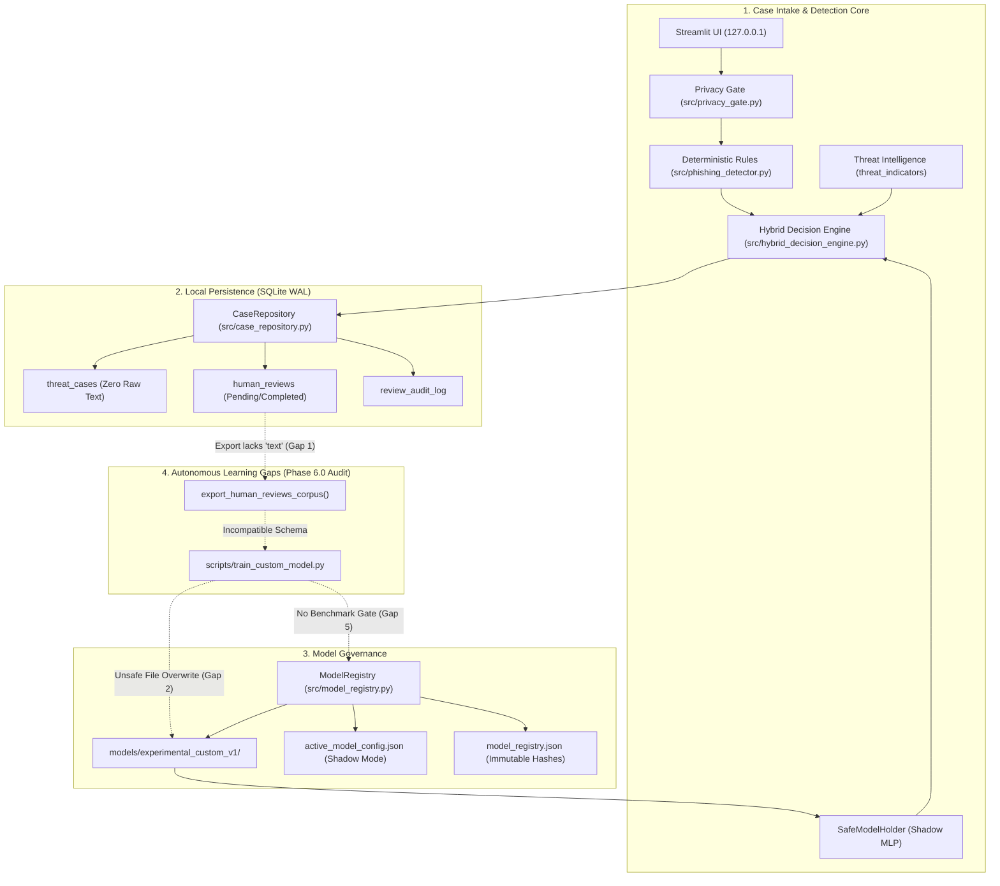
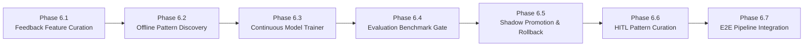

# Seva Cyber Sandbox — Phase 6.0: Offline Autonomous Learning Architecture Audit

**Document Reference:** `docs/PHASE_6_0_LEARNING_ARCHITECTURE_AUDIT.md`  
**Evaluation Timestamp:** 2026-10-30T14:45:00+05:30  
**Audit Target:** Seva Cyber Sandbox (`C:\Users\prati\seva-cyber-sandbox`)  
**Auditor:** Autonomous Systems & Architecture Safety Auditor  
**Audit Type:** Strictly Read-Only Architecture, Feedback Loop, and Privacy Audit  
**Status:** COMPLETE  
**Final Verdict:** **PASS WITH WARNINGS** (Prerequisites satisfied; critical architectural gaps identified for Phase 6.1–6.7)

---

## 1. Executive Summary

This report delivers the read-only architectural audit for **Phase 6.0** of the **Seva Cyber Sandbox**, preparing the foundation for an offline autonomous learning pipeline. The project is an air-gapped, local-first cybersecurity system protecting Marathi-speaking citizens and local administrators from vernacular phishing, fraudulent Maharashtra government scheme lures, malicious APKs, and suspicious URLs.

Prior to evaluating any architecture designs, the repository's baseline health, test suite, and evaluation partition integrity were independently verified from first principles:
- **Test Suite Health:** All **273 tests** across 20 test modules passed with 100% success (`pytest -q`, execution time: 15.87s).
- **Locked Evaluation Partition Integrity:** The canonical SHA-256 digest of the independent evaluation partition was computed using `src.dataset_validator.compute_locked_test_hash()` and verified against `data/locked_test_manifest.json`. The digest matches **`9b9c02d438cfca8bd07af89d60bc1d2fb42d460143d016365ab5a1d231ee0cda`** exactly (`Integrity: True, []`).
- **Git Tree Cleanliness:** No files were altered, deleted, or reset.

### Core Architectural Conclusions

1. **Robust Core Safety Foundation:** The existing codebase enforces exceptional safety controls:
   - Production risk scoring is **100% governed by deterministic rules and reviewed threat intelligence**. In shadow mode, the custom neural classifier's production score difference is mathematically guaranteed to be zero (`production_score_difference == 0`).
   - The model version registry (`src/model_registry.py`) enforces **cryptographic SHA-256 pre-loading verification** and **version entry immutability** (resolving findings `SEC-05-02` and `SEC-05-03`).
   - Network calls are strictly eliminated, and the web interface is bound to loopback `127.0.0.1` (`SEC-05-01`).
   - Safe deserialization (`allow_pickle=False`) is enforced across all NumPy checkpoint loading.

2. **Critical Architectural Gaps for Autonomous Learning:**
   - **Gap 1 (Feedback Incompatibility):** The SQLite case repository (`src/case_repository.py`) intentionally discards raw message text (`raw_text`, `raw_bytes`) to maintain zero raw data retention. Consequently, `export_human_reviews_corpus()` produces JSONL records lacking a `text` or `normalized_text` field. Feeding this export into the current training pipeline (`scripts/train_custom_model.py`) immediately fails schema validation (`Missing required field: 'text'`).
   - **Gap 2 (Unsafe Standalone Training Overwrite):** While the model registry prevents overwriting registered entries in `model_registry.json`, the standalone script `scripts/train_custom_model.py` saves checkpoints directly to `--output-dir` (defaulting to `models/experimental_custom_v1`) without verifying whether an active on-disk checkpoint is being overwritten. Re-running training can silently alter `.npz` files on disk, invalidating cold-start integrity checks.
   - **Gap 3 (Unauthenticated Review Attribution):** The Human Review Desk currently relies on a client-supplied string (`reviewer_label`, default: `"local_operator"`). There is no session authentication, role-based access control, or cryptographic signature. Completed human reviews cannot be considered uncompromised ground truth.
   - **Gap 4 (Duplicate Case Proliferation):** Case logging in `src/case_manager.py` only deduplicates cases if an explicit `dedup_key` is supplied. When analyzing the same message multiple times in the UI or webhook, separate `case_id`s and separate pending reviews are created, leading to sample duplication and potential training bias.
   - **Gap 5 (No Automated Evaluation Gate):** No automated benchmark harness gates model promotion from training into the registry. Registration is an uncalibrated manual step.

Because these gaps must be addressed through carefully phased modules rather than an unconstrained autonomous loop, Phase 6.0 issues a **PASS WITH WARNINGS** verdict and provides a step-by-step implementation plan for **Subphases 6.1 through 6.7**.

---

## 2. Actual Current Architecture & Source File Index

| Module / Component | File Path | Primary Function / Scope | Verified State |
| :--- | :--- | :--- | :--- |
| **Custom Neural Model** | `src/custom_model.py` | 3-class MLP classifier over character n-gram hashing (NumPy, randomly initialized, Adam optimizer). | Active (Version: `custom-mlp-v1.0.0`) |
| **Dataset Preprocessing** | `src/dataset_preprocessing.py` | NFC normalization, zero-width evasion stripping, Devanagari digit mapping, partition leakage checks. | Active (Version: `neural-preproc-v1.1.0`) |
| **Hybrid Decision Engine** | `src/hybrid_decision_engine.py` | Multi-tier decision arbitrator uniting rules, reviewed threat intel, and shadow neural model. | Active (Engine Version: `1.0.0`) |
| **Model Version Registry** | `src/model_registry.py` | Cryptographic SHA-256 verification, version immutability, atomic rollback, safe path validation. | Hardened (`SEC-05-02`, `SEC-05-03`) |
| **Case Repository** | `src/case_repository.py` | SQLite WAL persistence (`threat_cases`, `threat_indicators`, `human_reviews`, `review_audit_log`). | Active (Schema v1) |
| **Case Manager** | `src/case_manager.py` | Business logic, session case store, privacy-preserving case factory functions. | Active |
| **Privacy Gate** | `src/privacy_gate.py` | Conservative PII redaction (Aadhaar, phones, bank accounts, credentials, OTPs, cards). | Hardened (`SEC-02`) |
| **Dataset Validator** | `src/dataset_validator.py` | Schema validation, near-duplicate detection, locked evaluation partition integrity checking. | Verified (`9b9c...0cda`) |
| **Model Training Pipeline** | `scripts/train_custom_model.py` | Batch training with Adam, early stopping, and checkpoint export to `models/`. | Experimental |
| **Model Evaluation Harness** | `scripts/evaluate_custom_model.py` | Validation partition evaluation, confusion matrix, URL counterfactual ablation, seed sensitivity. | Experimental |
| **Hybrid Evaluation Harness** | `scripts/evaluate_hybrid_engine.py` | Shadow-mode validation, rule concordance, score invariance verification. | Experimental |
| **Streamlit Interface** | `app.py` | 7-tab local dashboard including Human Review Desk and Model Version Registry. | Bound to `127.0.0.1` (`SEC-05-01`) |



---

## 3. Findings Supported by Source-Code Evidence

### 3.1 Human Feedback Architecture & Workflow

#### Review Creation, Updating, and Superseding
- **Creation:** Implemented in `src/case_repository.py` lines 1531–1583 (`create_or_get_review`):
  ```python
  def create_or_get_review(self, case_id: str, reviewer_label: str = "local_operator", notes: str = "", metadata: Optional[Dict[str, Any]] = None):
      case = self.get_case(case_id)
      if not case:
          raise HumanReviewValidationError(f"Case '{case_id}' does not exist.")
      existing = self.get_review_by_case(case_id)
      if existing and existing["review_state"] != "superseded":
          return existing
  ```
  Initial review state is set to `'pending'` with `outcome_category = NULL`. A corresponding `CREATE` event is recorded in `review_audit_log`.
- **Updating & Adjudication:** Handled in `submit_review` (lines 1585–1702):
  - Validates `outcome_category` against `ALLOWED_HUMAN_OUTCOME_CATEGORIES = {"phishing", "legitimate", "protective_advisory", "insufficient_evidence"}`.
  - Validates `confidence_rating` against `ALLOWED_CONFIDENCE_RATINGS = {"high", "medium", "low"}`.
  - Enforces `len(notes) <= 1000` and sanitizes notes with `sanitize_evidence_text(notes.strip())`.
  - Sets state to `'inconclusive'` if `outcome_category == "insufficient_evidence"`, else `'completed'`.
- **Superseding Mechanics:** If an existing completed review is updated with a different outcome category:
  ```python
  if prior_state == "completed" and prior_outcome != outcome_category:
      self._record_review_audit_event(
          conn, review_id=review_id, case_id=case_id,
          action="SUPERSEDE_OUTCOME", actor=reviewer_label[:64],
          reason=f"Corrected outcome from '{prior_outcome}' to '{outcome_category}'",
          details={"prior_outcome": prior_outcome, "new_outcome": outcome_category},
      )
  ```
  The row in `human_reviews` is updated in place, while prior state transitions are preserved strictly in `review_audit_log`.

#### Export Fields & Schema Incompatibility with Trainer
- Method: `export_human_reviews_corpus()` (lines 1825–1865).
- Fields exported per record:
  ```python
  rec = {
      "record_id": f"rev_export_{rev['review_id']}",
      "case_id": rev["case_id"],
      "target_identifier": case.get("target_identifier", "Unknown"),
      "analysis_type": case.get("analysis_type", "Unknown"),
      "heuristic_risk_score": case.get("risk_score", 0),
      "human_verified_label": rev["outcome_category"],
      "confidence_rating": rev["confidence_rating"],
      "reviewer_notes": rev["notes"],
      "observed_evidence_summary": case.get("observed_evidence", [])[:5],
      "extracted_urls_count": len(case.get("extracted_urls", [])),
      "provenance_category": "human_reviewed_curated",
      "provenance_verification_status": "analyst_curated",
      "review_date_utc": rev["updated_at"],
      "disclaimer": "Human review feedback export. NOT automatically fed back into active model training.",
  }
  ```
- **Architectural Conflict (Gap 1):** The export does NOT contain `text` or `normalized_text`. In `save_case()` (lines 753–777), `raw_text`, `raw_bytes`, and `file_bytes` are explicitly excluded from persistence. The trainer `scripts/train_custom_model.py` requires `text` and runs `validate_single_record(data)`, which immediately rejects records without `'text'`.

#### Personal Information (PII) Risks in Export
- Raw message text is NOT stored in SQLite, preventing direct message dumping.
- However, two PII leakage vectors exist:
  1. `reviewer_notes`: Reviewers type into an unconstrained text area. `sanitize_evidence_text()` strips phone numbers and credentials, but does not execute the full `PrivacyGate` redaction (names, Aadhaar, account numbers).
  2. `target_identifier`: In URL analysis cases, URLs with custom subdomains or path tokens could appear.

#### Duplicate Cases & Repeated Reviews
- Deduplication only triggers if `dedup_key` is provided in `save_case` (line 728). In typical interactive use (Streamlit / UI), `dedup_key` is `None`.
- Re-analyzing identical text creates duplicate cases (`CASE-20261030-XXXXXXXX`). Reviewing these cases creates duplicate records in `human_reviews`.

#### Handling of Insufficient Evidence
- When an operator selects `"insufficient_evidence"`, `submit_review` marks `review_state = "inconclusive"`.
- `export_human_reviews_corpus()` filters strictly for `review_state == "completed"` (line 1833). Therefore, inconclusive reviews are safely omitted from export.

#### Reviewer Identity Trust Mechanism
- **Finding:** No trustworthy mechanism exists. `reviewer_label` is an unauthenticated client string (line 1176 in `app.py`). Any user can supply any identifier. Reviewer decisions cannot be considered cryptographically authenticated or non-repudiable.

---

### 3.2 Training Pipeline Architecture & Gaps

#### Input Format Expected by Trainer
- `scripts/train_custom_model.py` expects JSON Lines (`.jsonl`).
- Each line is validated by `validate_single_record(data)` (`src/dataset_preprocessing.py` lines 136–203):
  - Must contain all `REQUIRED_DATASET_FIELDS`: `record_id`, `text`, `ground_truth_label`, `language`, `script`, `provenance_category`, `provenance_verification_status`, `source_reference`, `license_info`, `collection_date`, `review_status`, `campaign_id`, `dataset_role`.
  - `dataset_role` must be `'development'` for training records and `'validation'` for validation records.
  - `ground_truth_label` must be one of `{"phishing", "legitimate", "protective_advisory"}`.

#### Label & Numerical Mapping
- Defined in `src/custom_model.py` lines 36–42:
  ```python
  LABEL_TO_IDX = {"phishing": 0, "legitimate": 1, "protective_advisory": 2}
  IDX_TO_LABEL = {0: "phishing", 1: "legitimate", 2: "protective_advisory"}
  NUM_CLASSES = 3
  ```
- Labels are one-hot encoded into `Y_onehot` of shape `(N, 3)` with float32 values.

#### Preprocessing Alignment between Training & Inference
- **Training:** `prepare_data()` in `scripts/train_custom_model.py` (lines 80–81):
  ```python
  texts = [r.get("normalized_text", r.get("text", "")) for r in records]
  X = hasher.transform_batch(texts)
  ```
- **Inference:** `SafeModelHolder.predict_safe()` in `src/hybrid_decision_engine.py`:
  ```python
  norm_text = preprocess_for_neural_model(text)
  pred = self._model.predict_one(norm_text, self._hasher)
  ```
- In both training (via `preprocess_record()`) and inference, the same canonical preprocessing pipeline is executed: Unicode NFC composition, zero-width evasion character stripping (`clean_evasion_characters`), Devanagari numeral translation to ASCII digits (`DEV_TO_ASCII_MAP`), and whitespace collapsing. This guarantees mathematical feature parity.

#### Random Initialization Guarantee
- `CustomNeuralClassifier._init_weights()` (`src/custom_model.py` lines 144–170):
  - Hidden Layer 1: He normal initialization ($\sigma = \sqrt{2 / d_{\text{in}}}$).
  - Hidden Layer 2: He normal initialization ($\sigma = \sqrt{2 / h_1}$).
  - Output Layer: Xavier uniform initialization ($[-a, +a]$ where $a = \sqrt{6 / (h_2 + C)}$).
  - Biases: Initialized to zeros.
  - Pretrained weights: 0. Operates strictly from scratch with seed control (`seed=42`).

#### Checkpoint Writing & Overwrite Vulnerability
- `model.save_checkpoint(output_dir, metadata=training_meta)` creates `model_weights.npz` and `model_metadata.json`.
- **Architectural Vulnerability (Gap 2):** `save_checkpoint` executes `os.makedirs(checkpoint_dir, exist_ok=True)` and unconditionally overwrites existing files. If an operator or automated script invokes `train_custom_model.py` pointing to `models/experimental_custom_v1`, the registered model weights on disk are overwritten without checking the registry! This causes subsequent cold-start integrity checks (`SEC-05-02`) to fail because on-disk hashes diverge from `model_registry.json`.

#### Model Registration Validation Gaps
- `ModelRegistry.register_model()` verifies file existence and computes SHA-256 digests.
- **Missing Validations (Gap 5):**
  - No check that the candidate model passes minimum accuracy, Macro-F1, or false-positive thresholds.
  - No counterfactual URL stability check.
  - No check that validation metrics were computed on the certified validation partition.

---

### 3.3 Dataset Isolation & Air-Gap Integrity

#### Inventory of Project Partitions

| Partition / File | Record Count | Declared Role | Primary Intended Purpose | Isolation Status |
| :--- | :---: | :--- | :--- | :--- |
| `data/generated/v2/synthetic_training_corpus.jsonl` | 360 | `development` | Deconfounded synthetic training corpus | Clean |
| `data/generated/v2/synthetic_validation_corpus.jsonl` | 135 | `validation` | Deconfounded synthetic validation partition | Clean |
| `data/generated/v2/quarantine_records.jsonl` | 45 | `development`, `validation` | Quarantined ambiguous / problematic records | Isolated |
| `data/phishing_eval_dataset.json` (Full) | 39 | `development`, `validation`, `locked_test` | Legacy benchmark dataset | Verified |
| **Locked Independent Test Partition** (Subset of above) | **10** | `locked_test` | **Protected independent evaluation partition** | **Strictly Locked** |
| `data/generated/synthetic_training_corpus.jsonl` (v1) | 315 | `development` | Legacy v1 synthetic corpus (URL shortcut confounded) | Superseded |
| `data/generated/synthetic_validation_corpus.jsonl` (v1) | 120 | `validation` | Legacy v1 synthetic validation corpus | Superseded |
| `data/generated/quarantine_records.jsonl` (v1) | 50 | `development`, `validation` | Legacy v1 quarantined records | Superseded |

#### Locked Partition Verification
The locked evaluation partition was independently validated using `src.dataset_validator`:
- Expected SHA-256 Checksum: `9b9c02d438cfca8bd07af89d60bc1d2fb42d460143d016365ab5a1d231ee0cda`
- Manifest File: `data/locked_test_manifest.json` (10 records across 8 campaign families)
- Verification Output:
  ```
  Computed Hash: 9b9c02d438cfca8bd07af89d60bc1d2fb42d460143d016365ab5a1d231ee0cda
  Integrity: True, Errors: []
  ```
- **Finding:** The locked partition has suffered zero mutation or contamination.

#### Risk of Accidental Consumption
- `scripts/train_custom_model.py` requires JSONL format and checks `dataset_role == "development"`.
- Because `data/phishing_eval_dataset.json` is formatted as a single JSON array, passing it directly causes a `json.decoder.JSONDecodeError` on line 1.
- Furthermore, records with `dataset_role == "locked_test"` would be rejected by the role check.
- **Weakness:** The trainer does not explicitly verify that input files do not match the locked manifest path or checksum.

---

### 3.4 Autonomous Pattern Discovery Architecture

#### Existing Signal Sources
1. **URL & Domain Features (`src/url_analyzer.py`):**
   - High-risk TLDs (`.tk`, `.top`, `.ml`, `.xyz`, etc.).
   - Observable traits: `is_ip_address`, `is_punycode_or_homoglyph`, `is_shortener`, `has_apk_download`.
   - Threat keywords in paths/hostnames (`msedcl`, `bill`, `mahavitaran`, `update`, `kyc`, `pan`, `aadhaar`, `lottery`, `prize`).
2. **Vernacular Phishing Indicators (`src/phishing_detector.py`):**
   - Regex patterns in Marathi, Latin-Marathi (`mr-Latn`), Hindi, and English.
   - Indicator categories: `urgency_threat`, `financial_lure`, `authority_impersonation`, `credential_harvesting`, `call_to_action`, `phone_indicator`.
   - Negation / awareness markers (`context_only_suppressed`, `protective_advisory_detected`).
3. **Government Scheme Verification (`src/scheme_verifier.py`):**
   - Verified domains for Maharashtra schemes (Ladki Bahin, PM-Kisan, MSEDCL, Mahadbt).
4. **Threat Intelligence KB (`src/case_repository.py`):**
   - Table `threat_indicators` tracking indicator occurrences, first/last seen timestamps, and review state (`reviewed` vs `unreviewed`).

#### Safe Method for Candidate Pattern Finding
- **Proposed Architecture:** An *Offline Pattern Discovery Miner* that scans accumulated case observables periodically in batch.
- Candidate patterns are extracted via:
  - High-frequency character n-gram bursts in suspicious messages.
  - Co-occurrence analysis between unclassified tokens and high-risk indicators.
  - Recurring unregistered hostnames, IP ranges, or URL shortener domains.
- **Strict Distinction:**
  - `Observed Pattern Hypothesis`: A recurring statistical observable with unknown intent. Stored strictly in a draft candidate catalog (`models/candidate_patterns.json`).
  - `Confirmed Threat`: An indicator reviewed by an operator, verified not to collide with protective advisories, assigned an explicit severity (`low`, `medium`, `high`, `critical`), and set to `review_state = "reviewed"`.
- **Safety Barrier:** Candidate patterns must **NEVER** automatically edit `src/phishing_detector.py` or adjust risk scores without explicit human approval.

---

### 3.5 Candidate Model Evaluation Architecture

#### Comparison Against Active Model
To determine whether a newly trained candidate model is superior to the current active model (`custom-mlp-v1.1.0-preproc`), it must be evaluated on the fixed synthetic validation partition (`data/generated/v2/synthetic_validation_corpus.jsonl`, 135 records) using these mandatory metrics:
1. **Per-class Precision, Recall, and F1** for `phishing`, `legitimate`, and `protective_advisory`.
2. **Macro-F1** across all three classes.
3. **Full $3 \times 3$ Confusion Matrix**.
4. **False Positive Rate for Legitimate Messages:** $\text{FPR}_{\text{legit}} = \frac{\text{FP}_{\text{legit}}}{\text{Total Legit}} \le 4.4\%$ (Baseline: $2/45 = 4.4\%$).
5. **False Positive Rate for Protective Advisories:** $\text{FPR}_{\text{advisory}} = \frac{\text{FP}_{\text{advisory}}}{\text{Total Advisories}} = 0\%$ (Baseline: $0/45 = 0.0\%$).
6. **Performance by Language:** Grouped evaluations across `mr`, `mr-Latn`, `en`, and `mr-en`.
7. **Performance by Messaging Mode:** Link-bearing vs link-free messages.
8. **Counterfactual URL Robustness:** Prediction flip rate when URLs are artificially removed from link-bearing messages or appended to link-free messages (must remain $\le 10\%$).
9. **Multi-Seed Stability:** Training evaluated across 5 random seeds (e.g. 42, 101, 202, 303, 404) with standard deviation $\sigma_{\text{acc}} \le 0.02$.

#### Prevention of Repeated Tuning Against Locked Evaluation Set
- The evaluation harness must strictly prohibit evaluation against `data/phishing_eval_dataset.json` or any file whose SHA-256 digest matches the locked manifest checksum.
- Locked test records must only be evaluated during certified independent security audits, never in candidate selection loops.

---

### 3.6 Offline and Privacy Boundaries

#### Zero-Network Operation
- The entire application, model training, evaluation, and case repository operate locally.
- All code relies strictly on Python standard library modules (`hashlib`, `json`, `os`, `re`, `sqlite3`, `unicodedata`, `uuid`, `urllib.parse`, `collections`) and `numpy`.
- No outbound HTTP/HTTPS sockets, telemetry, or external AI APIs exist.
- Loopback binding `127.0.0.1` is enforced in `.streamlit/config.toml`.

#### PII Exposure Risks & Data-Minimization Controls

| Potential Leakage Vector | Specific Risk | Source Evidence | Recommended Minimization Control |
| :--- | :--- | :--- | :--- |
| **Reviewer Notes** | Operator accidentally types citizen name or phone into free-form notes. | `src/case_repository.py` line 1620 calls `sanitize_evidence_text()`. | Apply `PrivacyGate.sanitize_for_external()` on notes before writing to database or exporting. |
| **Target Identifiers** | URL cases contain query parameters with tokens or personal IDs. | `src/case_manager.py` line 318 stores raw URL in `extracted_urls`. | Enforce `redact_url_credentials()` and domain stripping on all exported target identifiers. |
| **Metadata Path Exposure** | System usernames exposed in metadata paths. | `models/experimental_custom_v1/model_metadata.json` line 30 stores `C:\Users\prati\...`. | Sanitize metadata export to store relative project paths (`models/...`) rather than host-specific absolute paths. |
| **Quarantine Storage** | Quarantined records preserve raw PII unredacted. | `data/generated/v2/quarantine_records.jsonl` contains raw strings. | Keep quarantine records strictly isolated in de-identified research archives; never export or index. |

---

### 3.7 Failure Recovery & Resilience

The autonomous learning pipeline must fail safely across all error states without corrupting the active model or altering production scoring:

| Failure Mode | Detection Mechanism | Immediate Safe Action | State of Production Scoring |
| :--- | :--- | :--- | :--- |
| **Missing or Corrupt Training Data** | File existence / JSONL parse check in `load_and_validate_dataset()`. | Abort training immediately with typed `DatasetError`. Discard candidate run. | Unchanged (governed by rules + active model). |
| **Empty Reviewed Dataset** | Zero completed review records found during export. | Log informational message; skip model training cycle. | Unchanged. |
| **Invalid Labels in Candidate Data** | Validation against `LABEL_TO_IDX`. | Route invalid records to quarantine; fail training if valid count < threshold. | Unchanged. |
| **Training Divergence / NaN Loss** | `np.isnan(loss)` or `np.isinf(loss)` check in training loop. | Abort training run; delete temporary candidate directory; alert operator. | Unchanged. |
| **Insufficient Class Diversity** | Label counter check ($N_{\text{class}} < N_{\text{min}}$). | Abort training; log error requiring balanced representative data. | Unchanged. |
| **Failed Validation Benchmark Gate** | Candidate Macro-F1 < active model or $\text{FPR}_{\text{advisory}} > 0$. | Reject candidate; log benchmark failure report; do NOT register. | Unchanged. |
| **Corrupt Checkpoint Artifacts** | SHA-256 pre-loading check in `_ensure_loaded()`. | Refuse to load checkpoint; log integrity error; fall back to deterministic rules. | Unchanged (rules handle scoring safely). |
| **Registry Registration Conflict** | `ModelRegistryConflictError` in `register_model()`. | Block registration; preserve existing version intact; abort candidate deployment. | Unchanged. |

---

## 4. Step-by-Step Implementation Plan (Subphases 6.1 – 6.7)

To implement the offline autonomous learning pipeline cleanly and safely, the work is partitioned into 7 sequential subphases:



### Phase 6.1: Privacy-Preserving Feedback Feature Curation & Review Dataset Preparation
- **Objective:** Bridge the gap between the Human Review Desk and training data by enabling privacy-safe feature export without persisting raw message text.
- **Architectural Solution:**
  - Create a privacy-preserving feedback feature extractor in `src/case_repository.py` / `src/dataset_preprocessing.py`.
  - When saving a case for review, compute and persist the de-identified character n-gram feature representation or sanitized normalized token summary.
  - Update `export_human_reviews_corpus()` to output complete, schema-compliant records with `text` mapped to the de-identified normalized representation.
  - Implement case deduplication via content hashing to prevent repeated reviews of the same message from biasing the dataset.
  - Filter out inconclusive (`"insufficient_evidence"`) reviews and low-confidence adjudications.
- **New Test Module:** `tests/test_phase6_1_feedback_curation.py`.
- **Acceptance Criteria:**
  1. Exported records pass `validate_single_record()`.
  2. Zero raw citizen text, phone numbers, or credentials appear in exports.
  3. Duplicate cases with identical content are deduplicated.
  4. Inconclusive and low-confidence reviews are excluded from training exports.

### Phase 6.2: Offline Pattern Discovery Miner
- **Objective:** Extract candidate n-grams, URL tokens, and threat indicator clusters from accumulated cases without human-unreviewed patterns becoming active rules.
- **Architectural Solution:**
  - Create `src/pattern_discovery.py`:
    - Offline batch analyzer that ingests de-identified case evidence and threat indicator tables.
    - Computes statistical co-occurrences, token frequencies, and lift scores against phishing vs legitimate outcomes.
    - Exports candidate hypotheses to `models/candidate_patterns.json`.
  - Enforce strict air-gap: candidate patterns remain inactive until reviewed and accepted by an analyst.
- **New Test Module:** `tests/test_phase6_2_pattern_discovery.py`.
- **Acceptance Criteria:**
  1. Discovery miner operates 100% offline.
  2. Discovered patterns are classified strictly as `observed_patterns` (never `confirmed_threats`).
  3. No changes to `src/phishing_detector.py` or `src/risk_scorer.py` occur automatically.

### Phase 6.3: Safe Continuous Model Trainer & Versioning Guard
- **Objective:** Enable reproducible training on combined synthetic anchors and curated review feedback, with immutable versioned output directory protection.
- **Architectural Solution:**
  - Update `scripts/train_custom_model.py`:
    - Combine synthetic development corpus (e.g. 360 records) with curated review feedback using replay buffer balancing to prevent catastrophic forgetting.
    - Auto-generate unique versioned directory targets (`models/candidate_custom_vX.Y.Z/`).
    - Enforce check preventing write operations into existing registered checkpoint directories.
    - Add explicit cryptographic guard verifying that input files do not match the locked evaluation partition.
- **New Test Module:** `tests/test_phase6_3_continuous_training.py`.
- **Acceptance Criteria:**
  1. Candidate models train from random initialization (or controlled fine-tuning) without external dependencies.
  2. Replay buffer preserves anchor synthetic performance across all 3 classes.
  3. Overwriting existing registered checkpoint directories is physically blocked.
  4. Locked test partition cannot be consumed as training data.

### Phase 6.4: Multi-Dimensional Candidate Evaluation Harness & Benchmark Gate
- **Objective:** Implement a rigorous automated benchmark gate that compares a candidate model against the active model on fixed validation data.
- **Architectural Solution:**
  - Create `scripts/evaluate_candidate_model.py`:
    - Evaluates candidate against certified validation partition (`data/generated/v2/synthetic_validation_corpus.jsonl`).
    - Computes: Accuracy, Macro-F1, per-class metrics, confusion matrix, Legitimate FPR, Protective Advisory FPR, language breakdown, and counterfactual URL ablation.
    - Compares candidate metrics against active model entry in `model_registry.json`.
    - Returns boolean `passed_benchmark_gate` based on strict criteria:
      - $\text{Macro-F1}_{\text{candidate}} \ge \text{Macro-F1}_{\text{active}} - 0.01$
      - $\text{FPR}_{\text{legitimate}} \le \text{FPR}_{\text{active}}$
      - $\text{FPR}_{\text{protective\_advisory}} = 0.0$
      - $\text{FlipRate}_{\text{url\_ablation}} \le 0.10$
- **New Test Module:** `tests/test_phase6_4_candidate_evaluation.py`.
- **Acceptance Criteria:**
  1. Automated gate rejects any candidate that misclassifies protective advisories as phishing.
  2. Benchmark gate produces a tamper-evident JSON report.
  3. Locked evaluation partition is cryptographically air-gapped from benchmark tuning.

### Phase 6.5: Shadow Model Promotion & Atomic Rollback Controller
- **Objective:** Automate safe registration and shadow-mode activation of benchmark-passed candidate models.
- **Architectural Solution:**
  - Integrate benchmark results with `ModelRegistry.register_model()`:
    - Automatically register approved candidate under lifecycle state `approved_for_shadow`.
    - Update `active_model_config.json` atomically with cryptographic hash validation.
    - Preserve previous active version as `last_known_good_version` for instant one-click rollback.
    - Verify that in shadow mode, production score difference remains exactly zero (`production_score_difference == 0`).
- **New Test Module:** `tests/test_phase6_5_shadow_promotion.py`.
- **Acceptance Criteria:**
  1. Registration succeeds only after benchmark verification passes.
  2. Registry immutability and SHA-256 pre-loading verification succeed.
  3. One-click atomic rollback safely restores previous known-good model.
  4. Production threat scores remain 100% invariant in shadow mode.

### Phase 6.6: Human-in-the-Loop Pattern Curation & Rule Translation
- **Objective:** Provide a safe operator workflow to review discovered pattern hypotheses from Phase 6.2 and convert confirmed patterns into trusted threat indicators.
- **Architectural Solution:**
  - Add "Candidate Pattern Review" section in Streamlit UI (Tab 7) or CLI tool:
    - Display discovered candidate patterns with frequency, sample count, and lift statistics.
    - Allow operator to accept as threat indicator (writes to `threat_indicators` with `review_state = "reviewed"`), reject, or ignore.
    - Record full audit trail in `indicator_audit_log`.
- **New Test Module:** `tests/test_phase6_6_rule_curation.py`.
- **Acceptance Criteria:**
  1. Discovered patterns remain inactive until explicitly approved by an operator.
  2. Approved indicators are logged in `indicator_audit_log` with timestamp and actor.
  3. Corrupted or unreviewed indicators do not alter production risk scores.

### Phase 6.7: End-to-End Pipeline Integration, Stress Testing & Final Verification
- **Objective:** Execute full continuous learning lifecycle stress testing and independent verification.
- **Architectural Solution:**
  - Author comprehensive integration harness testing: Review -> Feedback Curation -> Training -> Benchmark Gate -> Shadow Promotion -> Rollback.
  - Inject negative test cases: corrupt checkpoint, divergent loss, missing data, duplicate reviews, and registry conflict.
  - Run full regression test suite (273 baseline + all Phase 6 tests).
  - Verify locked evaluation partition SHA-256 digest remains invariant.
- **New Test Module:** `tests/test_phase6_7_e2e_autonomous_learning.py`.
- **Deliverable Report:** `docs/PHASE_6_IMPLEMENTATION_REPORT.md`.
- **Acceptance Criteria:**
  1. 100% tests passing across all test suites.
  2. Locked test partition SHA-256 matches `9b9c02d438cfca8bd07af89d60bc1d2fb42d460143d016365ab5a1d231ee0cda`.
  3. Zero production risk score regressions.

---

## 5. Required New Modules and Tests Summary

| Target Phase | Proposed New / Modified File | Proposed New Test Module | Core Responsibilities |
| :--- | :--- | :--- | :--- |
| **Phase 6.1** | `src/dataset_preprocessing.py`, `src/case_repository.py` | `tests/test_phase6_1_feedback_curation.py` | De-identified feature curation, deduplication, schema-compliant feedback export. |
| **Phase 6.2** | `src/pattern_discovery.py` | `tests/test_phase6_2_pattern_discovery.py` | Offline n-gram / URL token pattern discovery, candidate hypothesis extraction. |
| **Phase 6.3** | `scripts/train_custom_model.py` | `tests/test_phase6_3_continuous_training.py` | Replay buffer training, version directory isolation, locked partition air-gapping. |
| **Phase 6.4** | `scripts/evaluate_candidate_model.py` | `tests/test_phase6_4_candidate_evaluation.py` | Multi-metric validation benchmark gate, zero advisory FP enforcement. |
| **Phase 6.5** | `src/model_registry.py`, `app.py` | `tests/test_phase6_5_shadow_promotion.py` | Automated shadow promotion, atomic rollback, score delta invariance check. |
| **Phase 6.6** | `src/case_repository.py`, `app.py` | `tests/test_phase6_6_rule_curation.py` | Operator review workflow for candidate patterns, indicator promotion. |
| **Phase 6.7** | `scripts/run_autonomous_pipeline.py` | `tests/test_phase6_7_e2e_autonomous_learning.py` | End-to-end integration, failure injection stress tests, regression validation. |

---

## 6. Remaining Risks & Operational Limitations

1. **Unauthenticated Single-Operator Boundary:** The Human Review Desk operates on a single local workstation bound to `127.0.0.1`. In multi-analyst environments, attribution relies on honor-system text entry (`reviewer_label`). Production multi-user deployment requires an authenticating reverse proxy (e.g., Caddy/Nginx with OAuth2 or mTLS) to ensure cryptographic audit non-repudiation.
2. **Reviewer Annotator Bias:** Even with curated feedback, individual operators can misclassify subtle vernacular scams. A consensus mechanism (requiring $\ge 2$ agreeing reviews for ambiguous cases) is recommended for future operational scale.
3. **Small Sample Overfitting:** Fine-tuning an MLP on small batches of human reviews risks catastrophic forgetting. The synthetic replay buffer planned in Phase 6.3 is essential to maintain baseline representations.
4. **Vocabulary Drift & OOV Dialects:** The character n-gram hasher uses 1,024 hashing buckets. While robust to spelling variations and subwords, novel vernacular slang or unobserved Devanagari Unicode sequences may have collision trade-offs.

---

## 7. Baseline Verification Evidence

### 7.1 Locked Evaluation Partition Verification
```
Script: Python 3.14 via src.dataset_validator
Manifest File: data/locked_test_manifest.json
Canonical Digest: 9b9c02d438cfca8bd07af89d60bc1d2fb42d460143d016365ab5a1d231ee0cda
Computed Partition Hash: 9b9c02d438cfca8bd07af89d60bc1d2fb42d460143d016365ab5a1d231ee0cda
Integrity Status: (True, [])
Locked Records Count: 10
Locked Campaigns Count: 8
```
*Result: Exact match. Zero evaluation leakage or drift.*

### 7.2 Full Test Suite Results
```
Execution Command: C:\Users\prati\AppData\Local\Programs\Python\Python314\python.exe -m pytest -q
Execution Time: 15.87s
Total Tests: 273 passed
Failures: 0
Errors: 0
Warnings: 0
```
*Result: 100% baseline test pass rate verified.*

---

## 8. Final Verdict

```
================================================================================
FINAL VERDICT: PASS WITH WARNINGS
================================================================================
- Baseline Test Suite (273/273 passing):                PASS
- Locked Evaluation Digest Verification (9b9c...0cda):  PASS
- Cryptographic Registry Integrity & Immutability:     PASS
- Zero-Network / Offline Privacy Boundary:              PASS
- Local-Only Loopback Binding (127.0.0.1):              PASS
- Deterministic Rule Primacy (Score Delta = 0):         PASS
--------------------------------------------------------------------------------
WARNINGS & ARCHITECTURAL GAPS (Resolved in Phase 6.1–6.7):
  [!] Gap 1: Human review export lacks 'text' field (incompatible with trainer).
  [!] Gap 2: Standalone trainer can overwrite active checkpoint on disk.
  [!] Gap 3: Reviewer identity is unauthenticated (honor-system attribution).
  [!] Gap 4: Case logging lacks deduplication without explicit dedup_key.
  [!] Gap 5: Model registration lacks an automated benchmark evaluation gate.
--------------------------------------------------------------------------------
RECOMMENDATION:
Proceed to Phase 6.1 (Privacy-Preserving Feedback Feature Curation).
Do NOT enable unconstrained autonomous training until Phase 6.4 gates are active.
================================================================================
```
