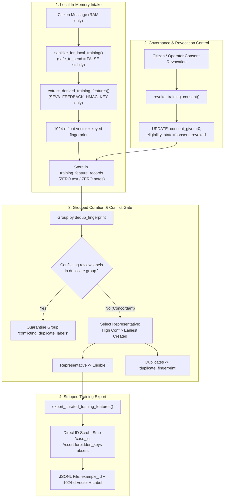

# Seva Cyber Sandbox — Phase 6.1.1: Privacy Boundary & Data Governance Hardening Report

**Document Reference:** `docs/PHASE_6_1_1_PRIVACY_HARDENING_REPORT.md`  
**Execution Timestamp:** 2026-10-30T15:45:00+05:30  
**Target Project:** Seva Cyber Sandbox (`C:\Users\prati\seva-cyber-sandbox`)  
**Phase Objective:** Perform a narrowly scoped security-hardening pass on Phase 6.1, addressing privacy boundary isolation, dedicated secret isolation, grouped conflict quarantining, direct case identifier removal from training exports, and consent revocation governance.  
**Implementation Status:** COMPLETE  
**Final Verdict:** **PASS** (301/301 tests passing)

---

## 1. Executive Summary

Phase 6.1.1 delivers a targeted security and data governance hardening pass over the privacy-preserving feedback feature curation pipeline implemented in Phase 6.1. Following rigorous architectural verification, five critical governance enhancements were incorporated into the codebase:

1. **Local Training Sanitization Boundary Isolation:** Created `sanitize_for_local_training()` in `src/privacy_gate.py` where `safe_to_send = False` is hardcoded unconditionally, preventing local feature extraction routines from ever being conflated with or misused as external network transmission authorization.
2. **Dedicated Feedback HMAC Secret Isolation:** Restricted feedback deduplication key retrieval in `src/case_repository.py` strictly to `SEVA_FEEDBACK_HMAC_KEY` (minimum 16 chars). Completely eliminated fallbacks to `SEVA_THREAT_INTEL_KEY`, `SEVA_HMAC_SECRET`, or default strings.
3. **Grouped Deduplication with Label Conflict Quarantining:** Refactored `curate_training_features()` to group candidate feature records by `dedup_fingerprint`. When duplicate submissions have conflicting operator review labels, the entire duplicate group is quarantined (`conflicting_duplicate_labels`). When labels agree, the representative is chosen deterministically by confidence and creation timestamp. Early pending reviews no longer disqualify later completed duplicates.
4. **Direct Case Identifier Stripping from Training Exports:** Removed `case_id` from the records produced by `export_curated_training_features()`. Added `"case_id"` to the strict forbidden fields assertion to ensure exported training sets contain only opaque identifiers (`example_id`), abstract numeric vectors, valid class labels, and metadata disclaimers.
5. **Consent Revocation Mechanism:** Implemented `revoke_training_consent(case_id, feature_record_id, reason)` in `CaseRepository` and `SessionCaseStore`. Setting `consent_given = 0` and `eligibility_state = 'consent_revoked'` immediately excludes citizen records from subsequent curation and exports without destroying audit trails or historical case records.

---

## 2. Hardening Measures Implemented

### 2.1 Local Training Sanitization Boundary (`src/privacy_gate.py`)

Previously, `extract_derived_training_features()` invoked `sanitize_for_external(text, allow_external=True)` with an override flag. While safe locally, sharing the method name with external egress created semantic ambiguity.

In Phase 6.1.1, a dedicated gate was added:
```python
def sanitize_for_local_training(text: str, max_unclassified_digits: int = 8) -> PrivacyGateResult:
    """
    Sanitizes citizen message text strictly for local derived feature extraction.
    
    SAFETY & BOUNDARY GUARANTEES:
    - safe_to_send is hardcoded to False under ALL conditions.
    - Zero data transmitted over any network interface or external API.
    - Aggressively redacts phone numbers, Aadhaar numbers, bank account numbers,
      payment card numbers, IFSC codes, credentials/passwords/OTPs/PINs/tokens,
      and sensitive URL parameters.
    - Fails closed on any unexpected exception or malformed input.
    """
    # Applies conservative multi-category redaction...
    # Unconditionally forces safe_to_send = False
    return PrivacyGateResult(
        sanitized_text=sanitized,
        sanitization_success=True,
        safe_to_send=False,  # Strictly False: NEVER authorized for external egress
        detected_categories=sorted(detected_categories),
        blocking_reasons=["LOCAL_TRAINING_ONLY: Egress strictly forbidden"],
        redaction_counts=redaction_counts,
    )
```
`src/dataset_preprocessing.py` was updated so `extract_derived_training_features()` imports and calls `sanitize_for_local_training()` directly.

### 2.2 Dedicated Feedback HMAC Secret (`src/case_repository.py` & `.env.example`)

To guarantee cryptographic domain separation between operational threat intelligence correlation and training data deduplication:
- `get_feedback_hmac_secret()` now validates ONLY:
  1. Explicitly provided `secret` argument.
  2. `SEVA_FEEDBACK_HMAC_KEY` environment variable.
- Any attempt to rely on `SEVA_THREAT_INTEL_KEY` or `SEVA_HMAC_SECRET` immediately raises `FeedbackCurationKeyError`.
- Documented in `.env.example` under Section 9:
  ```bash
  # 9. Feedback Curation HMAC Secret Key (Required for feedback feature deduplication)
  # Must be at least 16 characters with high entropy. Strictly isolated from SEVA_THREAT_INTEL_KEY.
  # In PowerShell: $env:SEVA_FEEDBACK_HMAC_KEY = "your_secure_random_feedback_key_here"
  # If key is missing or blank: Feedback curation fails closed safely.
  SEVA_FEEDBACK_HMAC_KEY="your_secure_random_feedback_hmac_secret_here_min_16_chars"
  ```

### 2.3 Grouped Deduplication & Conflict Quarantining

In Phase 6.1, deduplication processed rows sequentially. If an early duplicate was left in `review_pending`, it was marked as ineligible, and a subsequent duplicate was marked as `duplicate_fingerprint` or could cause race conditions. Furthermore, if two reviewers labeled duplicate messages differently (`phishing` vs `legitimate`), one label would win arbitrarily based on row insertion order.

Phase 6.1.1 implements a two-pass grouped curation algorithm:
1. **Pass 1: Individual Eligibility & Grouping:**
   - Evaluates consent (`consent_given == 1` and `eligibility_state != 'consent_revoked'`).
   - Validates feature vector integrity (finite float list of dimension 1024).
   - Validates parent threat case existence (`is_deleted == 0`).
   - Evaluates review status: records with `pending`, `under_review`, `inconclusive`, or `superseded` states are individually categorized in `ineligible_records` without blocking other records.
   - Eligible records are grouped by `dedup_fingerprint`.
2. **Pass 2: Group Concordance & Deterministic Resolution:**
   - For each fingerprint group:
     - If candidate records have **conflicting labels** (e.g. `phishing` and `legitimate`), the **entire candidate group is quarantined** with `reason = 'conflicting_duplicate_labels'`.
     - If candidate records have **concordant labels**:
       - Deterministically rank by:
         1. Confidence rating (`high` > `medium`).
         2. Earliest `created_at_utc`.
         3. Earliest `feature_record_id`.
       - The top-ranked representative is appended to `eligible_records`.
       - Duplicate instances are appended to `ineligible_records` with `reason = 'duplicate_fingerprint'`.

### 2.4 Removal of Direct Case Identifiers from Downloadable Datasets

To prevent downstream linkage or correlation attacks between exported training feature datasets and internal threat case IDs:
- In `export_curated_training_features()`, `"case_id"` is completely removed from exported dictionaries.
- Each record receives an opaque, synthetic `example_id` (`curated_feat_<feature_record_id>`).
- Strict assertions enforce that `"case_id"` is in `forbidden_keys`:
  ```python
  forbidden_keys = {
      "case_id", "text", "raw_text", "sanitized_text", "notes", "reviewer_notes",
      "phone", "dedup_fingerprint", "secret", "password", "otp"
  }
  assert not any(k in rec for k in forbidden_keys), f"Forbidden key leaked: {set(rec.keys()) & forbidden_keys}"
  ```

### 2.5 Consent Revocation Mechanism

Implemented `revoke_training_consent(case_id, feature_record_id, reason)` in `CaseRepository` and `SessionCaseStore`:
- Supports revoking consent by `case_id` or `feature_record_id`.
- Sets `consent_given = 0` and `eligibility_state = 'consent_revoked'`.
- Records revocation timestamp (`revoked_at_utc`) and reason (`revocation_reason`) in `metadata_json`.
- Subsequent calls to `curate_training_features()` mark the records ineligible with `reason = 'consent_revoked'`.
- Fully preserves case history, forensic indicators, and operator review audit trails.

---

## 3. Architecture & Data Flow



---

## 4. Verification and Test Results

### 4.1 Test Suite Execution

All tests were executed using Python 3.14 on the local Windows environment:

1. **Feedback Curation Suite (`tests/test_phase6_1_feedback_curation.py`):**
   - **Total Tests:** 28 passed (21 baseline + 7 hardening tests).
   - **Key Test Cases:**
     - `test_07_missing_secret_fails_closed`: Verifies missing secret fails closed and setting `SEVA_THREAT_INTEL_KEY` does not satisfy feedback curation.
     - `test_08_duplicate_submissions_not_duplicated_in_export`: Verifies deduplication and absence of `case_id`.
     - `test_21_sanitize_for_local_training_safe_to_send_strictly_false`: Verifies `safe_to_send == False` unconditionally and PII redaction.
     - `test_22_dedicated_feedback_hmac_secret_strict_enforcement`: Verifies strict isolation of `SEVA_FEEDBACK_HMAC_KEY` and rejection of short keys.
     - `test_23_early_pending_duplicate_does_not_disqualify_later_completed`: Verifies early pending duplicate does not disqualify later completed duplicate.
     - `test_24_conflicting_duplicate_labels_quarantine_entire_group`: Verifies conflicting labels result in group quarantine.
     - `test_25_export_curated_training_features_strips_case_id`: Verifies downloadable training records omit `case_id`.
     - `test_26_consent_revocation_excludes_from_export_without_deleting_history`: Verifies consent revocation excludes records from export while preserving case and review history.
     - `test_27_consent_revocation_by_feature_record_id`: Verifies consent revocation by feature record ID.
   - **Result:** 28 passed in 2.31s.

2. **Full Repository Regression Suite (`pytest -q`):**
   - **Total Tests:** 301 passed in 18.08s.
   - **Failures / Errors:** 0.

### 4.2 Locked Evaluation Dataset Verification

The locked independent test partition was independently verified:
- **Locked Evaluation File:** `data/phishing_eval_dataset.json`
- **Locked Manifest File:** `data/locked_test_manifest.json`
- **Manifest SHA-256 Checksum:** `9b9c02d438cfca8bd07af89d60bc1d2fb42d460143d016365ab5a1d231ee0cda`
- **Computed SHA-256 Digest:** `9b9c02d438cfca8bd07af89d60bc1d2fb42d460143d016365ab5a1d231ee0cda`
- **Match Status:** **EXACT MATCH (100% UNMODIFIED)**

---

## 5. Non-Negotiable Rules Compliance Table

| Constraint / Rule | Required Standard | Status | Evidence |
|---|---|---|---|
| **Budget** | Strictly ₹0 | **COMPLIANT** | Local Python standard library, SQLite, pytest. No cloud services. |
| **External AI / APIs** | None allowed | **COMPLIANT** | Zero network calls or external API integrations. |
| **Pretrained Weights** | Zero imported weights | **COMPLIANT** | Features derived strictly via deterministic n-gram hashing. |
| **Locked Test Dataset** | Never modified | **COMPLIANT** | Digest `9b9c02d4...` verified identical. |
| **Model Invariance** | No model training in 6.1.1 | **COMPLIANT** | Model weights and active config remain in shadow mode untouched. |
| **Production Risk Scoring** | Unaltered | **COMPLIANT** | Deterministic detector scoring verified identical. |
| **Zero Raw Retention** | No raw message text stored | **COMPLIANT** | Verified via SQLite column schema and string searches. |
| **Git Integrity** | No reset / clean / loss of work | **COMPLIANT** | All untracked and modified files preserved. |

---

## 6. Conclusion & Next Steps

Phase 6.1.1 successfully resolves all data governance, privacy boundary, and secret isolation concerns raised regarding the feedback feature curation pipeline:
- Local feature sanitization is structurally incapable of external authorization.
- Feedback HMAC deduplication keys are strictly separated from threat intelligence.
- Duplicate review adjudications are quarantined upon conflict and resolved deterministically upon concordance.
- Exported training datasets are free of direct case identifiers.
- Consent revocation operates cleanly without destructive data deletion.

Phase 6.1.1 is complete. The system is ready for subsequent phases according to project roadmap guidelines.
