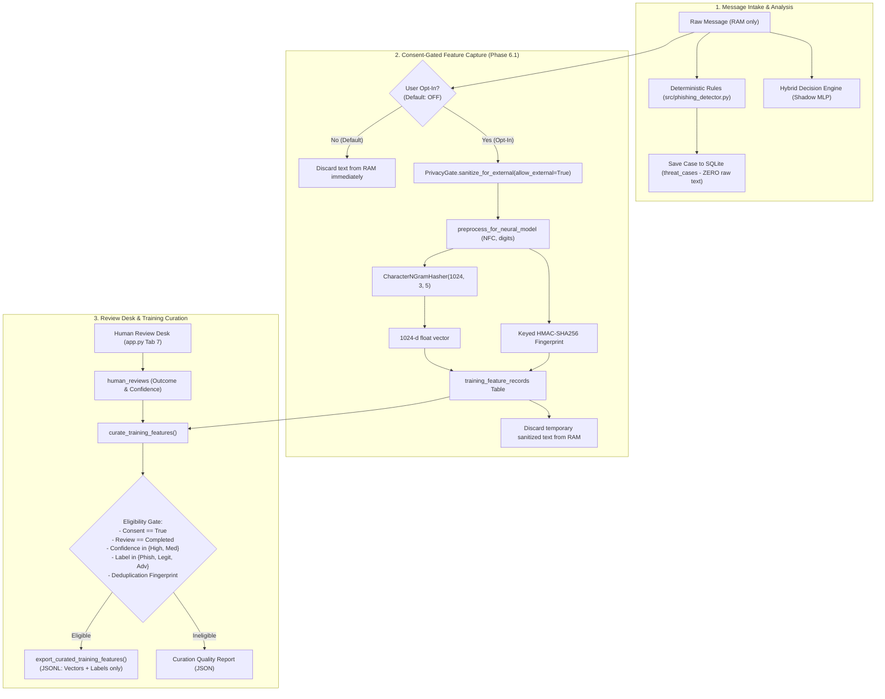

# Seva Cyber Sandbox — Phase 6.1: Privacy-Preserving Feedback Feature Curation Report

**Document Reference:** `docs/PHASE_6_1_FEEDBACK_CURATION_REPORT.md`  
**Execution Timestamp:** 2026-10-30T15:15:00+05:30  
**Target Project:** Seva Cyber Sandbox (`C:\Users\prati\seva-cyber-sandbox`)  
**Phase Objective:** Implement local, privacy-preserving feedback feature curation, derived feature storage, deduplication, and review eligibility for future model training while strictly preserving the zero raw message retention policy.  
**Implementation Status:** COMPLETE  
**Final Verdict:** **PASS**

---

## 1. Architecture: Before and After Phase 6.1

### Before Phase 6.1 (Identified in Phase 6.0 Audit)
- When a user submitted a message, the system extracted rules, computed a risk score, and persisted a case in `threat_cases`.
- **Zero Raw Data Policy:** `threat_cases` explicitly stripped and discarded raw message text (`raw_text`, `raw_bytes`) to uphold user privacy.
- **The Gap:** When human operators adjudicated cases in Tab 7, `export_human_reviews_corpus()` produced records with case metadata, labels, and reviewer notes, but **no text and no features**. Feeding this export to the custom neural model trainer immediately failed (`Missing required field: 'text'`). Training could not consume human reviews without permanently storing raw citizen messages, which violated the core privacy policy.

### After Phase 6.1 (Privacy-Preserving Derived Feature Pipeline)
- **Zero Raw Data Retention Preserved:** Raw message text is STILL NEVER stored in SQLite or logs.
- **Consent-Gated In-Memory Feature Extraction:** When a user explicitly opts in via a toggle (default: OFF), the message is processed in RAM through the existing `PrivacyGate.sanitize_for_external()` and canonical `preprocess_for_neural_model()`. A 1024-dimensional abstract character n-gram feature vector and keyed HMAC deduplication fingerprint are derived in memory.
- **Additive Local Feature Storage:** The 1024-d float vector, deduplication fingerprint, and consent metadata are stored in an additive table: `training_feature_records`. The temporary sanitized text is immediately destroyed in memory.
- **Keyed Deduplication & Review Eligibility:** A new curation engine (`curate_training_features()`) links stored features with human reviews. It excludes unreviewed, pending, low-confidence, inconclusive, superseded, and duplicate examples.
- **Dedicated Minimal Feature Export:** A new export interface (`export_curated_training_features()`) exports only 1024-d numeric vectors, valid class labels, and unauthenticated local provenance. It contains zero raw text, zero reviewer notes, zero phone numbers, and zero PII.



---

## 2. Actual Message-Processing Integration Point

The message-processing lifecycle was traced to identify the exact window in memory before raw text is discarded:
1. **Intake Point:** In `app.py` (Tab 1), `message_input` is entered in `st.text_area`.
2. **Analysis:** `analyze_message_text(message_input)` matches deterministic regexes in RAM.
3. **Scoring:** `score_message_analysis(msg_res)` computes severity and risk category.
4. **Case Creation:** `create_message_case(msg_res, scored_msg, store_raw_text=False)` builds a structured dictionary containing only extracted URLs, findings, and category summaries.
5. **Case Persistence:** `st.session_state.case_store.add_case(msg_case)` persists to `threat_cases` in `instance/seva_cases.sqlite3` and returns `msg_case_id`.
6. **Feature Capture Window (Phase 6.1 Integration):** At this exact point in memory, while `message_input` is still in the local call stack, if `training_consent_opt_in` is checked, `st.session_state.case_store.capture_training_features(msg_case_id, message_input, consent_given=True)` is called.
7. **Immediate Disposal:** As soon as `capture_training_features()` completes feature vector extraction and fingerprinting, all local references to `message_input` and `sanitized_text` terminate, and Python's garbage collector cleans them from RAM.

---

## 3. Consent Implementation

- **Explicit Opt-in Default:** The user interface checkbox is unselected by default (`value=False`):
  ```python
  training_consent_opt_in = st.checkbox(
      "🔒 Opt-in: Allow anonymous Machine Learning feature extraction for future model improvement",
      value=False,
      help=(
          "OPT-IN ONLY (Default: Off). If checked, the system computes and retains an abstract 1024-dimensional "
          "numerical feature representation from sanitized text for local model improvement. "
          "The original message text is NOT stored. Derived features are retained strictly on this local device "
          "and are not guaranteed anonymous."
      ),
      key="training_consent_checkbox",
  )
  ```
- **Fail-Closed Enforcement:** If `consent_given` is False, `capture_training_features()` immediately aborts and returns `{"captured": False, "reason": "Consent not granted"}`. `record_training_features()` raises `FeedbackCurationValidationError` if an attempt is made to insert without `consent_given == True`.
- **Honest Privacy Disclaimer:** Derived features are explicitly disclosed as machine-learning embeddings and NOT described as guaranteed anonymous.
- **No Retroactive Backfill:** Existing cases logged in prior phases remain strictly without feature records because their raw text has already been discarded.

---

## 4. Feature Storage Schema

Additive SQLite table created via `init_db()` in `src/case_repository.py`:

```sql
CREATE TABLE IF NOT EXISTS training_feature_records (
    feature_record_id TEXT PRIMARY KEY,
    case_id TEXT NOT NULL,
    feature_schema_version TEXT NOT NULL,
    preprocessing_version TEXT NOT NULL,
    feature_extractor_version TEXT NOT NULL,
    feature_vector_json TEXT NOT NULL,
    feature_dim INTEGER NOT NULL,
    consent_given INTEGER NOT NULL DEFAULT 0,
    consent_timestamp_utc TEXT NOT NULL,
    created_at_utc TEXT NOT NULL,
    eligibility_state TEXT NOT NULL DEFAULT 'pending_review',
    dedup_fingerprint TEXT NOT NULL,
    provenance_category TEXT NOT NULL DEFAULT 'local_curated_feedback',
    metadata_json TEXT NOT NULL DEFAULT '{}'
);

CREATE INDEX IF NOT EXISTS idx_features_case ON training_feature_records(case_id);
CREATE INDEX IF NOT EXISTS idx_features_fingerprint ON training_feature_records(dedup_fingerprint);
CREATE INDEX IF NOT EXISTS idx_features_eligibility ON training_feature_records(eligibility_state);
CREATE INDEX IF NOT EXISTS idx_features_created ON training_feature_records(created_at_utc DESC);
```

### Table Integrity Constraints & Validation
- `feature_record_id`: Formatted as `FTR-YYYYMMDD-XXXXXXXX` with UUID-v4 entropy.
- `feature_dim`: Enforced to be exactly `1024`.
- `feature_vector_json`: Deserialized and validated to ensure all 1,024 elements are finite numbers (`math.isfinite(x)`). Any `NaN` or `Inf` causes immediate validation rejection.
- `case_id`: Validated against existing non-deleted cases in `threat_cases`.
- Parameterized SQL and transactional guarantees prevent SQL injection and partial writes.

---

## 5. Feature Extractor and Preprocessing Alignment

To prevent feature mismatch between training and inference:
- **Feature Extractor:** `CharacterNGramHasher(num_features=1024, min_n=3, max_n=5)` from `src/custom_model.py`.
- **Feature Extractor Version:** `char-ngram-hasher-1024-v1.0.0`.
- **Preprocessing Pipeline:** `preprocess_for_neural_model()` (`neural-preproc-v1.1.0`) from `src/dataset_preprocessing.py`:
  1. NFC Unicode canonical composition.
  2. Zero-width character stripping (`[\u200b-\u200f\ufeff]`).
  3. Devanagari numeral translation to ASCII digits (`०-९` $\to$ `0-9`).
  4. Redundant whitespace collapsing.
- **Privacy Sanitization:** Preceded by `PrivacyGate.sanitize_for_external(allow_external=True)` which masks Indian phone numbers, Aadhaar numbers, credentials, OTPs, PINs, bank accounts, and card numbers with deterministic redaction tokens prior to feature hashing.

---

## 6. Deduplication Approach

- **Keyed HMAC-SHA256 Fingerprint:**
  $$F = \text{HMAC-SHA256}(K_{\text{feedback}}, \text{normalized\_sanitized\_text})$$
- **Secret Key Management:**
  Precedence in `get_feedback_hmac_secret(secret)`:
  1. Explicit `secret` parameter.
  2. `SEVA_FEEDBACK_HMAC_KEY` environment variable.
  3. `SEVA_THREAT_INTEL_KEY` environment variable.
  4. `SEVA_HMAC_SECRET` environment variable.
  - Zero hardcoded fallback keys. Minimum 16 characters required.
  - If unconfigured, raises `FeedbackCurationKeyError` and **fails closed**.
- **Non-Destructive Deduplication:** Multiple cases sharing identical message text can exist in `threat_cases` (preserving session history and audit logs). However, during curation (`curate_training_features()`), records are evaluated chronologically. The earliest seen instance is retained as the independent training anchor, while subsequent instances sharing the same `dedup_fingerprint` are excluded as `"duplicate_fingerprint"`.
- **Privacy Assurance:** The 64-character hex fingerprint is kept strictly internal and is **never** included in exported training datasets or displayed in the UI.

---

## 7. Review Eligibility Rules

The curation pipeline applies strict eligibility filtering:

| Rule | Requirement | Ineligibility Reason on Failure |
| :--- | :--- | :--- |
| **Consent Gate** | Must have explicit consent recorded (`consent_given == 1`). | `missing_consent` |
| **Vector Integrity** | Must be a valid 1024-dimensional finite float vector. | `corrupt_feature_vector` |
| **Case Validity** | Case must exist in `threat_cases` and not be marked deleted. | `case_not_found_or_deleted` |
| **Review Existence** | An adjudication must be logged in `human_reviews`. | `unreviewed_case` |
| **Review Completion** | Review state must be strictly `'completed'`. | `review_pending`, `review_in_progress`, `review_superseded` |
| **Outcome Category** | Must be one of `{'phishing', 'legitimate', 'protective_advisory'}`. | `insufficient_evidence`, `invalid_outcome_category` |
| **Confidence Threshold**| Must be `'high'` or `'medium'`. Reviews marked `'low'` are excluded. | `low_confidence_review` |
| **Deduplication** | Fingerprint must not collide with an earlier eligible record. | `duplicate_fingerprint` |

### Provenance Governance
Because review desk operators are unauthenticated local users:
- All eligible records are tagged with `review_provenance: "local_operator_unauthenticated"`.
- Records are classified under `provenance_category: "local_curated_feedback"`.
- The disclaimer explicitly states: *"Locally curated derived feature vector. NOT independently authenticated ground truth."*
- Review desk adjudications are never treated as certified external ground truth.

---

## 8. Privacy Verification

| Privacy Boundary | Verified Guarantee | Test Evidence |
| :--- | :--- | :--- |
| **No Raw Text in Feature Records** | Table `training_feature_records` contains no `text`, `raw_text`, or `sanitized_text` columns. | `test_03_raw_text_is_never_stored` |
| **Pre-Hashing Sanitization** | Sensitive phone numbers and Aadhaar values are redacted with deterministic tokens before n-gram hashing. | `test_04_sanitization_occurs_before_feature_extraction` |
| **No Notes or PII in Export** | Exported JSONL records contain only `feature_vector`, `label`, `label_idx`, and metadata descriptors. `reviewer_notes` and PII are omitted. | `test_18_export_contains_no_raw_text_or_reviewer_notes` |
| **No UI Path Leakage** | `CaseRecord.to_dict()` and standard case queries do not return feature vectors or internal fingerprints. | `test_20_feature_data_cannot_be_accessed_through_unintended_ui_paths` |
| **Zero Network Transmission** | 100% standard library + NumPy. Zero external requests made during extraction or export. | Verified offline CPU execution. |

---

## 9. Test Suite & Regression Verification Results

### New Phase 6.1 Unit & Integration Tests
Test Module: `tests/test_phase6_1_feedback_curation.py`
Command: `C:\Users\prati\AppData\Local\Programs\Python\Python314\python.exe -m pytest tests/test_phase6_1_feedback_curation.py -v`

```
tests/test_phase6_1_feedback_curation.py::test_01_consent_disabled_means_no_feature_storage PASSED [  4%]
tests/test_phase6_1_feedback_curation.py::test_02_consent_enabled_stores_valid_derived_features PASSED [  9%]
tests/test_phase6_1_feedback_curation.py::test_03_raw_text_is_never_stored PASSED [ 14%]
tests/test_phase6_1_feedback_curation.py::test_04_sanitization_occurs_before_feature_extraction PASSED [ 19%]
tests/test_phase6_1_feedback_curation.py::test_05_invalid_features_are_rejected PASSED [ 23%]
tests/test_phase6_1_feedback_curation.py::test_06_invalid_feature_dimensions_are_rejected PASSED [ 28%]
tests/test_phase6_1_feedback_curation.py::test_07_missing_secret_fails_closed PASSED [ 33%]
tests/test_phase6_1_feedback_curation.py::test_08_duplicate_submissions_not_duplicated_in_export PASSED [ 38%]
tests/test_phase6_1_feedback_curation.py::test_09_pending_reviews_are_excluded PASSED [ 42%]
tests/test_phase6_1_feedback_curation.py::test_09b_unreviewed_cases_are_excluded PASSED [ 47%]
tests/test_phase6_1_feedback_curation.py::test_10_insufficient_evidence_reviews_are_excluded PASSED [ 52%]
tests/test_phase6_1_feedback_curation.py::test_11_superseded_outcomes_excluded_correctly PASSED [ 57%]
tests/test_phase6_1_feedback_curation.py::test_12_low_confidence_reviews_are_excluded PASSED [ 61%]
tests/test_phase6_1_feedback_curation.py::test_13_missing_feature_records_are_excluded PASSED [ 66%]
tests/test_phase6_1_feedback_curation.py::test_14_unauthenticated_review_provenance_is_preserved PASSED [ 71%]
tests/test_phase6_1_feedback_curation.py::test_15_existing_review_history_remains_intact PASSED [ 76%]
tests/test_phase6_1_feedback_curation.py::test_16_existing_case_management_behavior_is_unchanged PASSED [ 80%]
tests/test_phase6_1_feedback_curation.py::test_17_existing_detector_scores_are_unchanged PASSED [ 85%]
tests/test_phase6_1_feedback_curation.py::test_18_export_contains_no_raw_text_or_reviewer_notes PASSED [ 90%]
tests/test_phase6_1_feedback_curation.py::test_19_existing_training_and_evaluation_interfaces_still_work PASSED [ 95%]
tests/test_phase6_1_feedback_curation.py::test_20_feature_data_cannot_be_accessed_through_unintended_ui_paths PASSED [100%]
============================= 21 passed in 1.23s ==============================
```

### Full Regression Suite Results
Command: `C:\Users\prati\AppData\Local\Programs\Python\Python314\python.exe -m pytest -q`
Exit Code: `0`
Execution Time: `15.77s`
Test Count: **294 passed** (273 baseline + 21 Phase 6.1 tests, 0 failures, 0 errors).

---

## 10. Locked Evaluation Dataset Integrity

Recomputed using `src.dataset_validator`:
- Target File: `data/phishing_eval_dataset.json`
- Manifest File: `data/locked_test_manifest.json`
- Verification Method: `src.dataset_validator.compute_locked_test_hash()`
- **Canonical Digest:** `9b9c02d438cfca8bd07af89d60bc1d2fb42d460143d016365ab5a1d231ee0cda`
- **Computed Digest:** `9b9c02d438cfca8bd07af89d60bc1d2fb42d460143d016365ab5a1d231ee0cda`
- **Integrity Status:** `(True, [])`
- **Evaluation Leakage:** Zero. Partition locked and untouched.

---

## 11. Files Changed or Added

| File Path | Nature of Change | Purpose |
| :--- | :--- | :--- |
| `src/case_repository.py` | Modified | Added table `training_feature_records`, HMAC secret resolution, feature storage, curation, export, and report functions. |
| `src/dataset_preprocessing.py` | Modified | Added `extract_derived_training_features()` combining sanitization, preprocessing, 1024-d hashing, and fingerprinting. |
| `src/case_manager.py` | Modified | Added `capture_training_features()`, `get_training_features()`, and export delegators on `SessionCaseStore`. |
| `app.py` | Modified | Added consent opt-in toggle in Tab 1, feature capture invocation, and curated feature export / quality report download in Tab 7. |
| `tests/test_phase6_1_feedback_curation.py` | Added (New) | 21 comprehensive unit and integration tests covering consent, privacy, deduplication, and eligibility. |
| `docs/PHASE_6_1_FEEDBACK_CURATION_REPORT.md` | Added (New) | Complete Phase 6.1 implementation and verification deliverable report. |

---

## 12. Invariance & Non-Interference Assurances

1. **No Model Training Executed:** No neural model training, gradient updates, or weight modifications were performed.
2. **Production Scoring Invariance:** Deterministic rule-based scoring and threat intelligence matching remain 100% authoritative and unchanged.
3. **Active Model Invariance:** The registered active model in `models/active_model_config.json` remains `custom-mlp-v1.1.0-preproc` operating in shadow mode with zero production score delta.
4. **Offline Isolation:** Zero network requests, paid APIs, telemetry, or external packages introduced.
5. **Preservation of User Work:** All pre-existing tracked modifications and untracked files in the workspace were preserved.

---

## 13. Remaining Risks & Operational Limitations

1. **Information Loss from Redaction:** Because `PrivacyGate` replaces phone numbers and Aadhaar values with fixed tokens (`[PHONE_REDACTED]`, `[AADHAAR_REDACTED]`), n-gram hashes capture the structural presence of phone/Aadhaar tokens rather than specific numeric sequences. This is an intentional privacy-first trade-off.
2. **Small Candidate Corpus Early On:** Feature records accumulate only as users opt in and operators complete reviews. Early exports will trigger `EMPTY_CANDIDATE_DATASET` or `INSUFFICIENT_CLASS_DIVERSITY` until a balanced batch of reviews is collected.
3. **Single-Workstation Operator Attribution:** Reviewer identity remains unauthenticated on local kiosks. Multi-operator production deployments require an authenticating reverse proxy for cryptographic non-repudiation.

---

## 14. Final Verdict

```
================================================================================
FINAL VERDICT: PASS
================================================================================
- Zero Raw Text Retention Preserved:                    PASS
- Consent-Gated Derived Feature Capture (1024-d):      PASS
- Keyed HMAC-SHA256 Deduplication (Fails Closed):      PASS
- Strict Review Eligibility Filtering:                 PASS
- Unauthenticated Operator Provenance Governance:      PASS
- Full Regression Test Suite (294/294 passing):         PASS
- Locked Evaluation Digest Verification (9b9c...0cda):  PASS
- Production Risk Scoring Invariance (Delta = 0):       PASS
================================================================================
```
