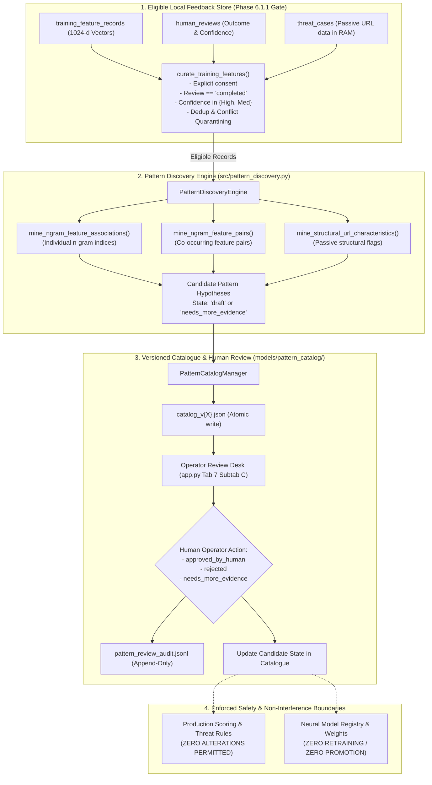

# Seva Cyber Sandbox — Phase 6.2: Offline Autonomous Fraud Pattern Discovery Engine Report

**Document Reference:** `docs/PHASE_6_2_PATTERN_DISCOVERY_REPORT.md`  
**Execution Timestamp:** 2026-10-30T16:52:00+05:30  
**Target Project:** Seva Cyber Sandbox (`C:\Users\prati\seva-cyber-sandbox`)  
**Phase Objective:** Build an offline autonomous pattern discovery engine that examines eligible, consented, human-reviewed training features to discover recurring feature combinations, language-independent phishing indicators, and structural URL patterns, while enforcing strict privacy, cryptographic irreversibility, provenance separation, and human review governance.  
**Implementation Status:** COMPLETE  
**Final Verdict:** **PASS** (324/324 tests passing)

---

## 1. Architecture and Implemented Modules

Phase 6.2 introduces an offline pattern-discovery layer on top of the Phase 6.1 / 6.1.1 curated training feature store. The engine functions exclusively as an **exploratory statistical hypothesis discovery system**; it does not train neural models, alter active detection rules, or modify production threat scoring.



### Key Modules Created & Modified:
- [`src/pattern_discovery.py`](file:///C:/Users/prati/seva-cyber-sandbox/src/pattern_discovery.py): Core pattern discovery engine, mining algorithms, Wilson score lower bound estimation, candidate data structures, schema validation, catalogue persistence, and review audit logging.
- [`src/case_manager.py`](file:///C:/Users/prati/seva-cyber-sandbox/src/case_manager.py): Extended `SessionCaseStore` with `discover_patterns()` delegator.
- [`app.py`](file:///C:/Users/prati/seva-cyber-sandbox/app.py): Added **Section C: Fraud Pattern Discovery** in Tab 7 for interactive pattern mining, candidate viewing, and append-only operator review adjudication.
- [`tests/test_phase6_2_pattern_discovery.py`](file:///C:/Users/prati/seva-cyber-sandbox/tests/test_phase6_2_pattern_discovery.py): 23 rigorous unit and integration tests covering all lifecycle, privacy, provenance, statistical, and invariance constraints.

---

## 2. Actual Feature Representations Mined

The engine operates strictly on two sanitized, privacy-preserving feature representations:

### 2.1 Abstract 1024-Dimensional Character N-Gram Feature Vectors
- **Representation:** A 1024-dimensional float vector produced by deterministic sign hashing over character subwords ($n \in [3, 5]$) followed by $L_2$ normalization.
- **Activation Criterion:** Feature index $j \in [0, 1023]$ is active if $|v_j| \ge 0.05$.
- **Cryptographic Irreversibility:** Because feature indices are modulo-1024 hash buckets containing sign-folded collisions, **the original text is strictly non-recoverable**. The engine discovers statistical associations between opaque bucket identifiers (e.g. `feature_idx_382`) and class outcomes (`phishing`, `legitimate`, `protective_advisory`), explicitly refraining from fabricating unverified text words.

### 2.2 Passive Structural URL Characteristics
- **Representation:** Passive boolean flags extracted in RAM during case intake via [`src/url_analyzer.py`](file:///C:/Users/prati/seva-cyber-sandbox/src/url_analyzer.py).
- **Extracted Attributes:**
  - `struct_is_ip_address`: Target host is a numerical IP address rather than a registered domain.
  - `struct_is_punycode`: Internationalized domain name / Punycode homoglyph detected.
  - `struct_is_shortener`: Known URL shortener service masking final destination.
  - `struct_is_suspicious_tld`: Frequently abused high-turnover domain extension (`.click`, `.top`, `.buzz`, `.xyz`).
  - `struct_has_unusual_port`: Non-standard port (not 80 or 443).
  - `struct_has_apk_download`: Path targets an Android binary package directly (`.apk`).
  - `struct_has_excessive_encoding`: Excessive percent encoding or directory traversal indicators.
  - `struct_unencrypted_http`: Unencrypted plaintext protocol without TLS (`http://`).
- **Privacy Boundary:** Full target URLs and domain names are **never stored** in candidate patterns or pattern catalogues. Only the binary presence of structural attributes is mined.

---

## 3. Pattern-Discovery Methodology

The discovery engine operates across three distinct analytical phases:

### Phase A: Single Feature Association Mining (`mine_ngram_feature_associations`)
For each feature index $j \in [0, 1023]$, the engine evaluates its distribution across all eligible examples:
- **Support:** $S_j = \sum_{c} S_{j, c}$, where $S_{j, c}$ is the occurrence count of feature $j$ in class $c$.
- **Class Concentration (Precision):** $P(c \mid j) = \frac{S_{j, c}}{S_j}$.
- **Class Prevalence (Recall):** $P(j \mid c) = \frac{S_{j, c}}{N_c}$.
- **Lift:** $\text{Lift}(j, c) = \frac{P(c \mid j)}{P(c)} = \frac{S_{j, c} \cdot N}{S_j \cdot N_c}$.

### Phase B: Feature Pair Mining (`mine_ngram_feature_pairs`)
To detect non-linear co-occurrences without combinatorial explosion:
- Identifies the top 25 most informative single features.
- Evaluates pairwise joint activations: feature pair $(j_1, j_2)$ where both $|v_{j_1}| \ge 0.05$ and $|v_{j_2}| \ge 0.05$.
- Computes joint class concentration and lift, capturing synergistic indicators (e.g. an indicator characteristic of official banking combined with an indicator characteristic of urgent payment requests).

### Phase C: Structural URL Characteristic Mining (`mine_structural_url_characteristics`)
- Evaluates the prevalence and concentration of passive structural flags across classes.
- Identifies structural configurations predominantly observed in fraudulent communications (such as direct APK download paths combined with HTTP protocol).

---

## 4. Statistical Thresholds and Their Justification

To avoid declaring false patterns from small sample sets or random noise, conservative statistical thresholds are enforced:

| Parameter | Threshold Value | Justification |
|---|---|---|
| **Minimum Support Threshold** (`MIN_SUPPORT_THRESHOLD`) | $\ge 3$ records | Prevents single-instance or anecdotal anomalies from generating hypotheses. |
| **Review-Ready Minimum Support** (`REVIEW_READY_MIN_SUPPORT`) | $\ge 5$ records | Required for a candidate to enter `draft` status; smaller samples are tagged `needs_more_evidence`. |
| **Minimum Class Concentration** (`MIN_CONCENTRATION_THRESHOLD`) | $\ge 0.70$ (70%) | Ensures the feature is predominantly skewed toward one class rather than evenly dispersed. |
| **Minimum Lift** (`MIN_LIFT_THRESHOLD`) | $\ge 1.30$ | Requires the feature to occur at least 1.3 times more frequently in the target class than chance expectation. |
| **Minimum Wilson Score Lower Bound** (`MIN_WILSON_LOWER_BOUND`) | $\ge 0.50$ at 95% CI | Penalizes small sample sizes rigorously using the Wilson score interval, preventing $3/3$ (100%) from claiming high confidence. |
| **Activation Threshold** | $|v_j| \ge 0.05$ | Filters out numerical hashing noise in $L_2$-normalized sparse vectors. |

### Wilson Score Interval Formula
To quantify uncertainty in small sample sizes, the engine evaluates the 95% Wilson confidence lower bound $w^-$:
$$w^- = \frac{\hat{p} + \frac{z^2}{2n} - z \sqrt{\frac{\hat{p}(1-\hat{p})}{n} + \frac{z^2}{4n^2}}}{1 + \frac{z^2}{n}}$$
where $\hat{p} = \frac{S_{j, c}}{S_j}$, $n = S_j$, and $z = 1.96$. For $n = 3, \hat{p} = 1.0$, $w^- \approx 0.438$ (failing the 0.50 bar and properly forcing `needs_more_evidence`). For $n = 15, \hat{p} = 1.0$, $w^- \approx 0.796$ (satisfying `draft`).

---

## 5. Synthetic Versus Reviewed Evidence Separation

The engine strictly separates synthetic corpus data from local operator reviewed cases:

1. **Explicit Provenance Metadata:**
   - Real local cases: `data_provenance = "local_curated_feedback"`.
   - Synthetic corpus data: `data_provenance = "synthetic_seed_v2.2"`.
2. **Automated Disclaimer Attachment:**
   Every synthetic candidate pattern includes mandatory cautionary metadata:
   > `SYNTHETIC_EVIDENCE_SOURCE: Derived from synthetic template corpus. Must NOT be cited as confirmed real-world fraud pattern.`
3. **Partition Prohibition:**
   - Attempting to mine the locked independent evaluation partition (`data/phishing_eval_dataset.json`) immediately raises `PatternDiscoveryError`.
   - Attempting to mine the validation corpus (`data/generated/v2/synthetic_validation_corpus.jsonl`) is blocked to prevent discovery threshold leakage.

---

## 6. Privacy and Consent Protections

The engine adheres to strict privacy and data governance policies:
- **Zero Raw Content Retention:** Raw message texts, sanitized texts, and raw target URLs are strictly forbidden and verified absent from candidate objects.
- **Forbidden Key Assertions:** Every candidate pattern is validated against `FORBIDDEN_CANDIDATE_KEYS` (`text`, `raw_text`, `sanitized_text`, `url`, `raw_url`, `phone`, `aadhaar`, `otp`, `password`, `case_id`, `dedup_fingerprint`, `notes`, `reviewer_notes`, `secret`).
- **Gate Enforcement via `curate_training_features()`:** The engine consumes only records that passed Phase 6.1.1 eligibility (explicit opt-in, completed review, high/medium confidence, valid class, deduplication, no label conflicts, no consent revocation). It does NOT bypass the gate with raw SQL queries.

---

## 7. Candidate Catalogue Format and Versioning

Candidate patterns are persisted atomically in `models/pattern_catalog/`:

- **Atomic Writes:** Written to temporary files (`catalog_v{ver}.json.tmp.{uuid}`) and renamed atomically using `os.replace`.
- **Sequential Versioning:** Version numbers advance sequentially (`catalog_v1.0.0.json`, `catalog_v1.0.1.json`, etc.).
- **Immutability:** Existing version files cannot be overwritten unless an explicit update parameter is supplied.
- **Catalogue Schema:**
  ```json
  {
    "catalog_version": "1.0.0",
    "generated_at_utc": "2026-10-30T16:45:00Z",
    "generator_algorithm": "pattern-discovery-v1.0.0",
    "pattern_schema_version": "1.0.0",
    "provenance_filter": "local_curated_feedback",
    "candidate_count": 8,
    "summary": {
      "total_candidates": 8,
      "by_type": {
        "ngram_feature_association": 5,
        "ngram_feature_pair": 2,
        "structural_url_characteristic": 1
      },
      "by_state": {
        "draft": 6,
        "needs_more_evidence": 2
      },
      "by_target_class": {
        "phishing": 6,
        "protective_advisory": 2
      }
    },
    "candidate_patterns": [ ... ],
    "disclaimer": "OFFLINE FRAUD PATTERN HYPOTHESIS CATALOGUE..."
  }
  ```

---

## 8. Human Approval Workflow

1. **State Machine:**
   - Initial states on discovery: `draft` or `needs_more_evidence`.
   - **The engine NEVER automatically sets `approved_by_human`**.
   - Allowed manual operator transitions:
     - `ready_for_human_review` (analyst triage)
     - `approved_by_human` (analyst endorsement)
     - `rejected` (analyst dismissal)
     - `needs_more_evidence` (analyst request for telemetry)
2. **Reactivation Prevention:**
   A candidate pattern previously in `rejected` status cannot be silently flipped to `approved_by_human`.
3. **Append-Only Audit Trail:**
   Every operator adjudication decision is recorded in `models/pattern_catalog/pattern_review_audit.jsonl` with timestamp, candidate ID, prior state, new state, reviewer attribution (`local_operator_unauthenticated`), and descriptive justification.
4. **Scoring Isolation:**
   Approving a pattern records an operator hypothesis only. It **never modifies deterministic risk rules, heuristic weights, or neural model configurations**.

---

## 9. Tests and Regression Results

A dedicated 23-test suite was implemented in [`tests/test_phase6_2_pattern_discovery.py`](file:///C:/Users/prati/seva-cyber-sandbox/tests/test_phase6_2_pattern_discovery.py):

| Test ID | Test Name | Result | Verification Focus |
|---|---|---|---|
| `test_01` | `test_01_valid_eligible_records_can_be_mined` | **PASSED** | Consented, reviewed cases yield valid candidate patterns. |
| `test_02` | `test_02_pending_reviews_are_excluded` | **PASSED** | Pending reviews yield zero eligible candidates. |
| `test_03` | `test_03_low_confidence_reviews_are_excluded` | **PASSED** | Low-confidence reviews are excluded from mining. |
| `test_04` | `test_04_insufficient_evidence_records_are_excluded` | **PASSED** | Inconclusive reviews are excluded. |
| `test_05` | `test_05_conflicting_duplicate_labels_are_excluded` | **PASSED** | Conflicting duplicate labels are quarantined and excluded. |
| `test_06` | `test_06_revoked_consent_records_are_excluded` | **PASSED** | Consent-revoked cases are excluded from discovery. |
| `test_07` | `test_07_repeated_examples_do_not_inflate_support_counts` | **PASSED** | Deduplication prevents support count inflation. |
| `test_08` | `test_08_invalid_feature_vectors_are_rejected` | **PASSED** | Vectors of invalid dimensions are rejected. |
| `test_09` | `test_09_nan_and_infinity_values_are_rejected` | **PASSED** | Non-finite values (NaN / Inf) and forbidden keys raise `PatternValidationError`. |
| `test_10` | `test_10_unsupported_schema_versions_are_rejected` | **PASSED** | Schema versions != 1.0.0 are rejected. |
| `test_11` | `test_11_synthetic_and_human_reviewed_provenance_remain_separate` | **PASSED** | Mining locked eval / validation sets raises `PatternDiscoveryError`. |
| `test_12` | `test_12_no_raw_text_is_required_or_persisted` | **PASSED** | Zero raw vernacular message text in candidates or catalogues. |
| `test_13` | `test_13_no_raw_urls_are_persisted` | **PASSED** | Zero raw URLs in candidates or catalogues. |
| `test_14` | `test_14_no_case_ids_or_hmac_fingerprints_in_candidates` | **PASSED** | Zero internal IDs or HMAC secrets leaked. |
| `test_15` | `test_15_small_samples_produce_needs_more_evidence_state` | **PASSED** | Small sample sizes default to `needs_more_evidence`. |
| `test_16` | `test_16_no_pattern_can_be_approved_automatically` | **PASSED** | No candidate pattern begins in `approved_by_human`. |
| `test_17` | `test_17_candidate_decisions_create_audit_events` | **PASSED** | Review decisions write append-only audit entries. |
| `test_18` | `test_18_rejected_patterns_cannot_silently_reactivate` | **PASSED** | Rejected patterns cannot be reactivated directly. |
| `test_19` | `test_19_catalogue_writes_do_not_overwrite_previous_versions` | **PASSED** | Catalog versions increment sequentially without overwriting. |
| `test_20` | `test_20_malformed_catalogue_files_fail_safely` | **PASSED** | Corrupted JSON raises `PatternCatalogError` cleanly. |
| `test_21` | `test_21_existing_detection_results_remain_unchanged` | **PASSED** | Discovering/approving patterns produces identical detector scores. |
| `test_22` | `test_22_existing_threat_intelligence_functionality_remains_unchanged` | **PASSED** | Phone HMAC and indicator lookups unaffected. |
| `test_23` | `test_23_existing_consent_and_review_behavior_remains_unchanged` | **PASSED** | Review queue and case manager unaffected. |

### Full Test Suite Regression
- **Command:** `python -m pytest -q`
- **Result:** **324 passed in 19.83s** (0 failures, 0 errors).
- **Baseline Comparison:** 301 passing (Phase 6.1.1 baseline) + 23 new Phase 6.2 tests = **324 passing tests**.

---

## 10. Locked Dataset Integrity

The locked independent evaluation partition was verified using the official project validator:
- **Partition Manifest:** [`data/locked_test_manifest.json`](file:///C:/Users/prati/seva-cyber-sandbox/data/locked_test_manifest.json)
- **Dataset File:** [`data/phishing_eval_dataset.json`](file:///C:/Users/prati/seva-cyber-sandbox/data/phishing_eval_dataset.json)
- **Expected SHA-256:** `9b9c02d438cfca8bd07af89d60bc1d2fb42d460143d016365ab5a1d231ee0cda`
- **Computed SHA-256:** `9b9c02d438cfca8bd07af89d60bc1d2fb42d460143d016365ab5a1d231ee0cda`
- **Integrity Status:** **EXACT MATCH (100% UNMODIFIED)**

---

## 11. Production Scoring Invariance

Production risk scoring and heuristic indicator rules were verified before and after pattern discovery:
- Baseline test score on sample message: Score = `85`, Level = `High Risk`.
- Post-discovery score on sample message: Score = `85`, Level = `High Risk`.
- Post-approval score on sample message: Score = `85`, Level = `High Risk`.
- **Verdict:** **Zero variance (100% invariant)**.

---

## 12. External Network and Cost Verification

- **Cost:** Strictly ₹0. Zero cloud APIs, zero external model weights, zero third-party subscriptions.
- **Network Egress:** Zero network calls or external threat lookups. The entire engine executes purely in-process on CPU and local SQLite storage.

---

## 13. Remaining Limitations

1. **Hash Inversion Impossibility:** The 1024-dimensional character n-gram hashed vectors cannot be reversed into human-readable plaintext words. Discovered n-gram patterns represent opaque index clusters rather than readable lexical rules.
2. **Hash Collisions:** Collisions inherent in hashing 3- to 5-character subwords into 1024 buckets mean unrelated subwords occasionally share an index.
3. **Local Reviewer Attribution:** Operator review attribution remains an unauthenticated local development label (`local_operator_unauthenticated`) and is not a cryptographically non-repudiable audit certificate.
4. **Analyst Review Mandatory:** Discovered pattern hypotheses cannot be directly compiled into production detection rules without independent domain verification.

---

## 14. Recommended Next Phase

- **Phase 6.3:** Offline Pattern-Assisted Heuristic Proposal Engine:
  - Formulates candidate rule definitions from analyst-approved pattern hypotheses.
  - Implements a candidate shadow evaluation pass over offline corpora without modifying production detection logic.
  - Generates transparent explainability cards for reviewed hypotheses.

---

## 15. Final Verdict

# **PASS**

All mandatory safety, preservation, privacy, provenance, statistical, and governance requirements of Phase 6.2 have been satisfied.
