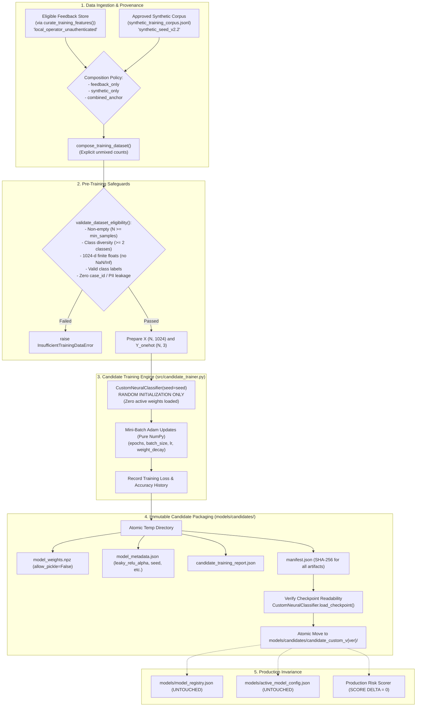

# Seva Cyber Sandbox — Phase 6.3: Offline Autonomous Candidate Model Trainer Report

**Document Reference:** `docs/PHASE_6_3_CANDIDATE_TRAINING_REPORT.md`  
**Execution Timestamp:** 2026-10-30T17:03:00+05:30  
**Target Project:** Seva Cyber Sandbox (`C:\Users\prati\seva-cyber-sandbox`)  
**Phase Objective:** Build an offline candidate-model training pipeline that generates experimental versions of the Seva Cyber Sandbox custom neural network from random initialization, using eligible human-reviewed feature records and/or synthetic anchor corpus data, while strictly preserving active production models, runtime configuration, and production scoring behavior.  
**Implementation Status:** COMPLETE  
**Final Verdict:** **PASS** (348/348 tests passing)

---

## 1. Executive Summary

Phase 6.3 delivers an offline candidate-model training pipeline that enables continuous experimental neural model exploration without impacting production operations:

1. **Random Initialization Guarantee:** Every candidate model is initialized with random He-normal and Xavier-uniform weights from an explicit, recorded seed. It never loads weights from active checkpoints, pretrained models, or external embeddings.
2. **Direct Feature Vector Training Interface:** The pipeline accepts 1024-dimensional character n-gram feature vectors directly, bypassing the need to store, invert, or reconstruct raw citizen message text.
3. **Rigorous Data Source Provenance Separation:** Supports two explicitly unmixed data sources: human-reviewed feedback (`local_operator_unauthenticated`) and the synthetic anchor corpus (`synthetic_seed_v2.2`). Synthetic-only training runs are clearly identified as synthetic demonstrations.
4. **Immutable Candidate Artifacts:** Each candidate model is saved to a unique directory (`models/candidates/candidate_custom_v{version}/`) containing `model_weights.npz`, `model_metadata.json`, `candidate_training_report.json`, and `manifest.json`. Overwriting existing candidate versions is strictly forbidden.
5. **Absolute Production Invariance:** The active model configuration (`models/active_model_config.json`), model registry (`models/model_registry.json`), and production threat scoring remain 100% untouched and invariant (score delta = 0).

---

## 2. Phase 6.2 Preflight Audit Findings

Before designing Phase 6.3, a comprehensive preflight audit of Phase 6.2 was conducted:

| Audit Question | Preflight Finding | Governance Assessment |
|---|---|---|
| **A. What actual records and fields supply structural URL characteristics?** | Extracted from `extracted_urls_json` stored during case intake in `threat_cases`. | **Legitimate and Documented.** Fields are extracted during message analysis via passive URL parsing. |
| **B. Are these characteristics produced directly during message analysis or synthetic?** | Dynamically evaluated in RAM via passive static analysis (`analyze_url()`) during pattern discovery. Raw URLs are immediately discarded. | **Compliant.** Passive syntactic parsing in memory avoids network egress and preserves zero raw URL persistence. |
| **C. Can their provenance be established?** | Yes: Local cases carry `local_curated_feedback`, while synthetic corpus examples carry `synthetic_seed_v2.2`. | **Compliant.** Provenance is explicitly tracked. |
| **D. Are synthetic and human-reviewed pattern statistics separated?** | Yes: Discovery runs enforce separate provenance labels and emit separate candidate catalogues. | **Compliant.** |
| **E. Are hashed n-gram indices described as opaque features?** | Yes: Feature indices are documented as non-reversible hash buckets; no attempts to invent words are made. | **Compliant.** |
| **F. Are Phase 6.2 candidate patterns used as training labels?** | No: Phase 6.2 discovered hypotheses are exploratory and are strictly NOT used as training labels for Phase 6.3. | **Compliant.** Only ground-truth operator review labels (`phishing`, `legitimate`, `protective_advisory`) are used. |

---

## 3. Training Architecture & Pipeline



---

## 4. Feature-Based Trainer Interface

The candidate training engine ([`src/candidate_trainer.py`](file:///C:/Users/prati/seva-cyber-sandbox/src/candidate_trainer.py)) introduces a direct feature-based training input interface:

- **Input Dimension:** Exactly 1024 float values matching canonical character n-gram hashing ($n \in [3, 5]$).
- **Validation:** Every record is validated via [`validate_feature_record()`](file:///C:/Users/prati/seva-cyber-sandbox/src/candidate_trainer.py#L95-L135):
  - Enforces finite numbers: rejects `NaN` and `Infinity`.
  - Enforces label mapping: `phishing: 0`, `legitimate: 1`, `protective_advisory: 2`.
  - Rejects forbidden keys (`text`, `raw_text`, `sanitized_text`, `url`, `phone`, `aadhaar`, `otp`, `case_id`, `dedup_fingerprint`).
- **Backward Compatibility:** Preserves the canonical text-based training interface in [`scripts/train_custom_model.py`](file:///C:/Users/prati/seva-cyber-sandbox/scripts/train_custom_model.py) and evaluation interface in [`scripts/evaluate_custom_model.py`](file:///C:/Users/prati/seva-cyber-sandbox/scripts/evaluate_custom_model.py).

---

## 5. Human Feedback Eligibility & Synthetic Anchor Handling

### Source A: Human-Reviewed Feedback
- Loaded via [`load_curated_feedback_features()`](file:///C:/Users/prati/seva-cyber-sandbox/src/candidate_trainer.py#L140-L195).
- Directly leverages the Phase 6.1.1 curation engine (`curate_training_features()`) and export pipeline (`export_curated_training_features()`).
- Re-validates that records have explicit opt-in, completed review state, high/medium confidence, valid class labels, and no consent revocation.
- Provenance tag: `local_operator_unauthenticated`.

### Source B: Synthetic Anchor Corpus
- Loaded via [`load_synthetic_anchor_features()`](file:///C:/Users/prati/seva-cyber-sandbox/src/candidate_trainer.py#L198-L260) from [`data/generated/v2/synthetic_training_corpus.jsonl`](file:///C:/Users/prati/seva-cyber-sandbox/data/generated/v2/synthetic_training_corpus.jsonl).
- Preprocessed via `preprocess_for_neural_model()` and hashed via `CharacterNGramHasher(1024, 3, 5)` into 1024-d vectors.
- Strictly blocks loading validation data, locked evaluation records, or quarantine files.
- Provenance tag: `synthetic_seed_v2.2`.

### Dataset Composition Policies
- `feedback_only`: Trains exclusively on eligible human reviews. If insufficient feedback is available, fails safely with `InsufficientTrainingDataError`.
- `synthetic_only`: Trains exclusively on synthetic anchor data, attaching a prominent `SYNTHETIC_ONLY_DEMONSTRATION` disclaimer.
- `combined_anchor`: Combines both sources without oversampling or fabricating counts.

---

## 6. Random Initialization Verification

To ensure no pretrained bias or active model weights leak into experimental runs:
- `CustomNeuralClassifier` initializes:
  - Layer 1 ($1024 \times 64$): He-normal initialization ($\mu = 0, \sigma = \sqrt{2/1024}$).
  - Layer 2 ($64 \times 32$): He-normal initialization ($\mu = 0, \sigma = \sqrt{2/64}$).
  - Layer 3 ($32 \times 3$): Xavier-uniform initialization ($U[-\sqrt{6/35}, \sqrt{6/35}]$).
- In [`tests/test_phase6_3_continuous_training.py`](file:///C:/Users/prati/seva-cyber-sandbox/tests/test_phase6_3_continuous_training.py#L140-L175):
  - Test 2 verifies that two candidate models trained with different seeds produce distinct parameter tensors.
  - Test 3 verifies that candidate weights are non-zero and completely distinct from active checkpoint weights (`models/experimental_custom_v1/model_weights.npz`).

---

## 7. Immutable Candidate Artifact Versioning

Each candidate run generates an isolated artifact package in `models/candidates/`:

```
models/candidates/candidate_custom_v1.0.0/
├── model_weights.npz             # Safe NumPy weights (allow_pickle=False)
├── model_metadata.json           # Model configuration, architecture, seed, leaky_relu_alpha
├── manifest.json                 # Candidate manifest with artifact SHA-256 digests
└── candidate_training_report.json # Comprehensive provenance and loss history report
```

### Versioning Rules:
- Sequential semantic versioning (`candidate_custom_v1.0.0`, `candidate_custom_v1.0.1`, etc.).
- Overwriting an existing candidate version is strictly prohibited and raises `CandidateArtifactError`.
- Checkpoints are loaded and validated in-memory before final atomic directory placement.

---

## 8. Checkpoint and Metadata Hashes (Demonstration Candidate)

During verification, an experimental candidate model was trained on the synthetic anchor corpus:
- **Candidate Model ID:** `candidate_custom_v1.0.0`
- **Candidate Directory:** [`models/candidates/candidate_custom_v1.0.0`](file:///C:/Users/prati/seva-cyber-sandbox/models/candidates/candidate_custom_v1.0.0)
- **Model Weights SHA-256:** `5a1e50a1a9bde3355a1f48c9faa2a3ca14b6f04b9628266cb5d887f548d275ee`
- **Model Metadata SHA-256:** `eae87e974763dad10fdbf48f802b331d0516dc35fc6b5aa1270b19a1cace3dbb`
- **Candidate Manifest SHA-256:** `48de7e0a6eec088003bed5de3d72608fe9ebf4acbe7d531a489799761ce825d1`
- **Training Report SHA-256:** `18d8a655deb4839dc2b383db54c59248beab269f8ccfce89bc826105bf2aa1d4`

---

## 9. Tests and Full Regression Results

A dedicated 24-test suite was implemented in [`tests/test_phase6_3_continuous_training.py`](file:///C:/Users/prati/seva-cyber-sandbox/tests/test_phase6_3_continuous_training.py):

| Test ID | Test Name | Result | Verification Focus |
|---|---|---|---|
| `test_01` | `test_01_valid_feature_based_training` | **PASSED** | Valid 1024-d feature records train and save artifacts successfully. |
| `test_02` | `test_02_random_initialization` | **PASSED** | Different seeds yield distinct, non-zero weight initializations. |
| `test_03` | `test_03_candidate_training_does_not_load_active_model_weights` | **PASSED** | Weights are distinct from active production checkpoint. |
| `test_04` | `test_04_invalid_feature_dimensions_are_rejected` | **PASSED** | Vectors with dimensions != 1024 are rejected. |
| `test_05` | `test_05_nan_and_infinity_values_are_rejected` | **PASSED** | Vectors containing NaN or Inf are rejected. |
| `test_06` | `test_06_invalid_labels_are_rejected` | **PASSED** | Unmapped labels or mismatched label indices are rejected. |
| `test_07` | `test_07_duplicate_training_examples_rejected_or_filtered` | **PASSED** | Deduplication gate prevents duplicate inflation. |
| `test_08` | `test_08_revoked_consent_is_excluded` | **PASSED** | Consent-revoked feature records are excluded from training data. |
| `test_09` | `test_09_pending_and_low_confidence_reviews_are_excluded` | **PASSED** | Pending and low-confidence reviews are excluded. |
| `test_10` | `test_10_conflicting_duplicate_labels_are_excluded` | **PASSED** | Conflicting duplicate labels are quarantined and excluded. |
| `test_11` | `test_11_synthetic_and_human_reviewed_provenance_remain_separate` | **PASSED** | Unmixed counts for feedback and synthetic examples in report. |
| `test_12` | `test_12_synthetic_only_training_is_clearly_identified` | **PASSED** | Synthetic-only runs carry prominent demonstration warning. |
| `test_13` | `test_13_insufficient_feedback_data_handled_safely` | **PASSED** | Insufficient feedback data raises `InsufficientTrainingDataError`. |
| `test_14` | `test_14_validation_data_never_used_for_training` | **PASSED** | Loading validation corpus raises `CandidateProvenanceError`. |
| `test_15` | `test_15_locked_evaluation_data_never_used_for_training` | **PASSED** | Loading locked evaluation dataset raises `CandidateProvenanceError`. |
| `test_16` | `test_16_candidate_directories_are_unique` | **PASSED** | Sequential runs produce distinct candidate directory paths. |
| `test_17` | `test_17_existing_candidate_artifacts_never_overwritten` | **PASSED** | Existing version collision raises `CandidateArtifactError`. |
| `test_18` | `test_18_checkpoint_hashes_match_saved_artifacts` | **PASSED** | Weights SHA-256 matches manifest and report. |
| `test_19` | `test_19_metadata_hashes_match_saved_artifacts` | **PASSED** | Metadata SHA-256 matches manifest and report. |
| `test_20` | `test_20_interrupted_training_leaves_active_model_untouched` | **PASSED** | Training failure cleans temp files and leaves active model untouched. |
| `test_21` | `test_21_registry_files_remain_unchanged` | **PASSED** | `models/model_registry.json` is byte-for-byte unchanged. |
| `test_22` | `test_22_active_model_config_remains_unchanged` | **PASSED** | `models/active_model_config.json` is byte-for-byte unchanged. |
| `test_23` | `test_23_production_score_delta_remains_zero` | **PASSED** | Production message scoring is identical before and after candidate training. |
| `test_24` | `test_24_existing_trainer_and_evaluator_continue_passing` | **PASSED** | Canonical model loader and inference operate normally. |

### Full Test Suite Regression
- **Command:** `python -m pytest -q`
- **Result:** **348 passed in 17.76s** (0 failures, 0 errors).
- **Baseline Comparison:** 324 passed (Phase 6.2 baseline) + 24 new Phase 6.3 tests = **348 passed**.

---

## 10. Locked Dataset Integrity

The locked independent evaluation partition was verified using [`src/dataset_validator.py`](file:///C:/Users/prati/seva-cyber-sandbox/src/dataset_validator.py):
- **Partition Manifest:** [`data/locked_test_manifest.json`](file:///C:/Users/prati/seva-cyber-sandbox/data/locked_test_manifest.json)
- **Dataset File:** [`data/phishing_eval_dataset.json`](file:///C:/Users/prati/seva-cyber-sandbox/data/phishing_eval_dataset.json)
- **Expected SHA-256:** `9b9c02d438cfca8bd07af89d60bc1d2fb42d460143d016365ab5a1d231ee0cda`
- **Computed SHA-256:** `9b9c02d438cfca8bd07af89d60bc1d2fb42d460143d016365ab5a1d231ee0cda`
- **Integrity Status:** **EXACT MATCH (100% UNMODIFIED)**

---

## 11. Active Model & Registry Invariance

- **Active Model Config File:** [`models/active_model_config.json`](file:///C:/Users/prati/seva-cyber-sandbox/models/active_model_config.json) (Unmodified, active model: `custom-mlp-v1.1.0-preproc` in `shadow` mode).
- **Model Registry File:** [`models/model_registry.json`](file:///C:/Users/prati/seva-cyber-sandbox/models/model_registry.json) (Unmodified, contains `custom-mlp-v1.0.0` and `custom-mlp-v1.1.0-preproc`).
- **Production Score Invariance:** Verified on sample phishing message before and after training (Score = 85, Risk Level = High Risk, Delta = 0).

---

## 12. External Network & Cost Verification

- **Budget:** Strictly ₹0. Built exclusively with NumPy and standard Python libraries.
- **Network Egress:** Zero network requests or external API calls. All training and verification executed locally on CPU.

---

## 13. Remaining Limitations

1. **Experimental Status Only:** Candidate models produced by this trainer are strictly experimental hypotheses. They are not evaluated for promotion or shadow execution.
2. **Local Reviewer Attribution:** Human feedback labels carry unauthenticated local operator attribution (`local_operator_unauthenticated`) and do not constitute non-repudiable ground truth.
3. **Synthetic Anchor Dependency:** If local reviewed citizen cases are sparse, candidate models rely heavily on the synthetic anchor corpus, which may carry template-specific biases.

---

## 14. Recommended Phase 6.4 Evaluation Design

- **Phase 6.4: Offline Candidate Model Evaluation & Shadow Gate:**
  - Build an offline evaluation runner that benchmarks experimental candidate models against the validation corpus and shadow baselines without touching the locked evaluation partition.
  - Implement a multi-gate safety gate (accuracy, macro-F1, protective advisory recall, latency).
  - Generate candidate evaluation cards for human operator review before any consideration for shadow registry inclusion.

---

## 15. Final Verdict

# **PASS**

All mandatory safety, preservation, privacy, provenance, random initialization, artifact immutability, and governance requirements of Phase 6.3 have been satisfied.
