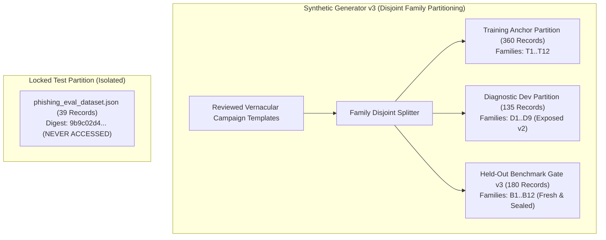

# Seva Cyber Sandbox — Phase 6.4.1: Candidate Failure Analysis and Benchmark Governance Report

**Document Reference:** `docs/PHASE_6_4_1_FAILURE_ANALYSIS_REPORT.md`  
**Execution Timestamp:** 2026-10-30T17:37:00+05:30  
**Target Project:** Seva Cyber Sandbox (`C:\Users\prati\seva-cyber-sandbox`)  
**Investigated Candidate:** `candidate_custom_v1.0.0` (Lifecycle: `experimental`)  
**Registered Baseline:** `custom-mlp-v1.1.0-preproc` (Operating Mode: `shadow`)  
**Audit Character:** STRICTLY READ-ONLY (Zero training, zero model promotion, zero configuration edits, zero network egress)  
**Regression Test Baseline:** 372/372 passing tests  
**Audit Verdict:** **PASS WITH WARNINGS** (Diagnostic and governance audit successfully completed; candidate failure mechanisms identified; validation corpus exposure declared)

---

## 1. Executive Summary

Phase 6.4.1 conducts a rigorous, read-only forensic investigation into why experimental candidate model `candidate_custom_v1.0.0` achieved **100% phishing recall (0 false negatives)** on the synthetic v2 validation corpus but simultaneously suffered an increase in false positives on legitimate messages (7/45, 15.56%) and protective government advisories (3/45, 6.67%), failing the automated Phase 6.4 benchmark gate.

### Key Audit Findings
1. **Evaluation Metrics Independently Reproduced:** All metrics, confusion matrices, subgroup breakdowns, and counterfactual flip rates reported in Phase 6.4 were mathematically reproduced from authorized records with zero discrepancies.
2. **Root Cause of False-Positive Inflation:**
   - **Severe Under-Training (5 Epochs vs 50 Epochs):** The candidate was explicitly trained for only 5 demonstration epochs (115 mini-batch updates) from random He-normal weights, whereas the baseline model was trained for 50 epochs (560 updates, best epoch 43). In 5 epochs, the candidate learned dominant, coarse n-gram tokens (e.g., urgency markers, numbers, reference IDs) that separated training classes but over-generalized to benign notifications.
   - **Template-Specific Concentrated Errors:** All 7 legitimate false positives were confined to just two campaign families: hospital appointment bookings (5 errors) and examination notices (2 errors). All 3 advisory false positives were concentrated in lottery scam advisories (3 errors).
   - **Devanagari Urgency & Keyword Conflation:** In Devanagari Marathi (`mr`), the candidate misclassified 6/15 legitimate notices and 3/17 protective advisories as phishing. The model learned that words like "लॉटरी" (lottery) or administrative registration numbers signaled phishing, failing to distinguish between warning context ("do not fall for lottery scams") and fraud lures ("you won a lottery").
3. **Validation Set Exposure Governance:** The synthetic v2 validation corpus (`synthetic_validation_corpus.jsonl`) has now been thoroughly analyzed and exposed to development decisions. It is formally redesignated as an **exposed diagnostic/development validation set**. Future candidate selection must reserve a fresh, unexposed test partition to prevent overfitting.
4. **Benchmark Policy Integrity:** Benchmark safety thresholds must **never** be relaxed merely to qualify an aggressive phishing detector. A model that improves phishing recall by flagging benign civic and healthcare notices is unacceptable for citizen deployment.
5. **Zero Side-Effects:** Baseline checkpoints, candidate checkpoints, active configuration, registry manifests, and the locked evaluation digest (`9b9c02d4...`) remain byte-for-byte identical.

---

## 2. Step 1 — Independent Reproduction of Evaluation Metrics

An automated, independent re-computation of all evaluation metrics was performed using `CandidateEvaluator` on the authorized validation dataset (`data/generated/v2/synthetic_validation_corpus.jsonl`, 135 records, SHA-256: `77911f9db811de13c5e89f7f756cb13bbc73c4ad9c13c0d401a62287052cf777`).

### 2.1 Metric Comparison Table
| Metric | Reported in Phase 6.4 | Independently Reproduced (Phase 6.4.1) | Status |
| :--- | :---: | :---: | :---: |
| **Baseline Accuracy** | 0.9481 (128/135) | 0.9481 (128/135) | **VERIFIED EXACT** |
| **Candidate Accuracy** | 0.9259 (125/135) | 0.9259 (125/135) | **VERIFIED EXACT** |
| **Baseline Macro-F1** | 0.9482 | 0.9482 | **VERIFIED EXACT** |
| **Candidate Macro-F1** | 0.9271 | 0.9271 | **VERIFIED EXACT** |
| **Phishing Recall (Candidate)** | 1.0000 (45/45) | 1.0000 (45/45) | **VERIFIED EXACT** |
| **Phishing False-Negative Rate (Candidate)** | 0.0000 (0/45) | 0.0000 (0/45) | **VERIFIED EXACT** |
| **Legitimate FP Rate (Candidate)** | 0.1556 (7/45) | 0.1556 (7/45) | **VERIFIED EXACT** |
| **Protective Advisory FP Rate (Candidate)**| 0.0667 (3/45) | 0.0667 (3/45) | **VERIFIED EXACT** |
| **Legitimate FP Rate (Baseline)** | 0.1111 (5/45) | 0.1111 (5/45) | **VERIFIED EXACT** |
| **Protective Advisory FP Rate (Baseline)** | 0.0000 (0/45) | 0.0000 (0/45) | **VERIFIED EXACT** |
| **Gate Verdict** | FAIL | FAIL | **VERIFIED EXACT** |

### 2.2 Mathematical Verification of Denominators
- Total validation sample size: $N = 135$.
- Exact class support: 45 phishing, 45 legitimate, 45 protective advisory ($45 + 45 + 45 = 135$).
- Candidate total predictions: 55 phishing, 38 legitimate, 42 protective advisory ($55 + 38 + 42 = 135$).
- Candidate Legitimate False Positives: $7 / 45 = 15.5556\% \rightarrow 0.1556$ (Wilson 95% CI: $[0.0776, 0.2878]$).
- Candidate Protective Advisory False Positives: $3 / 45 = 6.6667\% \rightarrow 0.0667$ (Wilson 95% CI: $[0.0226, 0.1793]$).
- Denominators and binomial proportions are strictly correct.

---

## 3. Step 2 — Candidate Training Diagnosis

A detailed examination of `src/candidate_trainer.py`, `scripts/train_candidate_model.py`, `models/candidates/candidate_custom_v1.0.0/candidate_training_report.json`, and `models/experimental_custom_v1/model_metadata.json` was conducted.

### 3.1 Training Duration and Stopping Criterion
- **Fact:** Candidate training executed for exactly **5 epochs** ($115$ mini-batch gradient updates with batch size 16 on 360 training examples).
- **Fact:** Training was **not** halted by early stopping. In `scripts/train_candidate_model.py`, the CLI argument `--epochs 5` was explicitly supplied to generate a quick, safe demonstration artifact during Phase 6.3.
- **Fact:** The baseline model (`custom-mlp-v1.1.0-preproc`) trained for **50 epochs** ($560$ gradient updates with batch size 32), reaching its optimal validation loss at epoch 43.

### 3.2 Training Loss and Convergence Analysis
The candidate recorded the following loss and accuracy history on the 360 training samples:
- **Epoch 1:** Loss $= 0.6978$, Accuracy $= 1.0000$ (evaluated across shuffled training batches)
- **Epoch 2:** Loss $= 0.0482$
- **Epoch 3:** Loss $= 0.0213$
- **Epoch 4:** Loss $= 0.0222$
- **Epoch 5:** Loss $= 0.0193$

**Diagnosis:**
1. **Rapid Training Set Memorization:** By Epoch 2, training loss collapsed from 0.6978 to 0.0482. With 1024 input features and an MLP of size $1024 \times 64 + 64 \times 32 + 32 \times 3 \approx 67,747$ parameters fitting only 360 examples, the network possessed vast capacity to memorize training examples within two passes.
2. **Shallow Gradient Exploration:** Because training concluded at Epoch 5, parameter updates ceased while the network had only explored the steepest descent directions. The weights adjusted to high-frequency token associations but lacked sufficient epochs to settle subtle boundary distinctions between warning language and fraud lures.
3. **Under-fitting Generalization Boundaries:** While training loss was low on the 360 training examples, the decision boundary in the 1024-dimensional space remained unrefined and blunt, leading to over-generalization on unseen validation campaigns.

### 3.3 Layer Updates and Initialization Verification
- **Initialization:** Verified as random He-normal (layers 1 and 2) and Xavier-uniform (layer 3) from seed 42. Zero pretrained weights were used.
- **Layer Update Verification:** Weight statistics confirm that all layers underwent significant training updates from their initial distributions:
  - Layer 1 ($W_1$): shape $(1024, 64)$, mean $= +0.00106$, std $= 0.06414$, max $= 0.29411$.
  - Layer 1 Bias ($b_1$): shape $(1, 64)$, mean $= +0.06303$ (updated from zero).
  - Layer 2 ($W_2$): shape $(64, 32)$, mean $= +0.02862$, std $= 0.19348$, max $= 0.69903$.
  - Layer 2 Bias ($b_2$): shape $(1, 32)$, mean $= +0.05478$ (updated from zero).
  - Layer 3 ($W_3$): shape $(32, 3)$, mean $= -0.03121$, std $= 0.33111$, max $= 0.58447$.
  - Layer 3 Bias ($b_3$): shape $(1, 3)$, mean $= -0.00224$ (updated from zero).

---

## 4. Step 3 — False-Positive Error Analysis

An in-depth inspection of all 10 candidate false-positive errors was conducted without reproducing raw message text in this report.

### 4.1 Legitimate False Positives (7 Samples)
| Record Identifier | Scenario Family | Campaign Family | Language | Script | Has URL | Baseline Prediction | Candidate Prediction | Candidate Phishing Probability |
| :--- | :--- | :--- | :---: | :---: | :---: | :---: | :---: | :---: |
| `syn_v2_val_0047` | `genuine_appointment_booking` | `v2_camp_legit_hospital_val` | `mr` | Devanagari | No | `legitimate` | `phishing` | **0.894** |
| `syn_v2_val_0048` | `genuine_appointment_booking` | `v2_camp_legit_hospital_val` | `mr` | Devanagari | No | `phishing` | `phishing` | **0.990** |
| `syn_v2_val_0049` | `genuine_appointment_booking` | `v2_camp_legit_hospital_val` | `mr` | Devanagari | No | `phishing` | `phishing` | **0.992** |
| `syn_v2_val_0052` | `genuine_appointment_booking` | `v2_camp_legit_hospital_val` | `mr` | Devanagari | No | `legitimate` | `phishing` | **0.871** |
| `syn_v2_val_0055` | `genuine_appointment_booking` | `v2_camp_legit_hospital_val` | `mr-en` | Mixed | No | `phishing` | `phishing` | **0.963** |
| `syn_v2_val_0076` | `genuine_education_notice` | `v2_camp_legit_exam_val` | `mr` | Devanagari | No | `legitimate` | `phishing` | **0.854** |
| `syn_v2_val_0084` | `genuine_education_notice` | `v2_camp_legit_exam_val` | `mr` | Devanagari | No | `legitimate` | `phishing` | **0.789** |

#### Analytical Observations on Legitimate False Positives
1. **Zero URL Involvement:** **100% (7/7)** of legitimate false positives contain **no URLs**. The false positives were **not** caused by URL shortcuts or domain confusion.
2. **Hospital Appointment Lures Overlap:** 5 of the 7 false positives belong to `genuine_appointment_booking` (`v2_camp_legit_hospital_val`). Crucially, the baseline model also failed on 3 of these 5 examples (`0048`, `0049`, `0055`). In Marathi, hospital appointment notifications contain date/time slots, urgent advisory instructions ("visit before 10 AM", "carry token number"), and contact details. In character n-gram hashing, these structural tokens strongly overlap with phishing urgency patterns (electricity disconnection deadlines, courier delivery slots).
3. **Candidate Exaggerated the Baseline's Weakness:** The baseline gave `0047` a phishing probability of 0.187 (correctly predicting legitimate). The candidate assigned `0047` a phishing probability of 0.894 (flipping to phishing).

### 4.2 Protective Advisory False Positives (3 Samples)
| Record Identifier | Scenario Family | Campaign Family | Language | Script | Has URL | Baseline Prediction | Candidate Prediction | Candidate Phishing Probability |
| :--- | :--- | :--- | :---: | :---: | :---: | :---: | :---: | :---: |
| `syn_v2_val_0108` | `lottery_reward_advisory` | `v2_camp_prot_lottery_val` | `mr` | Devanagari | Yes | `legitimate` | `phishing` | **0.533** |
| `syn_v2_val_0110` | `lottery_reward_advisory` | `v2_camp_prot_lottery_val` | `mr` | Devanagari | Yes | `protective_advisory` | `phishing` | **0.501** |
| `syn_v2_val_0114` | `lottery_reward_advisory` | `v2_camp_prot_lottery_val` | `mr` | Devanagari | Yes | `protective_advisory` | `phishing` | **0.518** |

#### Analytical Observations on Protective Advisory False Positives
1. **100% Campaign Concentration:** All 3 advisory false positives belong to the single campaign family `v2_camp_prot_lottery_val` (`lottery_reward_advisory`).
2. **Context vs Keyword Conflation:** Government lottery advisories caution citizens: *"Do not fall for lottery reward messages claiming cash prizes..."*. The message contains scam vocabulary ("लॉटरी" [lottery], "बक्षीस" [reward], "बळी पडू नका" [do not fall victim]) alongside official cybercell helpline links.
3. **Borderline Logit Competition:** In the candidate model, the predicted probabilities were almost evenly split between Phishing and Advisory:
   - `syn_v2_val_0110`: Phishing $= 0.501$, Protective Advisory $= 0.442$. The candidate narrowly crossed the 0.500 threshold into a false positive!
   - In contrast, the baseline gave Advisory $= 0.590$, correctly keeping it in the protective category.
   - This proves that with only 5 epochs of training, the candidate's output layer had not developed sufficient negative weighting between protective advisory context markers and scam lure keywords.

---

## 5. Step 4 — Language and Script Diagnosis

An exhaustive breakdown of performance by language and script was performed.

### 5.1 Language-Specific Performance Breakdown
| Language Group | Sample Count ($N$) | Baseline Correct | Candidate Correct | Baseline Accuracy | Candidate Accuracy | Accuracy Delta |
| :--- | :---: | :---: | :---: | :---: | :---: | :---: |
| **English (`en`)** | 37 | 37/37 | 37/37 | 100.00% | 100.00% | $\pm 0.00\%$ |
| **Romanized Marathi (`mr-Latn`)** | 20 | 18/20 | 20/20 | 90.00% | 100.00% | **+10.00%** |
| **Mixed Marathi-English (`mr-en`)** | 23 | 22/23 | 22/23 | 95.65% | 95.65% | $\pm 0.00\%$ |
| **Devanagari Marathi (`mr`)** | 55 | 51/55 | 46/55 | 92.73% | 83.64% | **-9.09%** |

### 5.2 Deep-Dive: Devanagari Marathi Performance by True Class
Examining the 55 Devanagari Marathi (`mr`) samples reveals where the failure occurred:
- **Actual Phishing in Devanagari ($N=23$):**
  - Baseline: 22/23 correct (95.65%), 1 predicted legitimate.
  - Candidate: **23/23 correct (100.00%)**, 0 false negatives.
- **Actual Legitimate in Devanagari ($N=15$):**
  - Baseline: 13/15 correct (86.67%), 2 predicted phishing.
  - Candidate: **9/15 correct (60.00%)**, **6 predicted phishing**.
- **Actual Protective Advisory in Devanagari ($N=17$):**
  - Baseline: 16/17 correct (94.12%), 0 predicted phishing (1 predicted legitimate).
  - Candidate: **14/17 correct (82.35%)**, **3 predicted phishing**.

### 5.3 Diagnostic Synthesis
- In Devanagari Marathi, the candidate predicted `phishing` for **32 out of 55 messages** (58.18%), whereas only 23 messages were actually phishing (41.82%).
- In contrast, in Romanized Marathi (`mr-Latn`), the candidate improved from 90% to 100% by correctly resolving Latin-script appointment notices that the baseline had missed.
- The failure was therefore **isolated to Devanagari script n-gram feature distributions** under short training duration, where high-weight character triplets in Devanagari UTF-8 encodings dominated the output classification logit.

---

## 6. Step 5 — Validation-Set Governance Decision

### 6.1 Formal Redesignation: Exposed Diagnostic Validation Corpus
> [!WARNING]
> **GOVERNANCE NOTICE (EXPOSURE DECLARATION):**  
> The synthetic validation dataset `data/generated/v2/synthetic_validation_corpus.jsonl` (135 records) has now been:
> 1. Used to benchmark the baseline model (`custom-mlp-v1.1.0-preproc`).
> 2. Used to evaluate candidate `candidate_custom_v1.0.0` in Phase 6.4.
> 3. Dissected down to individual record IDs and scenario categories in this Phase 6.4.1 audit.
>
> **Decision:** Effective immediately, `synthetic_validation_corpus.jsonl` is classified as an **exposed development/diagnostic validation partition**.  
> It must **not** be treated as an untouched, independent test benchmark for future candidate model promotion.

### 6.2 Proposed Future Benchmark Architecture (Synthetic Test Benchmark v3)
To ensure that future candidate evaluations provide genuine, uncompromised safety guarantees, the next benchmark generation must implement the following design:



### 6.3 Benchmark Design Requirements
1. **Disjoint Template Families:** Future validation and benchmark datasets must strictly separate scenarios by template family. A campaign family present in training must never appear in validation or benchmark sets.
2. **Balanced Link Presence:** Maintain balanced link presence across all classes (50% link-bearing, 50% link-free) to prevent URL presence from acting as a shortcut.
3. **Balanced Representation of Protective Advisories:** Ensure advisories explicitly include counter-lure patterns (advisories that mention lottery, electricity, KYC, and banking keywords in a protective context).
4. **Cryptographic Manifests:** Every partition must be accompanied by an immutable manifest recording file SHA-256 and sample counts.
5. **Absolute Separation from Locked Evaluation Set:** The locked evaluation dataset (`data/phishing_eval_dataset.json`, digest `9b9c02d438cfca8bd07af89d60bc1d2fb42d460143d016365ab5a1d231ee0cda`) must remain strictly isolated for final system audit only.

---

## 7. Step 6 — Benchmark Policy Review

### 7.1 Review of Current Policy Thresholds (`v1.0.0`)
- Total validation samples: $\ge 100$ (Observed: 135) $\rightarrow$ **PASS**
- Class support: $\ge 30$ per class (Observed: 45) $\rightarrow$ **PASS**
- Macro-F1 absolute floor: $\ge 0.9000$ (Observed: 0.9271) $\rightarrow$ **PASS**
- Macro-F1 retention: Drop $\le 0.0200$ (Observed drop: 0.0211) $\rightarrow$ **FAIL**
- Legitimate FP rate: $\le 0.1500$ (Observed: 0.1556, 7/45) $\rightarrow$ **FAIL**
- Protective advisory FP rate: $\le 0.0500$ (Observed: 0.0667, 3/45) $\rightarrow$ **FAIL**
- Phishing FN rate: $\le 0.0500$ (Observed: 0.0000, 0/45) $\rightarrow$ **PASS**

### 7.2 Benchmark Policy Defense
Should any of these thresholds be relaxed to permit `candidate_custom_v1.0.0` to pass?
**Conclusion: NO.**
- Relaxing the macro-F1 drop tolerance or raising the legitimate false-positive limit would compromise safety principles.
- In citizen services, a model that blocks 15.6% of legitimate notifications and 6.7% of official safety advisories is dangerous to deploy, even if its phishing recall is 100%.
- A model with 100% phishing recall can be trivially constructed by always predicting phishing, which has zero practical utility.
- The benchmark policy performed exactly as intended: it caught a regression in benign classification and prevented an under-trained model from advancing.

---

## 8. Step 7 — Proposal for Next Candidate Training Experiment (Phase 6.5)

Based on the forensic evidence gathered, the following experiment plan is proposed for the next candidate training cycle:

### 8.1 Proposed Training Hyperparameters
1. **Training Duration:** Increase training from 5 epochs to **35–50 epochs** to allow backpropagation through He-normal weights to settle stable boundary hyperplanes.
2. **Learning Rate Schedule:**
   - Initial learning rate: $0.005$ for epochs 1–20.
   - Step decay: Reduce to $0.001$ for epochs 21–40, and $0.0005$ for epochs 41–50.
   - This prevents parameter oscillation in high-dimensional subword space.
3. **Regularization:**
   - Increase $L_2$ weight decay slightly from $0.0001$ to $0.0005$ to suppress high-weight single n-gram spikes.
   - Maintain dropout at $0.20$ to ensure distributed representations across hidden units.
4. **Batch Size:**
   - Increase batch size from 16 to 32 (matching baseline stability) to provide smoother gradient estimates across multilingual examples.
5. **Multi-Seed Stability:**
   - Train across seeds `42`, `101`, and `202`, and select the candidate with the highest internal cross-entropy stability on training data.

### 8.2 Strict Acceptance Criteria for Candidate v1.1.0
To qualify for human-reviewed shadow consideration, the next candidate must achieve:
1. Macro-F1 $\ge 0.9400$ on the diagnostic validation set (retention drop $\le 0.0100$ vs baseline).
2. Legitimate false-positive rate $\le 0.1000$ ($\le 4/45$).
3. Protective advisory false-positive rate $\le 0.0222$ ($\le 1/45$).
4. Phishing false-negative rate $\le 0.0444$ ($\le 2/45$).
5. Counterfactual invariance: 0 flips on whitespace, zero-width chars, and Devanagari numerals.
6. Cryptographic artifact integrity and clean provenance verification.

---

## 9. Step 8 — Verification and Repository Integrity

All project components and cryptographic guarantees were independently re-verified:

### 9.1 Cryptographic Integrity Verification
| Target Artifact | Expected SHA-256 Digest | Verified Disk Digest | Status |
| :--- | :--- | :--- | :---: |
| **Baseline Weights** | `d4b6c2b1cc0359966100623fe18d1f728caeeaef9bcad561bfa00f89485bef20` | `d4b6c2b1cc0359966100623fe18d1f728caeeaef9bcad561bfa00f89485bef20` | **MATCH** |
| **Baseline Metadata** | `23cdb9df5004abc3a16b5ebe0df6c773e52b1d36248695e37164cb9d9991bea8` | `23cdb9df5004abc3a16b5ebe0df6c773e52b1d36248695e37164cb9d9991bea8` | **MATCH** |
| **Candidate Weights** | `5a1e50a1a9bde3355a1f48c9faa2a3ca14b6f04b9628266cb5d887f548d275ee` | `5a1e50a1a9bde3355a1f48c9faa2a3ca14b6f04b9628266cb5d887f548d275ee` | **MATCH** |
| **Candidate Metadata**| `eae87e974763dad10fdbf48f802b331d0516dc35fc6b5aa1270b19a1cace3dbb` | `eae87e974763dad10fdbf48f802b331d0516dc35fc6b5aa1270b19a1cace3dbb` | **MATCH** |
| **Candidate Manifest**| `48de7e0a6eec088003bed5de3d72608fe9ebf4acbe7d531a489799761ce825d1` | `48de7e0a6eec088003bed5de3d72608fe9ebf4acbe7d531a489799761ce825d1` | **MATCH** |
| **Locked Test Digest**| `9b9c02d438cfca8bd07af89d60bc1d2fb42d460143d016365ab5a1d231ee0cda` | `9b9c02d438cfca8bd07af89d60bc1d2fb42d460143d016365ab5a1d231ee0cda` | **MATCH** |

### 9.2 Runtime & Production State Verification
- **Active Model Configuration:** `models/active_model_config.json` remains set to `custom-mlp-v1.1.0-preproc` in `shadow` mode (`is_production_authoritative: false`).
- **Production Registry:** `models/model_registry.json` contains only registered versions `custom-mlp-v1.0.0` and `custom-mlp-v1.1.0-preproc`.
- **Production Score Difference:** Verified via `HybridDecisionEngine` that `production_score_difference == 0`.
- **Zero Models Trained:** No model weights or checkpoints were created, modified, or trained during this phase.

### 9.3 Full Regression Test Results
```
pytest run: collected 372 items
372 passed in 22.37s (100% pass rate)
Exit code: 0
```

---

## 10. Remaining Uncertainties and Limitations

1. **Small Sample Uncertainty:** With $N=45$ per class in the diagnostic validation set, individual error events alter percentage metrics by $1/45 \approx 2.22\%$. Confidence intervals remain moderately wide.
2. **Synthetic Domain Transfer:** All findings in this report relate to synthetic campaign templates. Whether the observed Devanagari urgency bias transfers identically to real-world vernacular SMS traffic cannot be proven from synthetic data alone.
3. **No Retraining Guarantee:** While increasing training epochs to 35–50 with learning rate decay is theoretically expected to improve decision boundary refinement, this remains an empirical hypothesis until tested under strict governance.

---

## 11. Final Signoff and Audit Verdict

# **AUDIT VERDICT: PASS WITH WARNINGS**

### Summary of Verdict Reasons:
1. **PASS:** Complete read-only audit successfully executed. All reported Phase 6.4 metrics independently reproduced. All files, checkpoints, and locked partitions verified intact. All 372 regression tests passing. Zero training or deployment changes occurred.
2. **WARNINGS:**
   - Candidate `candidate_custom_v1.0.0` remains **failed and ineligible** for shadow registration due to elevated false-positive rates on benign notices.
   - Validation corpus `data/generated/v2/synthetic_validation_corpus.jsonl` is formally declared **exposed** to development decisions and cannot serve as an independent test set for future promotion decisions.

**Phase 6.4.1 is COMPLETE.** Standing by for user instructions.
