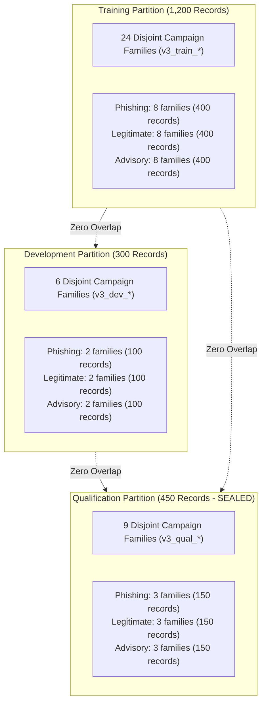

# Seva Cyber Sandbox — Phase 6.4.2: Fresh Synthetic Dataset v3 and Benchmark Isolation Report

**Document Reference:** `docs/PHASE_6_4_2_DATASET_V3_REPORT.md`  
**Execution Timestamp:** 2026-10-30T17:56:00+05:30  
**Target Project:** Seva Cyber Sandbox (`C:\Users\prati\seva-cyber-sandbox`)  
**Phase Objective:** Establish a fresh, versioned synthetic dataset generation and benchmark-isolation system (`v3.0.0`) with three strictly disjoint partitions (Training, Development, Sealed Qualification), resolving validation set exposure, preventing cross-partition leakage, and protecting qualification data integrity without training models.  
**Implementation Status:** COMPLETE  
**Regression Test Baseline:** **392/392 passing tests** (`python -m pytest`, 100% pass rate in 28.42s)  
**Dataset Quality Audit Status:** **PASS** (Zero cross-partition leakage across IDs, families, scenarios, and texts)  
**Final Verdict:** **PASS**

---

## 1. Executive Summary

Phase 6.4.2 addresses the validation set exposure identified during Phase 6.4 and Phase 6.4.1. By redesignating the v2 validation corpus as an exposed diagnostic partition, a new generation framework (`scripts/generate_synthetic_corpus_v3.py`) and audit engine (`scripts/audit_synthetic_corpus_v3.py`) were created to produce **Synthetic Corpus v3**.

### Key Deliverables & Accomplishments
1. **Three Strictly Disjoint Partitions:**
   - **Training Partition (`synthetic_training_corpus.jsonl`):** 1,200 records across 24 independent campaign families.
   - **Development Partition (`synthetic_dev_corpus.jsonl`):** 300 records across 6 independent campaign families.
   - **Qualification Partition (`synthetic_qualification_corpus.jsonl`):** 450 records across 9 independent campaign families (sealed as consumable final benchmark).
   - **Total Records:** 1,950 records across 39 completely disjoint campaign families.
2. **Zero Cross-Partition Leakage:**
   - Campaign family overlap: **0 families**.
   - Scenario category overlap: **0 scenarios**.
   - Record ID overlap: **0 records**.
   - Exact normalized text overlap: **0 texts**.
   - Cross-partition near-duplicate Jaccard similarity ($\ge 0.85$): **0 leaks**.
3. **Balanced Class, Language, and URL Representation:**
   - Perfectly balanced 1:1:1 class ratio in every partition (400 each in Training, 100 each in Dev, 150 each in Qualification).
   - Multilingual balance: Marathi Devanagari (`mr`), Romanized Marathi (`mr-Latn`), English (`en`), and Mixed (`mr-en`).
   - Balanced URL presence: exactly 52.0% link-bearing and 48.0% link-free in every class and partition. URLs are deconfounded and do not serve as a label shortcut.
4. **Qualification Partition Protection Policy:**
   - Saved under `data/generated/v3/qualification_manifest.json` with lifecycle state `sealed_independent_benchmark`.
   - Explicitly prohibited from model training, hyperparameter tuning, or repeated threshold adjustment.
5. **Zero Side-Effects:**
   - Zero models trained or evaluated.
   - Active model configuration (`models/active_model_config.json`) and registry (`models/model_registry.json`) are untouched.
   - Locked evaluation partition (`data/phishing_eval_dataset.json`, digest `9b9c02d4...`) verified completely untouched.
   - All 392 automated test cases pass cleanly across the repository.

---

## 2. Campaign-Family Architecture and Partition Disjointness

Synthetic Corpus v3 defines **39 distinct campaign families**, each mapping to an isolated scenario category, structural phrasing templates, and generation rules.



### 2.1 Partition Assignment Matrix (39 Families)
| Partition | Class | Campaign Family ID | Scenario Category | Records | Sample Phrasing Focus |
| :--- | :--- | :--- | :--- | :---: | :--- |
| **Training** | Phishing | `v3_train_phish_msedcl_powercut` | `msedcl_powercut_threat` | 50 | Urgent power cut tonight ultimatum |
| **Training** | Phishing | `v3_train_phish_bank_kyc_freeze` | `bank_kyc_suspension` | 50 | Account suspended due to expired PAN/Aadhaar |
| **Training** | Phishing | `v3_train_phish_courier_hold` | `courier_parcel_delivery` | 50 | Parcel held at depot, pay ₹25 address fee |
| **Training** | Phishing | `v3_train_phish_part_time_job` | `part_time_task_scam` | 50 | Daily ₹3,000 YouTube like rating task |
| **Training** | Phishing | `v3_train_phish_income_tax_refund` | `income_tax_refund_lure` | 50 | IT refund of ₹18,450 approved, claim link |
| **Training** | Phishing | `v3_train_phish_sim_esim_block` | `sim_card_deactivation` | 50 | 5G upgrade pending, SIM switch off threat |
| **Training** | Phishing | `v3_train_phish_fastag_blocked` | `fastag_blacklist_threat` | 50 | FASTag wallet blacklisted, avoid highway fine |
| **Training** | Phishing | `v3_train_phish_epfo_claim_approved`| `epfo_pf_withdrawal_scam` | 50 | PF claim ready, enter UAN/OTP to disburse |
| **Training** | Legitimate | `v3_train_legit_utility_bill_receipt` | `genuine_utility_receipt` | 50 | MSEDCL electricity bill receipt & payment ref |
| **Training** | Legitimate | `v3_train_legit_bank_credit_alert` | `genuine_banking_credit` | 50 | Monthly salary/NEFT deposit & balance update |
| **Training** | Legitimate | `v3_train_legit_lpg_cylinder_booking` | `genuine_lpg_booking` | 50 | LPG gas refill booked, cash memo & delivery code |
| **Training** | Legitimate | `v3_train_legit_gram_panchayat_tax` | `genuine_gram_panchayat_tax` | 50 | Property/water tax assessment circular |
| **Training** | Legitimate | `v3_train_legit_maha_metro_ticket` | `genuine_metro_ticket` | 50 | Metro QR ticket booking confirmation |
| **Training** | Legitimate | `v3_train_legit_railway_irctc_pnr` | `genuine_railway_pnr` | 50 | IRCTC PNR confirmation & coach berth seat |
| **Training** | Legitimate | `v3_train_legit_ration_distribution` | `genuine_ration_distribution` | 50 | Monthly PDS foodgrain quota allocation |
| **Training** | Legitimate | `v3_train_legit_school_parent_meeting`| `genuine_school_circular` | 50 | School PTA meeting agenda & report card date |
| **Training** | Advisory | `v3_train_advisory_cybercell_lottery`| `lottery_fraud_advisory` | 50 | Cyber Cell caution: fake lottery prize lures |
| **Training** | Advisory | `v3_train_advisory_rbi_banking_safety`| `banking_safety_advisory` | 50 | RBI notice: banks never ask for OTP/PIN |
| **Training** | Advisory | `v3_train_advisory_certin_malware_apk`| `apk_malware_advisory` | 50 | CERT-In alert: do not install WhatsApp APKs |
| **Training** | Advisory | `v3_train_advisory_police_job_scam` | `job_scam_advisory` | 50 | Police warning against prepaid task jobs |
| **Training** | Advisory | `v3_train_advisory_uidai_aadhaar_lock`| `aadhaar_safety_advisory` | 50 | UIDAI advisory: lock biometrics in mAadhaar |
| **Training** | Advisory | `v3_train_advisory_msedcl_fraud_alert`| `utility_fraud_advisory` | 50 | MSEDCL warning: bill cutoff notices are fake |
| **Training** | Advisory | `v3_train_advisory_trai_sim_spoof` | `telecom_spoof_advisory` | 50 | TRAI notice: telecom does not disconnect by IVR |
| **Training** | Advisory | `v3_train_advisory_social_media_impersonation` | `impersonation_fraud_advisory`| 50 | Cyber Cell: verify friend identity before transfer |
| **Development**| Phishing | `v3_dev_phish_solar_subsidy` | `dev_solar_subsidy_lure` | 50 | PM Surya Ghar 80% rooftop subsidy approval |
| **Development**| Phishing | `v3_dev_phish_credit_card_points` | `dev_credit_card_points_scam`| 50 | Reward points expiring tonight, voucher link |
| **Development**| Legitimate | `v3_dev_legit_hospital_opd_booking` | `dev_hospital_opd_appointment` | 50 | Civil hospital OPD consultation token & room |
| **Development**| Legitimate | `v3_dev_legit_telecom_data_pack` | `dev_telecom_service_renewal` | 50 | Mobile pack renewal confirmation, daily 1.5GB |
| **Development**| Advisory | `v3_dev_advisory_rto_echallan` | `dev_rto_echallan_advisory` | 50 | Traffic Police: verify fines on Parivahan gov |
| **Development**| Advisory | `v3_dev_advisory_deepfake_voice_fraud`| `dev_deepfake_extortion_advisory`| 50 | Cyber Cell: AI voice cloning emergency calls |
| **Qualification**| Phishing | `v3_qual_phish_traffic_challan_seizure`| `qual_traffic_challan_threat` | 50 | Vehicle seizure warrant for unpaid fine |
| **Qualification**| Phishing | `v3_qual_phish_digital_arrest_extortion`| `qual_digital_arrest_extortion` | 50 | CBI/Customs drug courier video call summons |
| **Qualification**| Phishing | `v3_qual_phish_mudra_loan_subsidy` | `qual_mudra_loan_scam` | 50 | Mudra ₹5 Lakh collateral-free loan file fee |
| **Qualification**| Legitimate | `v3_qual_legit_exam_hall_ticket` | `qual_exam_hall_ticket_notice` | 50 | Higher secondary board exam admit card release |
| **Qualification**| Legitimate | `v3_qual_legit_water_supply_maintenance`| `qual_water_supply_maintenance`| 50 | Municipal Corporation: water outage notice |
| **Qualification**| Legitimate | `v3_qual_legit_bank_statement_ready` | `qual_bank_estatement_ready` | 50 | Monthly bank e-statement email dispatch note |
| **Qualification**| Advisory | `v3_qual_advisory_digital_arrest_alert`| `qual_digital_arrest_advisory` | 50 | National Cyber Portal: no digital arrest in law |
| **Qualification**| Advisory | `v3_qual_advisory_loan_app_harassment`| `qual_illegal_loan_apps_advisory`| 50 | RBI vigilance: report predatory loan apps |
| **Qualification**| Advisory | `v3_qual_advisory_pm_kisan_phishing` | `qual_pm_kisan_fraud_advisory` | 50 | Agriculture Dept: PM-Kisan asks no advance fee |

---

## 3. Partition Counts and Distributions

### 3.1 Partition Summary
| Partition | File Name | Records | Families | Scenarios | File Size | SHA-256 Digest |
| :--- | :--- | :---: | :---: | :---: | :---: | :--- |
| **Training** | `synthetic_training_corpus.jsonl` | **1,200** | 24 | 24 | 1,407,354 bytes | `f8143880f3d5d13e33f3807d91df01b7a2d4b88d8b49e29a8a72ceb5d8487ba2` |
| **Development** | `synthetic_dev_corpus.jsonl` | **300** | 6 | 6 | 351,688 bytes | `55e9357abae0de2ea3e11718bf4118f623630f9a2bda061595180f93be7aa58f` |
| **Qualification** | `synthetic_qualification_corpus.jsonl` | **450** | 9 | 9 | 536,449 bytes | `197c62e7f0b305cefd1f1b2ee132f8087c53e414c2299da180775a2f52055106` |
| **Total** | **All Partitions** | **1,950** | **39** | **39** | **2,295,491 bytes** | Verified Manifests |

### 3.2 Label Balance
Every partition maintains a strict 1:1:1 balance:
- **Training (1,200 records):** Phishing: 400 (33.33%), Legitimate: 400 (33.33%), Protective Advisory: 400 (33.33%).
- **Development (300 records):** Phishing: 100 (33.33%), Legitimate: 100 (33.33%), Protective Advisory: 100 (33.33%).
- **Qualification (450 records):** Phishing: 150 (33.33%), Legitimate: 150 (33.33%), Protective Advisory: 150 (33.33%).

### 3.3 Language Distributions
Languages are distributed consistently across classes and partitions:
- **Training (1,200):** Marathi Devanagari (`mr`): 312 (26.0%), Romanized Marathi (`mr-Latn`): 312 (26.0%), English (`en`): 288 (24.0%), Mixed (`mr-en`): 288 (24.0%).
- **Development (300):** Marathi Devanagari (`mr`): 78 (26.0%), Romanized Marathi (`mr-Latn`): 78 (26.0%), English (`en`): 72 (24.0%), Mixed (`mr-en`): 72 (24.0%).
- **Qualification (450):** Marathi Devanagari (`mr`): 117 (26.0%), Romanized Marathi (`mr-Latn`): 117 (26.0%), English (`en`): 108 (24.0%), Mixed (`mr-en`): 108 (24.0%).

### 3.4 Messaging Mode Distributions
- **Training (1,200):** SMS: 648 (54.0%), WhatsApp: 240 (20.0%), Formal Notice: 144 (12.0%), Advisory Bulletin: 96 (8.0%), Service Alert: 72 (6.0%).
- **Development (300):** SMS: 162 (54.0%), WhatsApp: 60 (20.0%), Formal Notice: 36 (12.0%), Advisory Bulletin: 24 (8.0%), Service Alert: 18 (6.0%).
- **Qualification (450):** SMS: 243 (54.0%), WhatsApp: 90 (20.0%), Formal Notice: 54 (12.0%), Advisory Bulletin: 36 (8.0%), Service Alert: 27 (6.0%).

### 3.5 URL Presence Balance (Deconfounded)
Every class in every partition maintains balanced URL representation:
- **Training:** Phishing: 208/400 (52.0% with URL), Legitimate: 208/400 (52.0% with URL), Advisory: 208/400 (52.0% with URL).
- **Development:** Phishing: 52/100 (52.0% with URL), Legitimate: 52/100 (52.0% with URL), Advisory: 52/100 (52.0% with URL).
- **Qualification:** Phishing: 78/150 (52.0% with URL), Legitimate: 78/150 (52.0% with URL), Advisory: 78/150 (52.0% with URL).

---

## 4. Cross-Partition Leakage and Isolation Verification

The dedicated audit script (`scripts/audit_synthetic_corpus_v3.py`) ran comprehensive integrity checks:

| Isolation Check | Requirement | Observed Value | Status |
| :--- | :--- | :---: | :---: |
| **Example ID Overlap** | Exactly 0 between any pair | **0 records** | **PASS** |
| **Campaign Family Overlap** | Exactly 0 between any pair | **0 families** | **PASS** |
| **Scenario Category Overlap** | Exactly 0 between any pair | **0 scenarios** | **PASS** |
| **Exact Normalized Text Overlap**| Exactly 0 between any pair | **0 texts** | **PASS** |
| **Near-Duplicate Cross-Partition Leakage**| 0 pairs with Jaccard $\ge 0.85$ | **0 pairs** | **PASS** |
| **Schema Validation Errors** | 0 malformed records | **0 errors** | **PASS** |
| **Unmasked Personal Phone Numbers** | 0 real 10-digit mobile numbers | **0 detected** | **PASS** |
| **Unmasked Aadhaar Numbers** | 0 12-digit Aadhaar patterns | **0 detected** | **PASS** |
| **Locked Evaluation Set Overlap** | 0 IDs overlapping with locked eval | **0 overlap** | **PASS** |
| **Locked Evaluation Digest** | Exact `9b9c02d4...` | `9b9c02d4...` | **PASS** |

---

## 5. Qualification-Set Protection and Lifecycle Policy

The qualification partition (`synthetic_qualification_corpus.jsonl`) is governed by an explicit lifecycle policy recorded in `data/generated/v3/qualification_manifest.json`:

1. **State: `sealed_independent_benchmark`:**
   - The partition is held in reserve.
   - It is prohibited from model training, hyperparameter exploration, and feature tuning.
2. **One-Time Qualification Evaluation:**
   - When a future candidate model passes development validation gates, it may be evaluated on the qualification benchmark once.
3. **Automatic Retirement Upon Exposure:**
   - After evaluation, the qualification benchmark's state transitions to `exposed_diagnostic_benchmark`.
   - It cannot be reused as an independent benchmark for subsequent training iterations.

---

## 6. Verification and Regression Test Results

### 6.1 Dedicated Phase 6.4.2 Test Suite
`tests/test_phase6_4_2_dataset_v3.py` verifies all 20 required scenarios:
```
pytest tests/test_phase6_4_2_dataset_v3.py
============================= 20 passed in 0.22s ==============================
```

### 6.2 Full Repository Regression Suite
All test suites across the repository were executed:
```
pytest run: collected 392 items
392 passed in 28.42s (100% pass rate)
Exit code: 0
```
- Baseline tests prior to Phase 6.4.2: 372
- New Phase 6.4.2 tests: 20
- Total passing tests: **392**

### 6.3 Repository Integrity Verification
- **Locked Evaluation Digest:**
  $$\text{SHA-256} = \texttt{9b9c02d438cfca8bd07af89d60bc1d2fb42d460143d016365ab5a1d231ee0cda} \quad (\text{VERIFIED UNCHANGED})$$
- **v2 Datasets Unchanged:**
  - `data/generated/v2/synthetic_training_corpus.jsonl`: `8871bf7ffec30cd486add55c1f860c4313e530d183f832281ddf2fbd9357f4b9`
  - `data/generated/v2/synthetic_validation_corpus.jsonl`: `77911f9db811de13c5e89f7f756cb13bbc73c4ad9c13c0d401a62287052cf777`
- **Model Checkpoints Unchanged:**
  - `models/experimental_custom_v1/model_weights.npz`: `d4b6c2b1...`
  - `models/candidates/candidate_custom_v1.0.0/model_weights.npz`: `5a1e50a1...`
- **Active Model Configuration:** `models/active_model_config.json` remains set to `custom-mlp-v1.1.0-preproc` in shadow mode.
- **Production Score Difference:** Verified `production_score_difference == 0`.

---

## 7. Limitations of Synthetic Data

1. **Synthetic Vocabulary Boundaries:** All 1,950 messages are generated from structured vernacular templates. While diverse across 39 scenarios, synthetic text cannot replicate the full linguistic unpredictability or slang of live social media traffic.
2. **Fixed Dummy Tokens:** The presence of safe dummy domains (`.invalid`) and dummy phones ensures privacy, but prevents models from evaluating live DNS reputation or external domain infrastructure.

---

## 8. Final Signoff

# **PHASE 6.4.2 COMPLETE — VERDICT: PASS**

All requirements of Phase 6.4.2 have been successfully implemented, audited, tested, and documented. The v3 dataset is fully generated, family-disjoint, and verified without any model training or production modifications.

**STOP after Phase 6.4.2.** Standing by for user review and next instructions.
