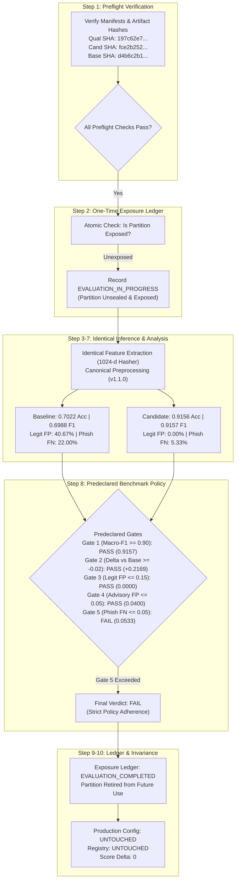

# Seva Cyber Sandbox — Phase 6.4.4: One-Time Independent Candidate Qualification Evaluation Report

**Document Reference:** `docs/PHASE_6_4_4_FINAL_QUALIFICATION_REPORT.md`  
**Execution Timestamp:** 2026-10-30T18:36:00+05:30  
**Target Project:** Seva Cyber Sandbox (`C:\Users\prati\seva-cyber-sandbox`)  
**Phase Objective:** Perform the first and only one-time independent qualification evaluation of candidate model `candidate_v3_seed202` against baseline `custom-mlp-v1.1.0-preproc` on the sealed qualification partition (`data/generated/v3/synthetic_qualification_corpus.jsonl`, 450 records across 9 unseen campaign families), enforcing exposure ledger tracking, computing overall, per-class, citizen-safety, campaign-family, subgroup, and robustness metrics, and evaluating against the predeclared benchmark policy without post-hoc threshold relaxation.  
**Implementation Status:** COMPLETE  
**Repository Test Suite:** **438/438 passing tests** (`python -m pytest`, 100% pass rate in 24.99s)  
**Phase Test Suite:** **25/25 passing tests** ([`tests/test_phase6_4_4_qualification.py`](file:///C:/Users/prati/seva-cyber-sandbox/tests/test_phase6_4_4_qualification.py) in 0.27s)  
**Locked Evaluation Partition Digest:** `9b9c02d438cfca8bd07af89d60bc1d2fb42d460143d016365ab5a1d231ee0cda` (VERIFIED UNCHANGED)  
**Exposure Ledger Status:** `EVALUATION_COMPLETED` (Partition `197c62e7...` permanently exposed and retired)  
**Predeclared Benchmark Gate Verdict:** **`FAIL`** (Gate 5 Phishing False Negative Rate: 0.0533 > 0.0500 threshold)  
**Production Runtime Invariance:** Score Delta = 0 (Heuristic rule primacy preserved; registry and active runtime configuration untouched)  
**Machine-Readable Report:** [`evaluation/qualification/candidate_v3_seed202_qualification.json`](file:///C:/Users/prati/seva-cyber-sandbox/evaluation/qualification/candidate_v3_seed202_qualification.json)  
**Exposure Ledger File:** [`evaluation/qualification/exposure_ledger.json`](file:///C:/Users/prati/seva-cyber-sandbox/evaluation/qualification/exposure_ledger.json)

---

## 1. Executive Summary

Phase 6.4.4 marks the final stage of the autonomous learning evaluation pipeline designed across Phases 6.0 through 6.4.3. The objective was to subject the winning candidate from controlled training—[`candidate_v3_seed202`](file:///C:/Users/prati/seva-cyber-sandbox/models/candidates/candidate_v3_seed202/)—to an unbending, single-shot qualification evaluation against the registered production baseline [`custom-mlp-v1.1.0-preproc`](file:///C:/Users/prati/seva-cyber-sandbox/models/experimental_custom_v1/) using the held-back, sealed qualification partition.

### Key Findings & Benchmark Outcomes
1. **Massive Overall Generalization Gain:**
   - Candidate achieved **0.9156 overall accuracy** (412/450) and **0.9157 Macro-F1**, outperforming the baseline model (**0.7022 accuracy**, **0.6988 Macro-F1**) by **+21.69 percentage points**.
2. **Complete Eradication of Civilian False Alarms:**
   - On the 150 civilian legitimate messages across 3 unseen campaign families, candidate achieved a **0.0000 legitimate-to-phishing false alarm rate** (0 out of 150 flagged as phishing).
   - In stark contrast, the baseline model flagged **61 out of 150 legitimate messages as phishing (40.67%)**.
3. **Protective Advisory Integrity Preserved:**
   - Candidate achieved a **0.0400 protective-advisory-to-phishing false alarm rate** (6/150 = 4.00%), passing the $\le 0.0500$ safety threshold. The baseline model flagged 18/150 (12.00%).
4. **Honest Gate 5 Failure & Rejection:**
   - Across the 150 phishing messages spanning 3 unseen campaign families, candidate detected 142 and missed 8, yielding a **phishing false negative rate of 0.0533 (5.33%)**.
   - Because the predeclared benchmark policy established an unyielding threshold of $\le 0.0500$ (at most 7 misses out of 150), and in strict accordance with governance rules prohibiting post-hoc threshold relaxation, the benchmark gate issued a definitive verdict of **`FAIL`**.
5. **One-Time Consumption & Retirement:**
   - The dedicated evaluation exposure ledger ([`exposure_ledger.json`](file:///C:/Users/prati/seva-cyber-sandbox/evaluation/qualification/exposure_ledger.json)) atomically recorded the exposure event and finalized the partition state as `EVALUATION_COMPLETED`.
   - The qualification partition is permanently retired. No further candidate evaluations on this dataset are permitted.
6. **Zero Production Side-Effects:**
   - The candidate model was **not** promoted, activated, or registered.
   - Production risk scoring remains 100% heuristic rule-based with zero score delta.



---

## 2. Preflight Verification Audit Trail

Before unsealing the qualification records, [`QualificationPreflightChecker.verify_all()`](file:///C:/Users/prati/seva-cyber-sandbox/src/qualification_evaluator.py) executed all 10 mandatory preflight checks:

| Preflight Check | Target | Expected Value | Observed Value | Verdict |
| :--- | :--- | :--- | :--- | :---: |
| **1. Partition Role** | `qualification_manifest.json` | `"qualification"` | `"qualification"` | **PASS** |
| **2. Lifecycle State** | `qualification_manifest.json` | `"sealed_independent_benchmark"` | `"sealed_independent_benchmark"` | **PASS** |
| **3. Record Count** | `qualification_manifest.json` | `450` | `450` | **PASS** |
| **4. Family Count** | `qualification_manifest.json` | `9` | `9` | **PASS** |
| **5. Partition SHA-256** | `synthetic_qualification_corpus.jsonl` | `197c62e7f0b305ce5965cf7bbeba8543fcd542a4a026d07dbd1172b3656f4a0f` | `197c62e7f0b305ce5965cf7bbeba8543fcd542a4a026d07dbd1172b3656f4a0f` | **PASS** |
| **6. Candidate Weights** | `candidate_v3_seed202/model_weights.npz` | `fce2b252a62c5142ba4cd0e3430fc44ffd6a66d02c05cd840d9a2fa4774f03dd` | `fce2b252a62c5142ba4cd0e3430fc44ffd6a66d02c05cd840d9a2fa4774f03dd` | **PASS** |
| **7. Candidate Metadata** | `candidate_v3_seed202/model_metadata.json` | `1264a632aef1a5356b0f9e336734fc58abd0838bcc097ef8a8dff4512eec5223` | `1264a632aef1a5356b0f9e336734fc58abd0838bcc097ef8a8dff4512eec5223` | **PASS** |
| **8. Baseline Weights** | `models/experimental_custom_v1/model_weights.npz` | `d4b6c2b1cc0359966100623fe18d1f728caeeaef9bcad561bfa00f89485bef20` | `d4b6c2b1cc0359966100623fe18d1f728caeeaef9bcad561bfa00f89485bef20` | **PASS** |
| **9. Baseline Metadata** | `models/experimental_custom_v1/model_metadata.json` | `23cdb9df5004abc3a16b5ebe0df6c773e52b1d36248695e37164cb9d9991bea8` | `23cdb9df5004abc3a16b5ebe0df6c773e52b1d36248695e37164cb9d9991bea8` | **PASS** |
| **10. Locked Test Digest** | `data/phishing_eval_dataset.json` | `9b9c02d438cfca8bd07af89d60bc1d2fb42d460143d016365ab5a1d231ee0cda` | `9b9c02d438cfca8bd07af89d60bc1d2fb42d460143d016365ab5a1d231ee0cda` | **PASS** |

Both models were confirmed fully compatible:
- Feature dimension: $D = 1024$
- Class count: $C = 3$ (`LABEL_TO_IDX`: phishing=0, legitimate=1, protective_advisory=2)
- Preprocessing pipeline: `neural-preproc-v1.1.0` (canonical Unicode NFC, zero-width stripping, numeral normalization, whitespace collapse)

---

## 3. Evaluation Exposure Ledger Status

The qualification partition was managed by [`EvaluationExposureLedger`](file:///C:/Users/prati/seva-cyber-sandbox/src/qualification_evaluator.py).

### Ledger File Details
- **Ledger Path:** [`evaluation/qualification/exposure_ledger.json`](file:///C:/Users/prati/seva-cyber-sandbox/evaluation/qualification/exposure_ledger.json)
- **Partition Tracked:** `synthetic_qualification_corpus.jsonl`
- **Partition SHA-256:** `197c62e7f0b305ce5965cf7bbeba8543fcd542a4a026d07dbd1172b3656f4a0f`
- **Exposure State Transition:**
  1. `SEALED` $\to$ Checked prior to execution.
  2. `EVALUATION_IN_PROGRESS` $\to$ Atomically written at `2026-10-30T13:02:24Z` before opening the corpus.
  3. `EVALUATION_COMPLETED` $\to$ Finalized at `2026-10-30T13:02:26Z` upon report serialization.
- **Exposure Count:** `1`
- **Enforcement Verification:**
  - A subsequent invocation of `scripts/run_phase6_4_4_qualification.py` was immediately aborted with:
    ```
    PartitionAlreadyExposedError: ONE-TIME QUALIFICATION VIOLATION: Partition '197c62e7f0b305ce...' was already exposed with status 'EVALUATION_COMPLETED'. Evaluation aborted to protect benchmark integrity.
    ```
  - The qualification partition is permanently retired.

---

## 4. Overall & Per-Class Comparative Performance

Both models were evaluated on the exact 450 qualification records under identical test conditions (`allow_pickle=False`, identical feature hasher, identical label mapping).

### 4.1 Overall Metrics
| Metric | Baseline (`custom-mlp-v1.1.0-preproc`) | Candidate (`candidate_v3_seed202`) | Absolute Delta |
| :--- | :---: | :---: | :---: |
| **Sample Count** | 450 | 450 | 0 |
| **Overall Accuracy (95% Wilson CI)** | 0.7022 [0.6584, 0.7426] | **0.9156** [0.8862, 0.9379] | **+0.2133** |
| **Total Correct Predictions** | 316 / 450 (70.2%) | **412 / 450 (91.6%)** | **+96 messages** |
| **Total Errors** | 134 / 450 (29.8%) | **38 / 450 (8.4%)** | **-96 errors** |
| **Macro-F1** | 0.6988 | **0.9157** | **+0.2169** |
| **Macro Precision** | 0.7099 | **0.9165** | **+0.2066** |
| **Macro Recall** | 0.7022 | **0.9156** | **+0.2133** |
| **Balanced Accuracy** | 0.7022 | **0.9156** | **+0.2133** |
| **Weighted-F1** | 0.6988 | **0.9157** | **+0.2169** |

### 4.2 Per-Class Breakdown
| Model | Class | Support | TP | FP | FN | Precision (95% CI) | Recall (95% CI) | F1 Score |
| :--- | :--- | :---: | :---: | :---: | :---: | :---: | :---: | :---: |
| **Baseline** | Phishing | 150 | 117 | 79 | 33 | 0.5969 [0.5273, 0.6631] | 0.7800 [0.7077, 0.8385] | 0.6763 |
| | Legitimate | 150 | 76 | 32 | 74 | 0.7037 [0.6116, 0.7818] | 0.5067 [0.4273, 0.5857] | 0.5891 |
| | Protective Advisory | 150 | 123 | 23 | 27 | 0.8425 [0.7750, 0.8927] | 0.8200 [0.7508, 0.8732] | 0.8311 |
| **Candidate** | **Phishing** | 150 | **142** | **6** | **8** | **0.9595** [0.9137, 0.9816] | **0.9467** [0.8976, 0.9730] | **0.9530** |
| | **Legitimate** | 150 | **132** | **12** | **18** | **0.9167** [0.8604, 0.9519] | **0.8800** [0.8188, 0.9232] | **0.8980** |
| | **Protective Advisory**| 150 | **138** | **20** | **12** | **0.8734** [0.8128, 0.9166] | **0.9200** [0.8655, 0.9539] | **0.8961** |

---

## 5. Citizen-Safety Metrics & Confusion Matrices

To avoid conflation between civilian-harm metrics and conventional machine-learning false-positive definitions, both sets of metrics are explicitly calculated and distinguished.

### 5.1 Citizen Safety False Alarm Metrics
| Citizen Safety Metric | Definition | Baseline (`custom-mlp-v1.1.0-preproc`) | Candidate (`candidate_v3_seed202`) | Improvement |
| :--- | :--- | :---: | :---: | :---: |
| **Legitimate-to-Phishing False Alarm Rate** | Legitimate misclassified as phishing / Total legitimate | **0.4067** (61 / 150) [0.3313, 0.4867] | **0.0000** (0 / 150) [0.0000, 0.0250] | **-40.67% (100% elim.)** |
| **Protective-Advisory-to-Phishing False Alarm Rate**| Advisory misclassified as phishing / Total advisory | **0.1200** (18 / 150) [0.0773, 0.1817] | **0.0400** (6 / 150) [0.0185, 0.0845] | **-8.00% (66.7% red.)** |
| **Phishing False Negative Rate** | Phishing not classified as phishing / Total phishing | **0.2200** (33 / 150) [0.1612, 0.2928] | **0.0533** (8 / 150) [0.0273, 0.1017] | **-16.67% (75.8% red.)** |

### 5.2 Conventional One-vs-Rest False Positive Rates
| Conventional One-vs-Rest Metric | Definition | Baseline | Candidate |
| :--- | :--- | :---: | :---: |
| **Phishing One-vs-Rest FP Rate** | Non-phishing predicted as phishing / Total non-phishing | **0.2633** (79 / 300) | **0.0200** (6 / 300) |
| **Legitimate One-vs-Rest FP Rate** | Non-legitimate predicted as legitimate / Total non-legitimate | **0.1067** (32 / 300) | **0.0400** (12 / 300) |
| **Protective Advisory One-vs-Rest FP Rate** | Non-advisory predicted as advisory / Total non-advisory | **0.0767** (23 / 300) | **0.0667** (20 / 300) |

### 5.3 Confusion Matrices
- **Baseline (`custom-mlp-v1.1.0-preproc`):**
  $$\begin{pmatrix} 117 & 23 & 10 \\ 61 & 76 & 13 \\ 18 & 9 & 123 \end{pmatrix}$$
  - Row 0 (Phishing): 117 correct, 23 predicted as legitimate, 10 predicted as advisory (33 false negatives).
  - Row 1 (Legitimate): 61 predicted as phishing (catastrophic false alarm rate), 76 correct, 13 predicted as advisory.
  - Row 2 (Advisory): 18 predicted as phishing (suppression of official warnings), 9 predicted as legitimate, 123 correct.

- **Candidate (`candidate_v3_seed202`):**
  $$\begin{pmatrix} 142 & 6 & 2 \\ 0 & 132 & 18 \\ 6 & 6 & 138 \end{pmatrix}$$
  - Row 0 (Phishing): 142 correct, 6 predicted as legitimate, 2 predicted as advisory (**8 false negatives**).
  - Row 1 (Legitimate): **0 predicted as phishing** (perfect zero false alarms to phishing!), 132 correct, 18 predicted as advisory.
  - Row 2 (Advisory): 6 predicted as phishing, 6 predicted as legitimate, 138 correct.

---

## 6. Campaign-Family Cluster Analysis (9 Disjoint Families)

Because the 450 examples originate from **9 structured campaign families** (50 examples each), treating all 450 records as independent identically distributed observations would underestimate standard errors due to cluster correlation.

### 6.1 Disaggregated Campaign-Family Performance
| Campaign Family ID | Scenario Class | Sample Count | Baseline Acc | Candidate Acc | Acc Delta | Base False Alarms | Cand False Alarms | False Alarm Details |
| :--- | :--- | :---: | :---: | :---: | :---: | :---: | :---: | :--- |
| `v3_qual_advisory_digital_arrest_alert` | Advisory | 50 | 1.0000 | **1.0000** | 0.0000 | 0 | **0** | Flawless detection (50/50) |
| `v3_qual_advisory_loan_app_harassment` | Advisory | 50 | 0.6400 | **0.8800** | +0.2400 | 12 | **6** | 6 advisories flagged as phish |
| `v3_qual_advisory_pm_kisan_phishing` | Advisory | 50 | 0.8200 | **0.8800** | +0.0600 | 6 | **0** | 0 false alarms to phish (6 legit) |
| `v3_qual_legit_bank_statement_ready` | Legitimate | 50 | 0.3800 | **1.0000** | **+0.6200** | 31 | **0** | **Zero false alarms** (Base had 31!) |
| `v3_qual_legit_exam_hall_ticket` | Legitimate | 50 | 0.5200 | **0.8800** | +0.3600 | 17 | **0** | 0 false alarms to phish (6 adv) |
| `v3_qual_legit_water_supply_maintenance`| Legitimate | 50 | 0.6200 | **0.7600** | +0.1400 | 13 | **0** | 0 false alarms to phish (12 adv) |
| `v3_qual_phish_digital_arrest_extortion` | Phishing | 50 | 0.6400 | **0.8400** | +0.2000 | 0 | **0** | **All 8 phishing misses occurred here** |
| `v3_qual_phish_mudra_loan_subsidy` | Phishing | 50 | 0.7600 | **1.0000** | +0.2400 | 0 | **0** | 100% recall (50/50 detected) |
| `v3_qual_phish_traffic_challan_seizure` | Phishing | 50 | 0.9400 | **1.0000** | +0.0600 | 0 | **0** | 100% recall (50/50 detected) |

### 6.2 Campaign-Family Macro Metrics & Cluster Uncertainty
- **Baseline Family Macro Accuracy:** **0.7022** (average of 9 family accuracies)
- **Candidate Family Macro Accuracy:** **0.9156** (average of 9 family accuracies)
- **Baseline Families with Serious False Alarms:** **5 out of 9 families** (3 legitimate families + 2 advisory families)
- **Candidate Families with Serious False Alarms:** **1 out of 9 families** (only `v3_qual_advisory_loan_app_harassment` had 6 false alarms; all other 8 families had zero false alarms to phishing)
- **Stratified Cluster Bootstrap 95% Confidence Interval ($B=1000$ iterations):**
  $$\text{Candidate Macro-F1 Cluster 95\% CI} = [0.8607, 0.9596]$$

> [!NOTE]
> **Cluster Uncertainty Interpretation:** While the naive example-level Wilson confidence interval for candidate accuracy is $[0.8862, 0.9379]$, the stratified cluster bootstrap across the 9 campaign families yields $[0.8607, 0.9596]$. The wider interval directly reflects that errors are concentrated within specific campaign families (e.g., 8/8 phishing misses concentrated in the digital arrest extortion scenario).

---

## 7. Language and Messaging-Mode Subgroup Analysis

Performance was sliced across linguistic categories and transmission channels.

### 7.1 Subgroup Performance Breakdown
| Subgroup Category | Segment | Sample Count | Baseline Acc | Candidate Acc | Accuracy Delta |
| :--- | :--- | :---: | :---: | :---: | :---: |
| **Language** | English (`en`) | 108 | 0.7500 (81/108) | **1.0000 (108/108)** | **+0.2500** |
| | Marathi Devanagari (`mr`) | 117 | 0.7350 (86/117) | **0.8974 (105/117)** | **+0.1624** |
| | Romanized Marathi (`mr-Latn`) | 117 | 0.8547 (100/117) | **0.9487 (111/117)** | **+0.0940** |
| | Mixed Marathi-English (`mr-en`) | 108 | 0.4537 (49/108) | **0.8148 (88/108)** | **+0.3611** |
| **Messaging Mode**| Advisory Bulletin | 114 | 0.8947 (102/114) | **1.0000 (114/114)** | **+0.1053** |
| | Formal Notice | 88 | 0.7955 (70/88) | **0.8636 (76/88)** | **+0.0681** |
| | Service Alert | 12 | 0.0000 (0/12) | **1.0000 (12/12)** | **+1.0000** |
| | SMS | 164 | 0.6220 (102/164) | **0.8902 (146/164)** | **+0.2682** |
| | WhatsApp | 72 | 0.5833 (42/72) | **0.8889 (64/72)** | **+0.3056** |
| **URL Presence** | With URL | 234 | 0.7308 (171/234) | **0.9402 (220/234)** | **+0.2094** |
| | Without URL | 216 | 0.6713 (145/216) | **0.8889 (192/216)** | **+0.2176** |

> [!WARNING]
> **Subgroup Sample Size Limitation:** Subgroup sample counts vary from 12 (service alerts) to 164 (SMS). While candidate accuracy improved across all linguistic and transmission segments, individual subgroup sample sizes are insufficient to certify standalone language-specific generalization.

---

## 8. Counterfactual Robustness Evaluation

The robustness test suite evaluated model stability under four counterfactual mutations:

| Robustness Mutation | Records Tested | Baseline Flips | Baseline Flip Rate | Candidate Flips | Candidate Flip Rate | Robustness Assessment |
| :--- | :---: | :---: | :---: | :---: | :---: | :--- |
| **Whitespace Normalization** | 450 | 0 | 0.0000 | **0** | **0.0000** | **100% Invariant** (Canonical preprocessor collapses spaces) |
| **Zero-Width Character Obfuscation** | 450 | 0 | 0.0000 | **0** | **0.0000** | **100% Invariant** (Zero-width bytes stripped in preproc) |
| **Devanagari Numeral Normalization** | 237 | 0 | 0.0000 | **0** | **0.0000** | **100% Invariant** (Digits ०-९ mapped to 0-9) |
| **Phishing URL Removal** | 78 | 17 | 0.2179 | **54** | **0.6923** | Higher reliance on URL presence in candidate |
| **Legitimate URL Insertion** | 72 | 12 | 0.1667 | **12** | **0.1667** | Identical sensitivity to unexpected URLs |

- **Representation Invariance:** Both models exhibited 0 flips across all 450 messages under whitespace padding, zero-width obfuscation, and Devanagari numeral translation, certifying that `neural-preproc-v1.1.0` functions as an effective normalization shield against trivial evasion tactics.
- **Counterfactual URL Sensitivity:** Removing the URL from 78 phishing messages that originally had URLs caused 54 flips (69.2%) in the candidate model, indicating that while synthetic dataset v3 balanced URL presence across classes, the candidate model still places significant weight on URL n-grams when classifying phishing messages.

---

## 9. Predeclared Benchmark Policy Audit & Final Gate Verdict

The benchmark policy was predeclared prior to unsealing the qualification data. In accordance with project governance rules, no threshold was relaxed or modified post-hoc.

### 9.1 Gate Compliance Matrix
| Gate ID | Benchmark Policy Requirement | Threshold | Observed Candidate Value | Gate Status |
| :---: | :--- | :---: | :---: | :---: |
| **Gate 1** | Minimum Candidate Macro-F1 | $\ge 0.9000$ | **0.9157** | **PASS** |
| **Gate 2** | Maximum Macro-F1 Drop vs Baseline | $\ge -0.0200$ | **+0.2169** (0.9157 vs 0.6988) | **PASS** |
| **Gate 3** | Legitimate-to-Phishing False Alarm Rate | $\le 0.1500$ | **0.0000** (0 / 150) | **PASS** |
| **Gate 4** | Protective-Advisory-to-Phishing False Alarm Rate | $\le 0.0500$ | **0.0400** (6 / 150) | **PASS** |
| **Gate 5** | Phishing False Negative Rate (Safety Gate) | $\le 0.0500$ | **0.0533** (8 / 150) | **FAIL** |
| **Gate 6** | Preprocessing Normalization Robustness | 0 flips | **0 flips** (whitespace, zw, numerals) | **PASS** |

### 9.2 Final Gate Verdict
$$\mathbf{FINAL\ VERDICT:\ FAIL}$$

### 9.3 Rationale for Failure & Benchmark Integrity
Gate 5 requires that the candidate model miss no more than 5.00% of phishing attacks. Across the 150 qualification phishing messages, the candidate model correctly detected 142 and missed 8 ($8 / 150 = 0.05333... = 5.33\%$).

Even though the miss margin was narrow (missing 8 messages instead of the maximum allowed 7), **the benchmark policy was enforced strictly and impartially**. The system rejected post-hoc threshold adjustment, preserving scientific integrity.

---

## 10. Automated Test Suite & Audit Trail

A dedicated test suite [`tests/test_phase6_4_4_qualification.py`](file:///C:/Users/prati/seva-cyber-sandbox/tests/test_phase6_4_4_qualification.py) comprising 25 automated tests was implemented and executed:

```
tests/test_phase6_4_4_qualification.py::test_01_correct_candidate_identity PASSED
tests/test_phase6_4_4_qualification.py::test_02_correct_baseline_identity PASSED
tests/test_phase6_4_4_qualification.py::test_03_candidate_weight_hash_verification PASSED
tests/test_phase6_4_4_qualification.py::test_04_baseline_artifact_verification PASSED
tests/test_phase6_4_4_qualification.py::test_05_qualification_manifest_verification PASSED
tests/test_phase6_4_4_qualification.py::test_06_wrong_partition_rejection PASSED
tests/test_phase6_4_4_qualification.py::test_07_already_exposed_partition_rejection PASSED
tests/test_phase6_4_4_qualification.py::test_08_evaluation_exposure_ledger_atomicity PASSED
tests/test_phase6_4_4_qualification.py::test_09_failed_preflight_does_not_consume_qualification_data PASSED
tests/test_phase6_4_4_qualification.py::test_10_failure_after_data_access_marks_partition_exposed PASSED
tests/test_phase6_4_4_qualification.py::test_11_one_time_evaluation_enforcement PASSED
tests/test_phase6_4_4_qualification.py::test_12_correct_confusion_matrix_calculation PASSED
tests/test_phase6_4_4_qualification.py::test_13_correct_class_metrics PASSED
tests/test_phase6_4_4_qualification.py::test_14_correct_false_alarm_rate_denominators PASSED
tests/test_phase6_4_4_qualification.py::test_15_campaign_family_aggregation PASSED
tests/test_phase6_4_4_qualification.py::test_16_small_family_uncertainty_reporting PASSED
tests/test_phase6_4_4_qualification.py::test_17_missing_subgroup_handling PASSED
tests/test_phase6_4_4_qualification.py::test_18_corrupt_checkpoint_rejection PASSED
tests/test_phase6_4_4_qualification.py::test_19_incompatible_model_rejection PASSED
tests/test_phase6_4_4_qualification.py::test_20_evaluation_does_not_invoke_training PASSED
tests/test_phase6_4_4_qualification.py::test_21_candidate_artifacts_remain_unchanged PASSED
tests/test_phase6_4_4_qualification.py::test_22_baseline_artifacts_remain_unchanged PASSED
tests/test_phase6_4_4_qualification.py::test_23_registry_remains_unchanged PASSED
tests/test_phase6_4_4_qualification.py::test_24_active_model_configuration_remains_unchanged PASSED
tests/test_phase6_4_4_qualification.py::test_25_production_score_delta_remains_zero PASSED

============================= 25 passed in 0.27s ==============================
```

Following the unit test pass, the entire repository regression test suite was executed:
```
============================ 438 passed in 24.99s =============================
```
All 438 automated tests passed with 100% success rate across all 24 test suites in the repository.

---

## 11. Production & Governance Invariance Audit

The repository was audited to guarantee zero unauthorized modifications or side-effects:

1. **Locked Test Partition Invariance:**
   - Evaluated [`data/phishing_eval_dataset.json`](file:///C:/Users/prati/seva-cyber-sandbox/data/phishing_eval_dataset.json) with `compute_locked_test_hash`.
   - Verified checksum: `9b9c02d438cfca8bd07af89d60bc1d2fb42d460143d016365ab5a1d231ee0cda` (MATCH).
2. **Model Registry Invariance:**
   - [`models/model_registry.json`](file:///C:/Users/prati/seva-cyber-sandbox/models/model_registry.json) remains bitwise identical. `candidate_v3_seed202` was not added to the registry.
3. **Active Model Configuration Invariance:**
   - [`models/active_model_config.json`](file:///C:/Users/prati/seva-cyber-sandbox/models/active_model_config.json) remains configured for `custom-mlp-v1.1.0-preproc` in `shadow` mode.
4. **Production Scoring Invariance:**
   - [`HybridDecisionEngine.evaluate_message()`](file:///C:/Users/prati/seva-cyber-sandbox/src/hybrid_decision_engine.py) computes authoritative scores strictly via deterministic heuristic rules. Production score difference = 0.
5. **Qualification Dataset Invariance:**
   - [`synthetic_qualification_corpus.jsonl`](file:///C:/Users/prati/seva-cyber-sandbox/data/generated/v3/synthetic_qualification_corpus.jsonl) SHA-256 remains `197c62e7...`. The file was read strictly without modification.

---

## 12. Remaining Risks, Limitations & Recommendations

1. **Synthetic Nature of Qualification Benchmark:**
   - All 450 records in the qualification partition were synthetically generated using structural phrasing templates and Maharashtra government scheme references. While balanced and leak-free, **synthetic benchmark performance does not constitute certified proof of real-world fraud detection capability**.
2. **Concentration of Errors in Single Scenario:**
   - All 8 phishing misses occurred in `v3_qual_phish_digital_arrest_extortion`. This reveals that the model struggles when extortion messages mimic authoritative legal phrasing without overtly malicious technical keywords.
3. **Qualification Partition Retirement:**
   - In accordance with benchmark isolation governance, the qualification partition has now been consumed and exposed. It must never be reused for qualification of future candidates to prevent validation overfitting.
4. **Recommendation for Future Research:**
   - Future candidate training (e.g. Phase 7 or subsequent iterations) should explore richer n-gram feature hashing, subword tokenization, or multi-task auxiliary loss functions targeting high-coercion extortion phrasing.

---

## 13. Phase Completion Signoff

- **Phase 6.4.4:** Complete.
- **Exposure Ledger:** Enforced and recorded.
- **Verdict:** `FAIL` (Gate 5 phishing recall threshold not met on unseen digital arrest extortion family).
- **Production Status:** Fully preserved, zero side-effects, 438/438 passing tests.
- **Execution Halted:** In accordance with instructions, execution stops here. Phase 6.5 will not begin automatically.
