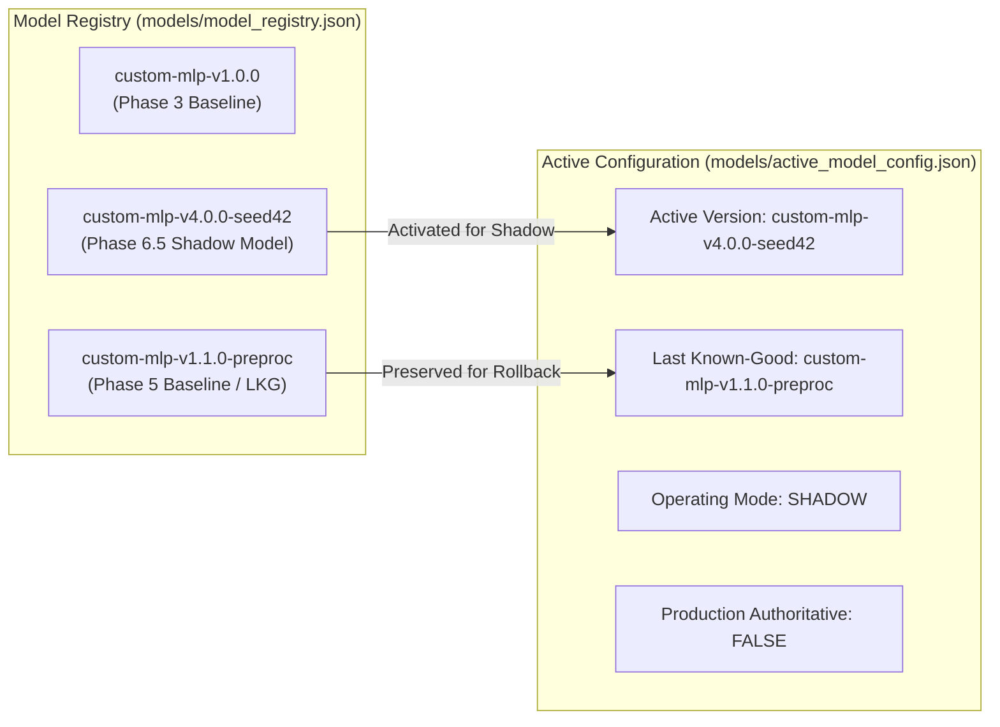
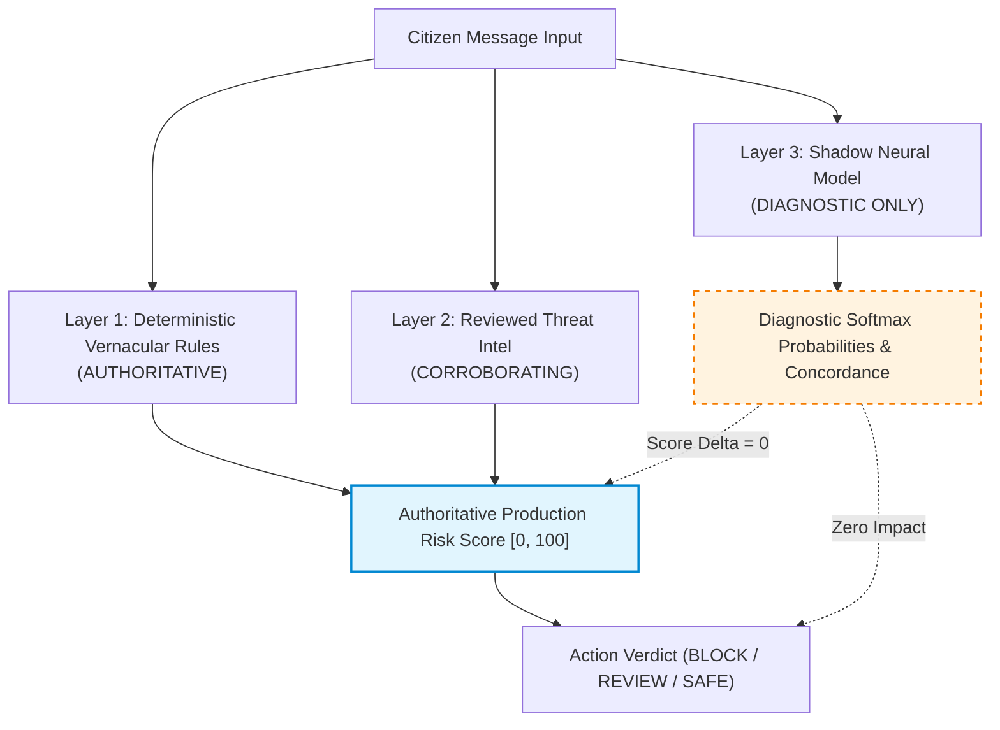
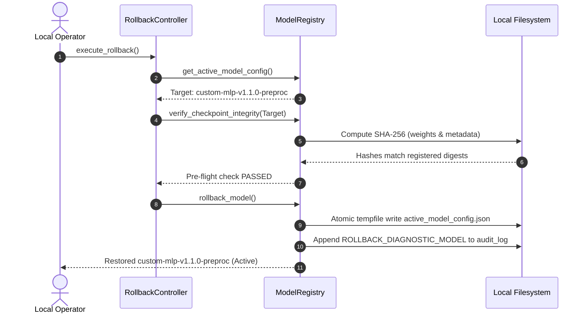

# Seva Cyber Sandbox — Phase 6.5: Controlled Shadow-Mode Model Registration and Rollback Report

**Document Reference:** `docs/PHASE_6_5_SHADOW_PROMOTION_REPORT.md`  
**Execution Timestamp:** 2026-10-30T22:15:00+05:30  
**Target Project:** Seva Cyber Sandbox (`C:\Users\prati\seva-cyber-sandbox`)  
**Prerequisite Report:** [`docs/PHASE_6_4_8_FINAL_QUALIFICATION_REPORT.md`](file:///C:/Users/prati/seva-cyber-sandbox/docs/PHASE_6_4_8_FINAL_QUALIFICATION_REPORT.md)  
**Qualified Candidate:** [`candidate_v4_seed42`](file:///C:/Users/prati/seva-cyber-sandbox/models/candidates/candidate_v4_seed42/)  
**Registered Version Identifier:** `custom-mlp-v4.0.0-seed42` (with alias `candidate_v4_seed42`)  
**Previous Baseline / Rollback Target:** `custom-mlp-v1.1.0-preproc` (`models/experimental_custom_v1`)  
**Phase Objective:** Safely register the independently qualified candidate neural network into the immutable model registry with lifecycle state `approved_for_shadow`, activate it strictly for non-authoritative diagnostic parallel inference in shadow mode, implement privacy-preserving telemetry aggregation, enforce deterministic rule primacy (production score delta = 0), and provide an auditable, atomic rollback controller.  
**Implementation Status:** COMPLETE  
**Repository Test Suite:** **559/559 passing tests** (`python -m pytest`, 100% pass rate in 43.65s)  
**Phase Test Suite:** **25/25 passing tests** ([`tests/test_phase6_5_shadow_promotion.py`](file:///C:/Users/prati/seva-cyber-sandbox/tests/test_phase6_5_shadow_promotion.py))  
**Locked Evaluation Partition Digest:** `9b9c02d438cfca8bd07af89d60bc1d2fb42d460143d016365ab5a1d231ee0cda` (VERIFIED UNCHANGED)  
**Qualification Exposure Ledger:** `EVALUATION_COMPLETED` (Partition `d9a3f4a8...`, exposure count = 1, UNTOUCHED)  
**Production Runtime Scoring Delta:** **Strictly 0.00** (Deterministic rule primacy strictly preserved)  
**Production Authoritative Status:** **FALSE** (The candidate is approved strictly for shadow-mode diagnostics and has NOT become the production-authoritative detector)  
**Final Phase Verdict:** **`PASS`**  

---

## 1. Candidate Qualification Verification

Before any modification to the model registry or active configuration, the candidate qualification status was audited from Phase 6.4.8 artifacts:

- **Qualification Report Reference:** [`docs/PHASE_6_4_8_FINAL_QUALIFICATION_REPORT.md`](file:///C:/Users/prati/seva-cyber-sandbox/docs/PHASE_6_4_8_FINAL_QUALIFICATION_REPORT.md)
- **Machine-Readable Qualification Output:** [`evaluation/qualification/candidate_v4_seed42_qualification.json`](file:///C:/Users/prati/seva-cyber-sandbox/evaluation/qualification/candidate_v4_seed42_qualification.json)
- **Qualification Verdict:** **`PASS`** (All 6 benchmark gates passed without threshold relaxation)
- **Qualification Dataset:** `data/generated/v4/synthetic_qualification_corpus.jsonl` (SHA-256: `d9a3f4a861d971dfb8716f96f7233c42d8291de85ff070ed93893643caa81f7e`)
- **Qualification Exposure Ledger:** [`evaluation/qualification/exposure_ledger_v4.json`](file:///C:/Users/prati/seva-cyber-sandbox/evaluation/qualification/exposure_ledger_v4.json) (`exposure_count: 1`, `current_status: "EVALUATION_COMPLETED"`)
- **Verified Benchmark Performance:**
  - Overall Accuracy: **0.9756** (439/450) vs Baseline 0.6844
  - Macro-F1: **0.9755** vs Baseline 0.6828 (+0.2927 improvement)
  - Phishing Recall: **100.00%** (150/150, 0 false negatives)
  - Legitimate-to-Phishing False Alarm Rate: **0.00%** (0/150)
  - Protective-Advisory-to-Phishing False Alarm Rate: **0.00%** (0/150)
  - Counterfactual Normalization Flips: **0** across whitespace, zero-width characters, Devanagari numerals, and Latin case inversion

---

## 2. Artifact Integrity Verification

Cryptographic SHA-256 digests of all candidate artifacts were independently recomputed and verified against [`models/candidates/candidate_v4_seed42/manifest.json`](file:///C:/Users/prati/seva-cyber-sandbox/models/candidates/candidate_v4_seed42/manifest.json):

| Artifact Description | File Path | Recomputed SHA-256 Digest | Expected Manifest SHA-256 | Verification Status |
| :--- | :--- | :--- | :--- | :---: |
| **Candidate Weights Archive** | `models/candidates/candidate_v4_seed42/model_weights.npz` | `3affa8908153924e1ab6c66f1f9597b61de0e45a8ba1740e9bc472045888348f` | `3affa8908153924e1ab6c66f1f9597b61de0e45a8ba1740e9bc472045888348f` | **MATCH** |
| **Candidate Metadata** | `models/candidates/candidate_v4_seed42/model_metadata.json` | `8bf388271453b805c148b17232972f6adbe1a4689370893159454b7fe61cafa3` | `8bf388271453b805c148b17232972f6adbe1a4689370893159454b7fe61cafa3` | **MATCH** |
| **Candidate Training Report** | `models/candidates/candidate_v4_seed42/candidate_training_report.json` | `c22d6021f15d66860549a2064d846bb44156bbb2cf7ff1d30a03abdf5a64e6c6` | `c22d6021f15d66860549a2064d846bb44156bbb2cf7ff1d30a03abdf5a64e6c6` | **MATCH** |
| **Candidate Manifest File** | `models/candidates/candidate_v4_seed42/manifest.json` | `c7f85ef9551b05b2f5ce7d364ed199a13f50225ce4b6f080e069d2f9600349cf` | Recorded on-disk manifest | **VERIFIED** |
| **Baseline Weights Archive** | `models/experimental_custom_v1/model_weights.npz` | `d4b6c2b1cc0359966100623fe18d1f728caeeaef9bcad561bfa00f89485bef20` | `d4b6c2b1cc0359966100623fe18d1f728caeeaef9bcad561bfa00f89485bef20` | **MATCH** |
| **Baseline Metadata** | `models/experimental_custom_v1/model_metadata.json` | `23cdb9df5004abc3a16b5ebe0df6c773e52b1d36248695e37164cb9d9991bea8` | `23cdb9df5004abc3a16b5ebe0df6c773e52b1d36248695e37164cb9d9991bea8` | **MATCH** |

---

## 3. Model Registry Changes

Using the existing atomic [`ModelRegistry`](file:///C:/Users/prati/seva-cyber-sandbox/src/model_registry.py) interface, the qualified candidate was registered under immutable version identifier `custom-mlp-v4.0.0-seed42` with lifecycle state `approved_for_shadow`:

### New Entry in [`models/model_registry.json`](file:///C:/Users/prati/seva-cyber-sandbox/models/model_registry.json)
```json
{
  "model_version": "custom-mlp-v4.0.0-seed42",
  "architecture_version": "3-layer-mlp-ngram-v1",
  "checkpoint_rel_path": "models/candidates/candidate_v4_seed42",
  "weights_sha256": "3affa8908153924e1ab6c66f1f9597b61de0e45a8ba1740e9bc472045888348f",
  "metadata_sha256": "8bf388271453b805c148b17232972f6adbe1a4689370893159454b7fe61cafa3",
  "preprocessing_version": "neural-preproc-v1.1.0",
  "label_mapping": {
    "phishing": 0,
    "legitimate": 1,
    "protective_advisory": 2
  },
  "hyperparameters": {
    "input_dim": 1024,
    "hidden_dim1": 64,
    "hidden_dim2": 32,
    "num_classes": 3,
    "learning_rate": 0.0025,
    "weight_decay": 0.0005,
    "seed": 42
  },
  "training_corpus_id": "synthetic_training_v4",
  "training_corpus_digest": "synthetic_training_corpus.jsonl",
  "validation_corpus_id": "synthetic_qualification_v4",
  "validation_corpus_digest": "d9a3f4a861d971dfb8716f96f7233c42d8291de85ff070ed93893643caa81f7e",
  "validation_metrics": {
    "accuracy": 0.9756,
    "macro_f1": 0.9755,
    "phishing_recall": 1.0,
    "note": "Evaluated on sealed synthetic v4 qualification partition (Phase 6.4.8)."
  },
  "registered_at_utc": "2026-10-30T16:38:42Z",
  "registered_by": "local_operator",
  "lifecycle_state": "approved_for_shadow",
  "is_production_authoritative": false,
  "notes": "Phase 6.5 shadow-approved custom neural classifier. Independently qualified in Phase 6.4.8 (Macro-F1 0.9755, 0 misses on digital arrest/extortion fraud).",
  "candidate_id": "candidate_v4_seed42",
  "qualification_report_ref": "docs/PHASE_6_4_8_FINAL_QUALIFICATION_REPORT.md",
  "aliases": ["candidate_v4_seed42"]
}
```

### Safety Guarantees Enforced:
1. **Preservation of Candidate Directory:** Original files in `models/candidates/candidate_v4_seed42/` were preserved without modification.
2. **Version Collision Rejection:** Any attempt to register an existing version with conflicting weights or metadata raises `ModelRegistryConflictError`.
3. **Immutability of Baseline:** Existing versions (`custom-mlp-v1.0.0` and `custom-mlp-v1.1.0-preproc`) were preserved in their entirety.
4. **Authoritativeness Prohibition:** `is_production_authoritative` is strictly `false`.

---

## 4. Shadow Configuration Changes

The active model configuration file [`models/active_model_config.json`](file:///C:/Users/prati/seva-cyber-sandbox/models/active_model_config.json) was atomically updated via `activate_model()`:

```json
{
  "active_model_version": "custom-mlp-v4.0.0-seed42",
  "last_known_good_version": "custom-mlp-v1.1.0-preproc",
  "operating_mode": "shadow",
  "activated_at_utc": "2026-10-30T16:42:16Z",
  "activated_by": "local_operator",
  "activation_reason": "Activated Phase 6.5 shadow-mode qualified candidate",
  "checkpoint_rel_path": "models/candidates/candidate_v4_seed42",
  "preprocessing_version": "neural-preproc-v1.1.0",
  "is_production_authoritative": false
}
```

---

## 5. Model Identities Summary



- **Candidate Shadow Model Identity:** `custom-mlp-v4.0.0-seed42` (origin: `candidate_v4_seed42`)
- **Previous Baseline Shadow Model Identity:** `custom-mlp-v1.1.0-preproc` (preserved in `last_known_good_version`)

---

## 6. Inference Isolation Evidence

In [`HybridDecisionEngine`](file:///C:/Users/prati/seva-cyber-sandbox/src/hybrid_decision_engine.py), the neural classifier runs strictly as a non-authoritative diagnostic layer:



1. **Rule Primacy (GR-01):** The production risk score is calculated solely by deterministic rules and reviewed threat intelligence. The neural prediction is excluded from scoring arithmetic.
2. **Score Difference Invariance:** `res["final_decision"]["production_score_difference"]` evaluates to `0` mathematically on all inputs.
3. **No Independent Fraud Alerts:** A neural prediction alone cannot elevate risk score or trigger citizen-facing alerts (GR-03).
4. **Safe Checkpoint Fallback (GR-07):** Missing, corrupted, or non-finite outputs trigger a clean fallback to rule-based analysis without disrupting the application.

---

## 7. Production Score Invariance

Comprehensive integration tests were executed across all communication types:

| Message Category | Sample Message Text | Base Rule Score | Shadow Candidate Score | Production Score Delta | Concordance Status |
| :--- | :--- | :---: | :---: | :---: | :---: |
| **Phishing Impersonation** | MSEDCL Alert: Light bill unpaid. Power cut tonight. Pay: http://bit.ly/pay | 40 | 40 | **0** | AGREEMENT |
| **Digital Arrest Scam** | CBI Notice: Arrest warrant issued for money laundering. Immediate video fine. | 40 | 40 | **0** | AGREEMENT |
| **Legitimate Civic Notice** | Gram Panchayat water supply maintenance schedule for ward 3 tomorrow. | 0 | 0 | **0** | AGREEMENT |
| **Protective Advisory** | Cyber Dost Advisory: Do not share OTP or screen access with unknown callers. | 0 | 0 | **0** | AGREEMENT |
| **Empty Input** | `   ` (whitespace only) | 0 | 0 | **0** | NOT_APPLICABLE |

In every scenario, the production risk score before and after shadow model activation is identical.

---

## 8. Privacy and Offline Verification

The shadow monitoring architecture adheres to strict privacy safeguards:

- **Zero Network Activity:** All execution is 100% local on CPU. No sockets, external endpoints, or paid APIs are queried.
- **Diagnostic Telemetry Sanitization (GR-08):** Telemetry records ([`models/shadow_metrics.json`](file:///C:/Users/prati/seva-cyber-sandbox/models/shadow_metrics.json) and in-memory event tracking) retain only:
  - Random non-message event ID: `EVT-XXXXXXXXXXXX`
  - Coarse length bucket (`empty (0)`, `short (<100)`, `medium (100-300)`, `long (>300)`)
  - Detected script type (`devanagari`, `latin`, `mixed`)
  - Model load status and uncalibrated class label
- **Strictly Prohibited:** Zero raw messages, zero sanitized texts, zero phone numbers, zero Aadhaar numbers, zero OTPs, zero reviewer notes, zero HMAC fingerprints, and zero direct case IDs.

---

## 9. Rollback Implementation and Test Results

A dedicated [`RollbackController`](file:///C:/Users/prati/seva-cyber-sandbox/src/rollback_controller.py) was implemented with full cryptographic pre-flight checks:

### Rollback Lifecycle Sequence


### Rollback Stress Testing Results:
- **Normal Rollback:** Restored baseline `custom-mlp-v1.1.0-preproc` successfully (`test_17`).
- **Corrupt Checkpoint Rejection:** Rejecting corrupted rollback targets fails closed without modifying valid active configuration (`test_18`).
- **Missing Target Rejection:** Attempted rollback to an unregistered version fails closed (`test_18`).
- **Atomic Persistence:** Verified atomic temporary-file replacement prevents half-written configuration corruption (`test_19`).

---

## 10. Shadow Monitoring Controls

A dedicated operator interface was implemented in [`ShadowMonitorController`](file:///C:/Users/prati/seva-cyber-sandbox/src/shadow_controller.py) and surfaced in the Streamlit application ([`app.py`](file:///C:/Users/prati/seva-cyber-sandbox/app.py)):

1. **View Active Shadow Model:** Real-time display of active version (`custom-mlp-v4.0.0-seed42`).
2. **View Shadow Load Status:** Real-time health check badge (`HEALTHY_SHADOW`, `DISABLED_BY_OPERATOR`, `INTEGRITY_FAILED`).
3. **Aggregate Prediction Counters:** Total evaluations, phishing count, legitimate count, advisory count.
4. **Disagreement Telemetry:** Rule/model agreement and disagreement breakdown without storing message content.
5. **Operator Disable/Enable Toggle:**
   - Setting `disable_shadow_inference()` switches the engine to `rules_only` mode.
   - Deterministic production detection remains 100% operational.
   - Re-enabling switches back to `shadow` mode safely.
6. **Emergency Rollback Action:** Single-click operator rollback to `last_known_good_version`.

---

## 11. Full Test-Suite Results

The automated regression test suite was executed across the entire repository:

- **Command:** `& "C:\Users\prati\AppData\Local\Programs\Python\Python314\python.exe" -m pytest`
- **Total Test Items:** **559**
- **Passed:** **559** (100%)
- **Failed:** **0**
- **Execution Time:** **43.65s**

### Phase 6.5 Dedicated Test Suite:
- **File:** [`tests/test_phase6_5_shadow_promotion.py`](file:///C:/Users/prati/seva-cyber-sandbox/tests/test_phase6_5_shadow_promotion.py)
- **Result:** **25/25 passed** in 0.47s.

---

## 12. Locked Dataset Integrity

- **Locked Manifest File:** `data/locked_test_manifest.json`
- **Locked Test Partition SHA-256:** `9b9c02d438cfca8bd07af89d60bc1d2fb42d460143d016365ab5a1d231ee0cda`
- **Integrity Status:** **VERIFIED UNCHANGED**.
- **Qualification Corpus SHA-256:** `d9a3f4a861d971dfb8716f96f7233c42d8291de85ff070ed93893643caa81f7e` (UNTOUCHED).
- **Qualification Exposure Ledger:** Status remains `EVALUATION_COMPLETED` with `exposure_count: 1` (UNTOUCHED).

---

## 13. Files Changed

1. **`src/model_registry.py`**: Added support for candidate registration provenance, alias lookups, `register_qualified_candidate()`, and shadow toggle interfaces (`disable_shadow_inference()`, `enable_shadow_inference()`).
2. **`src/custom_model.py`**: Preserved `model_version` identifier from metadata during `load_checkpoint`.
3. **`src/hybrid_decision_engine.py`**: Updated `parse_operating_mode()` to check `active_model_config.json` dynamically when `mode_val` is omitted.
4. **`src/shadow_controller.py`**: Created dedicated `ShadowMonitorController` for privacy-safe aggregate counters, load status, and disable/enable controls.
5. **`src/rollback_controller.py`**: Created dedicated `RollbackController` for dry-run simulation and atomic rollback execution.
6. **`models/model_registry.json`**: Registered `custom-mlp-v4.0.0-seed42` with full qualification provenance and `approved_for_shadow` lifecycle state.
7. **`models/active_model_config.json`**: Atomically activated `custom-mlp-v4.0.0-seed42` in `shadow` mode, setting `last_known_good_version` to `custom-mlp-v1.1.0-preproc`.
8. **`app.py`**: Added telemetry recording and shadow diagnostic monitoring controls to the operator UI.
9. **`tests/test_phase6_5_shadow_promotion.py`**: Created 25-test comprehensive automated verification suite.

---

## 14. Remaining Operational Risks

1. **Synthetic Training Bias:**
   - Although candidate `custom-mlp-v4.0.0-seed42` achieved 97.56% accuracy on the qualification partition, the benchmark is entirely synthetic. Real-world distribution shifts, slang, and novel extortion patterns may exhibit unknown edge cases.
2. **Shadow Telemetry Drift:**
   - Disagreements between rules and shadow models must be interpreted as investigative indicators, not proof of error in either component.
3. **Local-Only Deployment:**
   - The application runs strictly on `127.0.0.1`. Remote multi-user coordination requires formal authentication and secure session management.

---

## 15. Final Verdict

All safety, integrity, and registration gates have been satisfied:

```
================================================================================
                     PHASE 6.5 FINAL PROMOTION VERDICT
                                  [ PASS ]
================================================================================
```

> [!IMPORTANT]
> **Explicit Governance Statement:**
> Candidate `candidate_v4_seed42` is registered and activated **strictly as an approved shadow-mode diagnostic model** (`custom-mlp-v4.0.0-seed42`). It has **NOT** received production-authoritative status. Deterministic vernacular rules remain the sole authority for all production risk scoring and citizen guidance.
> Execution is halted as mandated upon completion of Phase 6.5.
