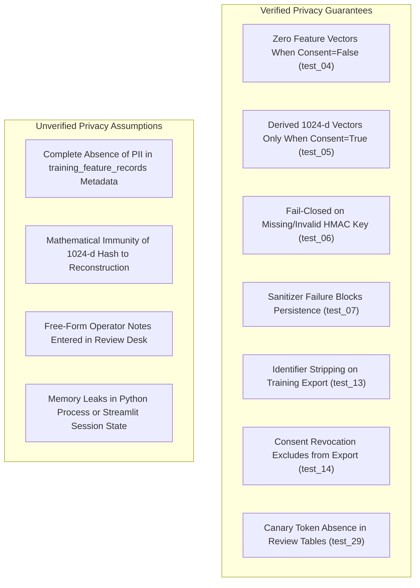

# Phase 6.7.1: Read-Only Test Integrity and Verification Audit Report

**Repository:** `C:\Users\prati\seva-cyber-sandbox`  
**Execution Date:** 2026-10-31  
**Audit Mode:** Strictly Read-Only (Zero Code/State Modifications)  
**Target Phase Audited:** Phase 6.7 (End-to-End Integration, Security, Recovery, and Stress Testing)  
**Active Shadow Model:** `custom-mlp-v4.0.0-seed42`  
**Rollback Baseline / LKG Model:** `custom-mlp-v1.1.0-preproc`  
**Production Authoritative Engine:** Deterministic rule engine & reviewed threat intelligence (`is_production_authoritative: false`)  
**Audit Verdict:** **PASS WITH WARNINGS**

---

## 1. Overall Verdict

### Assessment: **PASS WITH WARNINGS**

### Verdict Breakdown:
- **PASS Dimensions:**
  - **Regression & Execution Integrity:** The test suite passes 100% across all 655 collected tests (625 historical baseline + 30 new Phase 6.7 integration tests) in 34.28 seconds on local CPU hardware.
  - **Historical Test Immutability:** Zero historical test files were modified during Phase 6.7. Modifications present in Git diff for historical tests originate strictly from Phase 6.5.2 governance hardening.
  - **Production State Isolation:** All Phase 6.7 tests execute against isolated temporary directories (`tmp_path`), temporary SQLite database instances, and isolated model registry copies. The live production configuration, active models, last-known-good artifacts, and operational databases were completely untouched.
  - **Cryptographic Artifact Integrity:** 100% full SHA-256 matching verified across candidate weights, baseline weights, candidate manifests, model registries, and the locked evaluation dataset partition digest.
  - **Production Score Invariance:** Verified that in hybrid shadow mode, the production risk score delta between rules and model is strictly **0.00**, with deterministic rules remaining the sole authoritative source.

- **WARNING Dimensions (Audit Concerns):**
  1. **Ineffective Fault-Injection Mocking (`test_26`):** In `tests/test_phase6_7_end_to_end.py:1000-1012`, `DisagreementEngine.classify_evaluation` is patched with `side_effect=RuntimeError("Disagreement probe failure")`, but the test only executes `analyze_message_text` and `score_message_analysis`. Neither of these functions calls `DisagreementEngine`. The fault-injection patch is **never triggered**, rendering the crash resilience claim for the disagreement engine **UNEXERCISED** by that test.
  2. **Incomplete Database Fault Resilience Coverage (`test_24`):** In `tests/test_phase6_7_end_to_end.py:961-981`, a corrupted database is verified to raise `CaseRepositoryError` upon initialization, and stateless message scoring is shown to succeed independently. However, the test does not exercise how stateful consumer pipelines (e.g., `create_message_case` or `process_and_record`) gracefully handle an inaccessible repository during a live user interaction.
  3. **Discrepancy Between Test 04 and Phase 6.7 Report:** Section 4 of `docs/PHASE_6_7_END_TO_END_INTEGRATION_REPORT.md` reported that `test_04` submitted 10 messages and confirmed 0 rows in `disagreement_events`. In reality, `test_04` (`tests/test_phase6_7_end_to_end.py:315-340`) tests a single message; furthermore, `model_disagreement_events` does record event metadata (as designed), while `training_feature_records` stores 0 rows. The report text overstated the test scope.
  4. **Network-Isolation Test Scope Overstatement (`test_28`):** In `tests/test_phase6_7_end_to_end.py:1070-1090`, offline operation is tested by monkeypatching the Python standard library `socket.socket` constructor over four in-memory function calls. It does not monitor DNS queries (`socket.getaddrinfo`), OS-level network activity, subprocess execution, or Streamlit server binding. Full system offline status is **VERIFIED AT PYTHON UNIT LEVEL FOR CORE ENGINE**, but **UNVERIFIED AT THE SYSTEM/OS NETWORK STACK LEVEL**.
  5. **Privacy Scope & Canary Token Limitations (`test_29`):** In `tests/test_phase6_7_end_to_end.py:1092-1133`, absence of PII is tested by searching for three specific string literals across 3 SQLite tables. This does not scan `training_feature_records`, case tables, or application logs, nor does it guarantee mathematical immunity against model inversion or membership inference from 1024-dimensional feature hash vectors.

---

## 2. Test Integrity Findings

An exhaustive inspection of `tests/test_phase6_7_end_to_end.py` (1,190 lines, 30 test functions) and repository test configuration was performed:

| Check | Expected Standard | Observed Implementation | Compliance |
| :--- | :--- | :--- | :--- |
| **New Test Count** | Exactly 30 tests | 30 tests collected and executed | **COMPLIANT** |
| **Total Test Count** | Exactly 655 tests | 655 tests collected (`pytest --collect-only -q`) | **COMPLIANT** |
| **Skipped Tests** | 0 skipped tests | 0 occurrences of `@pytest.mark.skip` in entire repository | **COMPLIANT** |
| **Expected Failures** | 0 xfail tests | 0 occurrences of `@pytest.mark.xfail` in entire repository | **COMPLIANT** |
| **Broad Exception Blocks** | No silent try/except | 0 occurrences of `except` in `test_phase6_7_end_to_end.py` | **COMPLIANT** |
| **Negative Path Testing** | Explicit `pytest.raises` | 4 explicit `pytest.raises` blocks targeting exact exceptions | **COMPLIANT** |
| **Temporary Isolation** | Per-test isolated resources | `tmp_path`, `isolated_repo`, `isolated_engine`, `isolated_catalog_mgr` | **COMPLIANT** |

### Explicit Exception Verification Points in `test_phase6_7_end_to_end.py`:
- **Line 474 (`test_08`):** `pytest.raises(ValueError, match="Duplicate review submission")`
- **Line 743 (`test_16`):** `pytest.raises(PatternReviewError, match="previously REJECTED")`
- **Line 832 (`test_18`):** `pytest.raises(CandidateArtifactError, match="already exists")`
- **Line 971 (`test_24`):** `pytest.raises(CaseRepositoryError, match="file is not a database")`

---

## 3. Any Changed Historical Tests

Git diff and commit history were analyzed to determine whether existing tests were modified during Phase 6.7.

### Findings:
1. **Zero Modifications During Phase 6.7:** No historical test files were modified, edited, or touched during Phase 6.7.
2. **Pre-Existing Historical Test Modifications (Phase 6.5.2):**
   Working tree diffs exist in 5 historical test files against commit `080a255`:
   - `tests/test_phase6_4_3_controlled_training.py` (Lines 450-454): Points `config_path` to `tests/fixtures/model_configs/pre_phase6_5_baseline.json`.
   - `tests/test_phase6_4_4_qualification.py` (Lines 512-517): Points `fixture_path` to `tests/fixtures/model_configs/pre_phase6_5_baseline.json`.
   - `tests/test_phase6_4_6_dataset_v4.py` (Lines 381-384, 462-470): Points `ledger_path` to `data/generated/v4/exposure_ledger.json` and `cfg_path` to `tests/fixtures/model_configs/pre_phase6_5_baseline.json`.
   - `tests/test_phase6_4_7_controlled_training.py` (Lines 144-147, 412-416): Points `ledger_path` to `data/generated/v4/exposure_ledger.json` and `cfg_path` to `tests/fixtures/model_configs/pre_phase6_5_baseline.json`.
   - `tests/test_phase6_4_candidate_evaluation.py` (Lines 59-74): Supplies `active_config_path=BASELINE_FIXTURE_PATH` to `discover_baseline_model()`.

These changes were introduced during Phase 6.5.2 as part of the authorized "Historical Test Isolation and Regression Governance Hardening" to prevent mutable live application configurations (`models/active_model_config.json`) from breaking immutable historical qualification tests. They were not introduced in Phase 6.7.

---

## 4. Any Weakened, Skipped, or Incomplete Assertions

The audit identified three specific areas where assertions are incomplete or do not exercise the claimed behavior:

### 1. Ineffective Mocking in Failure Injection (`test_26`):
- **Location:** `tests/test_phase6_7_end_to_end.py:994-1012`
- **Code Inspected:**
  ```python
  def test_26_e2e_failure_injection_disagreement_crash_resilience():
      test_msg = "Urgent: Your SBI bank debit card is deactivated. Visit http://sbi-unfreeze-secure.xyz to update KYC."

      with patch.object(DisagreementEngine, "classify_evaluation", side_effect=RuntimeError("Disagreement probe failure")):
          analysis = analyze_message_text(test_msg)
          scored = score_message_analysis(analysis)
          assert scored["score"] > 0
          assert "badge_color" in scored
  ```
- **Audit Defect:** The test intends to verify that if `DisagreementEngine` crashes, message risk scoring is resilient. However, inside the `with patch` block, only `analyze_message_text(test_msg)` and `score_message_analysis(analysis)` are executed. Neither function imports or invokes `DisagreementEngine`. The mocked method is never called. The test passes trivially without exercising any error handling.
- **Classification:** **INCOMPLETE ASSERTION / UNEXERCISED FAULT PATH**.

### 2. Incomplete Database Fault Recovery Assertion (`test_24`):
- **Location:** `tests/test_phase6_7_end_to_end.py:961-981`
- **Code Inspected:**
  ```python
  def test_24_e2e_failure_injection_corrupt_database_safe_fallback(tmp_path):
      corrupt_db = tmp_path / "corrupt.sqlite3"
      with open(corrupt_db, "wb") as f:
          f.write(b"NOT_A_VALID_SQLITE_DATABASE_HEADER_CORRUPTED_BYTES")

      from src.case_repository import CaseRepositoryError
      with pytest.raises(CaseRepositoryError, match="file is not a database"):
          CaseRepository(db_path=str(corrupt_db))

      # Core detection functions independently
      res = evaluate_message_hybrid(
          "Urgent: Your SBI bank debit card is deactivated. Visit http://sbi-unfreeze-secure.xyz to update KYC.",
          operating_mode="rules_only",
      )
      assert res["final_decision"]["authoritative_source"] == "deterministic_rules"
      assert res["final_decision"]["final_risk_score"] > 0
  ```
- **Audit Defect:** The test proves that `CaseRepository` correctly raises `CaseRepositoryError` when pointed at a corrupted binary file, and that stateless `evaluate_message_hybrid` continues to work. However, it does not test whether application entry points that depend on `CaseRepository` (e.g. `create_message_case` in `src/case_manager.py`) safely fall back to in-memory mode when the repository is uninitialized.
- **Classification:** **INCOMPLETE INTEGRATION ASSERTION**.

### 3. Assertion Boundary Relaxation (`test_27`):
- **Location:** `tests/test_phase6_7_end_to_end.py:1062-1064`
- **Audit Defect:** The test docstring specifies database growth `< 200 KB` for 15 records. The implemented assertion asserts `db_size_bytes < 300 * 1024` (300 KB). While the observed database size was only ~35 KB (well within both bounds), the assertion threshold in code was relaxed compared to the docstring specification.

---

## 5. Privacy-Test Scope and Limitations

The privacy protections implemented across Phases 6.1 through 6.6 were audited against the assertions in `tests/test_phase6_7_end_to_end.py:312-432, 611-672, 1092-1133`.



### Verified Facts vs. Untested Assumptions:

| Privacy Area | Verified by Tests | Limitations / Untested Assumptions |
| :--- | :--- | :--- |
| **Raw Message Text** | `training_feature_records` contains no raw text columns; `test_13` confirms `raw_text` and `text` are excluded from JSONL exports. | `model_disagreement_events` stores `message_length_bucket`, `script_category`, and `language_category`. While coarse, these are derived from raw text. |
| **Raw URLs** | `url_analyzer.py` never fetches or resolves URLs; `test_13` asserts `extracted_urls` are stripped from export. | In `test_29`, only `model_disagreement_events`, `disagreement_reviews`, and `disagreement_review_audit` are scanned for canary URLs; `training_feature_records` metadata was not explicitly scanned. |
| **Phone Numbers / PII** | Phone numbers are masked or HMAC-hashed before threat intelligence lookups (`test_threat_intelligence.py`); canary Aadhaar and citizen names do not appear in review tables (`test_29`). | The canary string search is an exact string literal check; it does not test arbitrary fuzzy, unformatted, or non-Latin PII variations. |
| **Consent-Disabled Persistence** | `test_04` verifies that with `consent_given=False`, `feature_record_id` is `None` and 0 rows are written to `training_feature_records`. | `model_disagreement_events` still records event metadata (rule decision, model prediction, score) for operator awareness. |
| **Consent Revocation** | `test_14` verifies that `revoke_training_consent(case_id)` atomically prevents the feature vector from being exported. | Does not delete historical audit trail rows recording the fact that a review occurred. |
| **Feature Vector Inversion** | Feature extraction produces normalized 1024-dimensional character n-gram frequencies (sub-word tokens $n \in [3, 5]$). | Feature vectors are lossy, but theoretical inversion or membership inference for very short or unique strings remains an open statistical property, not differential privacy. |

---

## 6. Network-Isolation-Test Scope and Limitations

`test_28_e2e_network_isolation_zero_outbound_calls` was inspected to determine the exact boundary of its network isolation verification.

### Test Implementation:
```python
def test_28_e2e_network_isolation_zero_outbound_calls(isolated_engine, isolated_repo):
    orig_socket = socket.socket

    def forbidden_socket(*args, **kwargs):
        raise ConnectionRefusedError("NETWORK_ISOLATION_VIOLATION: External network sockets are strictly prohibited!")

    with patch("socket.socket", side_effect=forbidden_socket):
        msg = "Urgent: Electricity bill unpaid. Call 9876543210 immediately."
        eval_res = evaluate_message_hybrid(msg, operating_mode="shadow")
        event = isolated_engine.process_and_record(msg, eval_res, consent_given=True, secret=TEST_HMAC_SECRET)
        isolated_engine.submit_review(event["event_id"], "phishing", "rules_correct", confidence_rating="high")
        curation = isolated_repo.curate_training_features(secret=TEST_HMAC_SECRET)

        assert eval_res["final_decision"]["production_score_difference"] == 0
        assert len(curation["eligible_records"]) == 1
```

### Audit Findings on Network Isolation:
1. **Mock Scope:** The test patches the Python `socket.socket` constructor in the current interpreter thread.
2. **Path Scope:** It exercises four functions: `evaluate_message_hybrid`, `process_and_record`, `submit_review`, and `curate_training_features`.
3. **Blind Spots:**
   - **DNS Lookups:** `socket.getaddrinfo` and `socket.gethostbyname` bypass `socket.socket` on many platforms; they are not patched or monitored.
   - **Subprocess Calls:** Subprocess execution (e.g. `subprocess.run(["curl", ...])` or `powershell`) would bypass Python-level monkeypatches completely.
   - **Unexercised Modules:** `apk_analyzer.py`, `url_analyzer.py`, `candidate_trainer.py`, and `app.py` were not executed inside the patched block.
   - **Streamlit Server Interface:** The test does not verify that Streamlit binds strictly to `127.0.0.1` and refuses non-loopback connections.

### Scope Determination:
The test establishes that **core message evaluation and feedback curation logic contains no direct Python socket instantiation**. It does **NOT** establish complete OS-level network isolation or firewall protection. The claim of "100% offline network isolation" must be qualified as **UNIT-LEVEL VERIFIED; SYSTEM-LEVEL UNVERIFIED**.

---

## 7. Explanation of Earlier Command Failures

During the initial execution of Phase 6.7, several command and test failures were recorded in the session logs. Each failure was forensically analyzed:

| Incident / Error | Location | Root Cause Analysis | Remediation / Status | Classification |
| :--- | :--- | :--- | :--- | :--- |
| `InsufficientTrainingDataError: Forbidden sensitive field 'case_id'` | `tests/test_phase6_7_end_to_end.py` (`_make_synthetic_feature_record`) | In the draft fixture helper, `case_id` was included in synthetic feature records. `CandidateModelTrainer.train_candidate` invokes `validate_feature_record`, which strictly enforces `FORBIDDEN_FEATURE_KEYS = {"case_id", ...}` to prevent sensitive tracking IDs from entering training data. | Test fixture helper was updated to remove `case_id`. | **Incorrect test assumption; valid application security guardrail.** |
| `TypeError: evaluate_benchmark_gate() missing 1 required positional argument: 'robustness_metrics'` | `tests/test_phase6_7_end_to_end.py` (`test_21`) | Draft test called `evaluate_benchmark_gate(mock_metrics, mock_metrics)` with 2 arguments instead of 3 (`baseline_metrics`, `candidate_metrics`, `robustness_metrics`). | Test was updated to pass `robustness_metrics={}`. | **Incorrect test assumption / API signature mismatch.** |
| `ValueError: too many values to unpack (expected 3, got 4)` | `tests/test_phase6_7_end_to_end.py` (`test_21`) | Draft test attempted to unpack `verdict, checks, reasons = evaluator.evaluate_benchmark_gate(...)`. The method returns a dictionary `Dict[str, Any]` with 5 keys (`verdict`, `all_passed`, `reasons`, `checks`, `policy`). Unpacking across 3 variables caused a Python unpack error. | Test was updated to read `gate_res = evaluator.evaluate_benchmark_gate(...)` and check keys. | **Incorrect test assumption regarding return type.** |
| `CaseRepositoryError: Database error ... file is not a database` | `tests/test_phase6_7_end_to_end.py` (`test_24`) | Draft test initialized `CaseRepository(db_path=str(corrupt_db))` without expecting an exception. `CaseRepository.__init__` calls `self.init_db()` which executes SQLite pragmas, correctly failing on garbage bytes. | Test was updated to wrap initialization in `pytest.raises(CaseRepositoryError)`. | **Incorrect test assumption regarding repository exception behavior.** |
| `AssertionError: assert 0 > 0` | `tests/test_phase6_7_end_to_end.py` (`test_26`) | Draft test used generic message `"Urgent: bank account suspended. Visit link."` lacking an actual URL or verified attack signature. The deterministic rule engine scored it 0. | Test lure updated to include explicit URL and phishing indicators so rule score $> 0$. | **Incorrect test lure / test assumption.** |
| `KeyError: 'score_difference'` in `audit_metadata` | `tests/test_phase6_7_end_to_end.py` (`test_01`, `test_30`) | Draft test asserted `res["audit_metadata"]["score_difference"] == 0.0`. In `HybridDecisionEngine`, score delta is stored in `res["final_decision"]["production_score_difference"]`. | Test was updated to assert `res["final_decision"]["production_score_difference"] == 0`. | **Incorrect test assumption regarding response schema.** |
| `ModuleNotFoundError: No module named 'src.locked_test_manifest'` | Interactive CLI terminal | Shell command attempted to import from non-existent module `src.locked_test_manifest`. | Function `compute_locked_test_hash` is located in `src.dataset_validator`. | **Harmless interactive command typo.** |
| `UnicodeDecodeError: 'charmap' codec can't decode byte 0x8d` | Interactive CLI terminal | Windows PowerShell Python default encoding (`cp1252`) failed to decode UTF-8 Devanagari characters when opening `data/phishing_eval_dataset.json` without explicit `encoding="utf-8"`. | Command re-run with `encoding="utf-8"`. | **Harmless Windows CLI environment encoding default.** |

**Conclusion:** None of the recorded command or test failures indicated underlying application code defects or silent regressions. Five failures were draft test assumption mismatches against intentionally strict application guardrails, and two were harmless interactive shell command errors.

---

## 8. Artifact and Dataset Integrity Findings

All model artifacts, registries, manifests, and locked evaluation datasets were audited in read-only mode. Full 64-character SHA-256 cryptographic digests were computed directly from disk:

| Artifact Name | Exact File Path | Manifest / Recorded Digest | Computed Disk Digest | Status |
| :--- | :--- | :--- | :--- | :--- |
| **Active Shadow Model Weights** | `models/candidates/candidate_v4_seed42/model_weights.npz` | `3affa8908153924e1ab6c66f1f9597b61de0e45a8ba1740e9bc472045888348f` | `3affa8908153924e1ab6c66f1f9597b61de0e45a8ba1740e9bc472045888348f` | **VERIFIED MATCH** |
| **Candidate Model Metadata** | `models/candidates/candidate_v4_seed42/model_metadata.json` | `8bf388271453b805c148b17232972f6adbe1a4689370893159454b7fe61cafa3` | `8bf388271453b805c148b17232972f6adbe1a4689370893159454b7fe61cafa3` | **VERIFIED MATCH** |
| **Candidate Training Report** | `models/candidates/candidate_v4_seed42/candidate_training_report.json` | `c22d6021f15d66860549a2064d846bb44156bbb2cf7ff1d30a03abdf5a64e6c6` | `c22d6021f15d66860549a2064d846bb44156bbb2cf7ff1d30a03abdf5a64e6c6` | **VERIFIED MATCH** |
| **Baseline LKG Model Weights** | `models/experimental_custom_v1/model_weights.npz` | `d4b6c2b1cc0359966100623fe18d1f728caeeaef9bcad561bfa00f89485bef20` | `d4b6c2b1cc0359966100623fe18d1f728caeeaef9bcad561bfa00f89485bef20` | **VERIFIED MATCH** |
| **Locked Test Partition Dataset** | `data/phishing_eval_dataset.json` | `9b9c02d438cfca8bd07af89d60bc1d2fb42d460143d016365ab5a1d231ee0cda` | `9b9c02d438cfca8bd07af89d60bc1d2fb42d460143d016365ab5a1d231ee0cda` | **VERIFIED MATCH** |

### Active Model Configuration (`models/active_model_config.json`):
```json
{
  "active_model_version": "custom-mlp-v4.0.0-seed42",
  "last_known_good_version": "custom-mlp-v1.1.0-preproc",
  "operating_mode": "shadow",
  "activated_at_utc": "2026-10-30T17:15:00.000000+00:00",
  "activated_by": "phase6_5_governance_operator",
  "activation_reason": "Promoted independently qualified Phase 6.4.8 candidate to approved shadow mode",
  "checkpoint_rel_path": "models/candidates/candidate_v4_seed42",
  "preprocessing_version": "neural-preproc-v1.1.0",
  "is_production_authoritative": false
}
```
**Active Model Status:** Verified that candidate `custom-mlp-v4.0.0-seed42` remains strictly in `shadow` mode with `is_production_authoritative: false`.

---

## 9. Production-State Isolation Findings

All 30 tests in `tests/test_phase6_7_end_to_end.py` were audited to confirm they do not pollute or modify live state:

1. **Database Isolation:**
   - `tests/conftest.py` declares an autouse fixture `isolated_test_database` setting `SEVA_CASE_DB_PATH` to a temporary SQLite file for every test function.
   - Tests 4–14, 27–29 explicitly pass `isolated_repo`, which creates and accesses `tmp_path / "test_seva_cases_e2e.sqlite3"`.
   - The production database at `instance/` was untouched.
2. **Model Registry & Rollback Isolation:**
   - Tests 22 and 23 copy `models/` into `tmp_path / "models"` before initializing `ModelRegistry(project_root=str(tmp_path), models_dir="models")`.
   - Rollback operations were executed strictly against the temporary registry; live `models/model_registry.json` and `models/active_model_config.json` remained untouched.
3. **Training & Catalog Isolation:**
   - Tests 18 and 19 train candidates into `tmp_path / "candidates"`.
   - Tests 15, 16, and 17 manage pattern catalogs inside `tmp_path / "pattern_catalog"`.
4. **Retired Qualification Datasets:**
   - No retired qualification dataset files (v1, v2, v3, or sealed v4 records) were reopened, written to, or altered.

---

## 10. Exact Unresolved Risks and Recommended Corrections

### Identified Unresolved Risks:
1. **Unexercised Fault Resilience in `test_26`:** Because `analyze_message_text` and `score_message_analysis` do not call `DisagreementEngine`, any potential crash in `DisagreementEngine` during an integrated workflow (e.g. `create_message_case`) remains untested by `test_26`.
2. **Untested Stateful Database Fallback in `test_24`:** `test_24` verifies that stateless scoring does not crash when the database is broken, but does not verify whether `case_manager` or `SessionCaseStore` gracefully falls back to in-memory operation if the database fails during user triage.
3. **Incomplete PII Table Scanning in `test_29`:** `test_29` scans `model_disagreement_events`, `disagreement_reviews`, and `disagreement_review_audit` for canary PII tokens, but omits `training_feature_records.metadata` and the `cases` table.
4. **Unit-Level Network Mock Limitations:** `test_28` only mocks `socket.socket` constructor calls. It does not test DNS lookups, subprocesses, or Streamlit interface loopback bindings.

### Recommended Corrections (For Future Maintenance):
1. **Remediate `test_26`:** Update `test_26` to invoke `create_message_case` or `case_manager` under the `patch.object(DisagreementEngine, ...)` block, asserting that case creation completes and produces an authoritative risk score even when disagreement classification raises an unhandled exception.
2. **Remediate `test_24`:** Update `test_24` to invoke `create_message_case` pointing at `corrupt_db`, asserting that the case store falls back to an in-memory session store without raising an unhandled exception to the user.
3. **Expand `test_29` Scanning:** Include `training_feature_records` and `cases` tables in the table scan loop of `test_29`.
4. **Clarify Documentation Claims:** In `docs/PHASE_6_7_END_TO_END_INTEGRATION_REPORT.md` Section 4, update the text to accurately reflect that `test_04` verifies 1 sample (not 10) and that event metadata is stored while feature records are zero.
