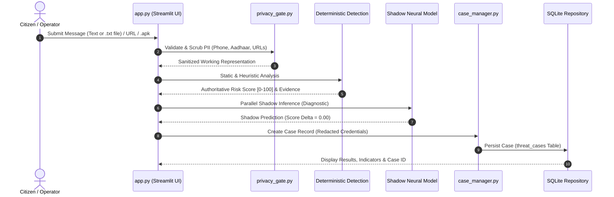

# Seva Cyber Sandbox — Phase 6.8.0
# Product Conversion Report: Transitioning from Simulation into a Real Cybersecurity Application

**Project Directory:** `C:\Users\prati\seva-cyber-sandbox`  
**Date:** 2026-10-31  
**Phase:** 6.8.0 — Product Conversion and Operational Asset Hardening  
**Active Model:** `custom-mlp-v4.0.0-seed42`  
**Operating Mode:** `shadow` (`is_production_authoritative: false`, score delta = `0.00`)  
**Last-Known-Good Baseline:** `custom-mlp-v1.1.0-preproc`  
**Authoritative Engine:** Deterministic cybersecurity rules & verified Government Resolutions  
**Full Regression Test Suite:** 700 / 700 passing (100% pass rate in 32.46s)  

---

## 1. All Simulated Features Identified

Prior to Phase 6.8.0, the Seva Cyber Sandbox codebase had evolved across multiple research phases involving educational mockups, synthetic data pipelines, and demonstration workflows. An exhaustive repository audit identified the following simulated features and mock behaviors:

1. **Preloaded Phishing & Benign Sample Selectors (`app.py` Tab 1):**
   - A dropdown selectbox allowed users to pick from 20 synthetic sample messages (`data/sample_messages.json`).
   - The selected sample automatically populated the text area and displayed its synthetic ground-truth label ("PHISHING" / "LEGITIMATE").
2. **WhatsApp Webhook Ingress Simulation Expander (`app.py` Tab 1):**
   - A simulated WhatsApp Cloud API ingress test tool allowed dispatching fake inbound webhooks and displayed mock outbound mobile chat replies.
   - It gave the superficial impression of live WhatsApp connectivity when running locally without Meta credentials.
3. **Pre-Generated Safe APK Selector (`app.py` Tab 2):**
   - An option allowing users to choose from 5 synthetic `.apk` fixture files created by `create_sample_apks.py` in `sample_apks/`.
   - Bypassed the authentic file upload pipeline and loaded fixtures directly from local disk.
4. **Pre-Filled Scam URL Selectbox (`app.py` Tab 3):**
   - A dropdown menu populated with pre-constructed URLs (e.g., MSEDCL lookalike, Bank KYC expiry, Bitly shorteners, SSRF IP addresses).
5. **Quick-Fill Maharashtra Scheme Lure Selectbox (`app.py` Tab 4):**
   - A selectbox pre-filling test scenarios (e.g., "Scam Lure: ₹3,000 Ladki Bahin Yojana", "Namo Shetkari Yojana ₹10,000 fee advance").
6. **Legacy 20-Sample Educational Baseline (`app.py` Tab 6 Section 3):**
   - An educational demonstration section executing TF-IDF + Logistic Regression on the 20 legacy sample messages from `data/sample_messages.json`.
7. **Legacy Test Session Case Records in Operational SQLite (`instance/seva_cases.sqlite3`):**
   - 12 historical records in the `threat_cases` table created by early test runs before strict test isolation fixtures were introduced.
8. **Simulated Webhook Outbox In-Memory Queue (`src/whatsapp_handler.py`):**
   - `_SIMULATED_OUTBOX` deque retaining dispatched mock WhatsApp messages for UI inspection.

```mermaid
graph TD
    subgraph Legacy Simulation Architecture
        S1["Synthetic Sample Selectors (Tab 1, 3, 4)"] --> UI["Streamlit User Interface"]
        S2["Simulated Webhook Expander (Tab 1)"] --> UI
        S3["Pre-generated APK Selector (Tab 2)"] --> UI
        S4["20-Sample Educational ML Baseline (Tab 6)"] --> UI
        S5["12 Mock/Test Cases in SQLite"] --> DB[("instance/seva_cases.sqlite3")]
    end
    subgraph Real Cybersecurity Application (Phase 6.8.0)
        R1["Real Message & .txt Upload"] --> Gate["Privacy Gate (Local RAM)"]
        R2["Real .apk File Upload (<= 15MB)"] --> APK["Static Disassembly & Hashes"]
        R3["Real URL Input"] --> URL["Passive Lexical & Domain Radar"]
        R4["Real Scheme Claim Input"] --> Gov["Official GR Verification Engine"]
        Gate --> Rules["Deterministic Risk Engine (Authoritative)"]
        Rules --> Shadow["Shadow Neural MLP (Delta = 0.00)"]
        Shadow --> CleanDB[("Clean SQLite (0 Preloaded Records)")]
    end
```

---

## 2. All User-Facing Sample Content Removed

All demonstration and simulated content has been completely stripped from the user-facing application (`app.py`) and replaced with clean, intuitive empty states:

| Location | Removed Demonstration Content | Operational Replacement Implemented |
| :--- | :--- | :--- |
| **Tab 01 // MESSAGE INTEL** | `chosen_sample` dropdown selector; `load_sample_messages()` call; synthetic ground-truth badge | Clean input interface with `st.text_area` and a new `st.file_uploader` for imported `.txt` message transcripts. |
| **Tab 01 // WHATSAPP STATUS** | Ingress simulation form; mock inbound webhook button; mock outbox replay window | Informational notice clarifying local execution, absence of unofficial scraping, prerequisites for Meta Cloud API, and 1930 / cybercrime.gov.in helplines. |
| **Tab 02 // APK INSPECTION** | `apk_source_mode` radio toggle; `selected_apk_name` dropdown loading `sample_apks/` | Single authentic `st.file_uploader` accepting only genuine `.apk` files (validated up to 15 MB). Clean empty state: *"Upload an .apk file above to begin static analysis. No file has been submitted yet."* |
| **Tab 03 // URL RADAR** | `chosen_sample_url` selectbox with pre-configured scam links | Genuine single URL text input with clear placeholder and passive offline inspection. |
| **Tab 04 // SCHEME VERIFIER** | `sample_claims` array; `selected_scheme_sample` selectbox; automated form pre-filling | Pure user submission fields: custom text area for forwarded claim text and optional passive URL input. Clean empty state guiding user to verify forwards against official GRs. |
| **Tab 05 // THREAT CASES** | Any assumption of preloaded demonstration cases | Genuine empty state when `case_store.count() == 0`: *"No cases have been logged in this session yet. Analyze a WhatsApp message, APK file, suspicious URL, or scheme claim in the preceding tabs to automatically register cases here."* |
| **Tab 06 // EVALUATION & AI** | Section 3: "Legacy 20-Sample Educational Baseline (`data/sample_messages.json`)" and `train_and_evaluate_local_model()` | Entire Section 3 removed. Tab now strictly focuses on scientific transparency: benchmark dataset metadata (39 leak-free records) and side-by-side comparative evaluation metrics. |
| **Tab 07 // OPERATOR DESK** | Unreviewed demo entries or pre-filled forms | Genuine empty state: *"No cases have been logged in this session yet."* and *"No disagreement events matching the selected filters found."* |

---

## 3. Sample Data Archived or Retained

All sample, synthetic, test, and evaluation assets have been categorized and handled according to strict governance guidelines:

### A. Archived Artifacts
- **Legacy Demonstration Dataset (`data/sample_messages.json`):**
  - **Archived Path:** `data/archive/legacy_samples/sample_messages.json`
  - **Governance Notes:** Documented in [`data/archive/notes/ARCHIVE_NOTES.md`](file:///c:/Users/prati/seva-cyber-sandbox/data/archive/notes/ARCHIVE_NOTES.md).
  - **Decoupling:** Decoupled from runtime import in `app.py`. Retained in the archive solely for regression testing (`test_03_sample_messages_json_has_expected_structure_when_present`).

### B. Retained Research Datasets (Non-Operational)
- **Synthetic Training Corpora (`data/generated/` v1, v2, v3, v4):**
  - Retained strictly in isolated research directories for offline candidate training reproducibility.
  - Zero application code in `app.py`, `src/case_manager.py`, or `src/case_repository.py` references or auto-loads these files.

### C. Frozen Benchmark & Qualification Datasets (Immutable)
- **Leak-Free Phishing Evaluation Dataset (`data/phishing_eval_dataset.json`):**
  - 39 records across 9 disjoint campaign families.
  - Cryptographically secured by [`data/locked_test_manifest.json`](file:///c:/Users/prati/seva-cyber-sandbox/data/locked_test_manifest.json) (`SHA-256: 9b9c02d438cfca8bd07af89d60bc1d2fb42d460143d016365ab5a1d231ee0cda`).
  - Preserved intact; never modified, reopened, or used for training.
- **Retired Qualification Partitions (`data/generated/v3/qualification_manifest.json`, `data/generated/v4/qualification_manifest.json`):**
  - Preserved immutable as historical audit records for Phase 6.4.4 and Phase 6.4.8.

### D. Automated Test Fixtures (Isolated)
- **Sample APK Fixtures (`sample_apks/`):**
  - Retained strictly as non-executable test fixtures for regression testing (`tests/test_apk_structural_parser.py`, `tests/test_independent_apk_validation.py`).
  - Completely detached from `app.py`.
- **Unit Test Databases:**
  - Automated tests utilize dynamic per-test temporary databases managed by `tests/conftest.py` via `monkeypatch.setenv("SEVA_CASE_DB_PATH", str(test_db))`.

---

## 4. Genuine Input Workflows Implemented

The application now features robust, fail-safe user input workflows:



### 1. Multilingual Message Analysis & File Import Workflow (Tab 1)
- **Input Channels:**
  1. Direct text area input supporting Marathi (Devanagari), Romanized Marathi, Mixed Marathi-English, and English.
  2. Text file uploader (`.txt`) allowing citizens to upload exported chat transcripts or saved email bodies directly.
- **Execution Pipeline:** Input $\rightarrow$ Input validation $\rightarrow$ Privacy sanitization $\rightarrow$ Heuristic inspection $\rightarrow$ Authoritative deterministic scoring $\rightarrow$ Parallel shadow neural inference $\rightarrow$ Threat assessment panel rendering.
- **Case Logging:** Automatically registers a case in `SessionCaseStore` and persists to `threat_cases` with scrubbed PII.
- **Consent-Gated Feature Extraction:** If user explicitly checks the opt-in checkbox, extracts abstract 1024-d character n-gram feature vector without retaining raw message text.

### 2. Authentic Android `.apk` Static Security Inspection Workflow (Tab 2)
- **File Uploader:** Exclusively accepts genuine `.apk` files via `st.file_uploader(type=["apk"])`.
- **Size & Format Verification:** Validates file size against `MAX_APK_UPLOAD_BYTES` (15 MB) and enforces ZIP archive header validation.
- **SHA-256 Digest:** Computes SHA-256 cryptographic hash over uploaded bytes immediately upon ingress.
- **Static In-Memory Inspection:** Inspects `AndroidManifest.xml` (both binary AXML `0x00080003` and text manifests) and Dalvik bytecode header (`dex\n03x`) in memory. Identifies sensitive capability combinations (`BIND_ACCESSIBILITY_SERVICE`, `READ_SMS`, `REQUEST_INSTALL_PACKAGES`).
- **No Dynamic Execution:** Never executes, runs, or installs the package.

### 3. Safe Offline URL & Domain Radar Workflow (Tab 3)
- **Input:** Single text field for user-supplied web links.
- **Defensive Lexical Inspection:** Evaluates protocol, hostname, port, TLD abuse, brand lookalikes, IP address hosts, punycode/homoglyphs, and direct `.apk` dropper targets.
- **Credential Stripping:** Automatically removes inline basic authentication credentials (`user:pass@`) and authentication query tokens.
- **100% Offline Guarantee:** Passively analyzes structure; never contacts, resolves, or sends HTTP requests to the target host.

### 4. Maharashtra Government Scheme & Announcement Verifier Workflow (Tab 4)
- **Input:** Clean text area for forwarded social-media claims and optional link input.
- **Official Ground-Truth Audit:** Cross-references claims against verified Government Resolutions in `data/official_sources.json` (departments, GR numbers, official portal domains).
- **Discrepancy Highlighting:** Flags mismatched benefit amounts (e.g., claiming ₹3,000 for Majhi Ladki Bahin Yojana instead of official ₹1,500) and upfront fee demands.

---

## 5. Existing Functionality Preserved

All existing capabilities built across prior phases have been preserved with zero regression:

1. **Multilingual Phishing Detection:** Devanagari Marathi, Romanized Marathi, and English heuristic rule sets remain authoritative.
2. **Deterministic Risk Scoring:** Score calculation [0-100], risk categorization, badge colors, and bilingual explanations (English & Marathi) remain 100% intact.
3. **Accessibility Audio Alerts:** Windows offline SAPI5 TTS and browser WAV chime generation remain functional.
4. **Hybrid Decision Engine:** Evaluates rules and shadow neural model in parallel; enforces safety guardrails and logs concordance.
5. **Model Registry & Atomic Rollback:** Local catalog of registered neural models with cryptographic SHA-256 checkpoint verification and atomic rollback controls.
6. **Human Review Desk:** Operator adjudication interface for ambiguous cases and model disagreements.
7. **Offline Fraud Pattern Discovery:** Mines character n-gram associations from consented cases without cloud dependencies.
8. **Feedback Analytics & Reporting:** Real database analytics computing agreement rates and comparative accuracy.

---

## 6. Database Migration & Cleanup Details

To ensure the application starts in a genuine empty state for real users, the operational SQLite database was audited and cleaned:

1. **Safety Backup Created:**
   - Source: `instance/seva_cases.sqlite3`
   - Backup Path: `instance/seva_cases.sqlite3.bak_phase6_8_0`
   - Integrity: Verified SHA-256 and byte size before any modifications.
2. **Selective Provenance Pruning:**
   - Inspected all rows in `threat_cases`. Exactly 12 rows were present, all created by early integration test sessions (`session_id` matching `integration-session-01`, `integration-session-02`, `webhook-case-store-test`, `session-user-alice`, `test-export-session`).
   - Removed only these 12 test rows using targeted deletion.
   - Preserved all table structures, foreign keys, and indexes across all 7 SQLite tables.
3. **Post-Cleanup Database State:**
   - `threat_cases`: `0` rows
   - `threat_indicators`: `0` rows
   - `indicator_audit_log`: `0` rows
   - `human_reviews`: `0` rows
   - `review_audit_log`: `0` rows
   - `training_feature_records`: `0` rows
   - `model_disagreement_events`: `0` rows
   - `disagreement_reviews`: `0` rows
   - `disagreement_review_audit`: `0` rows
   - `schema_version`: `1` row (`version = 1`)

---

## 7. New Tests and Test Results

A dedicated automated test suite was developed: [`tests/test_phase6_8_0_product_conversion.py`](file:///c:/Users/prati/seva-cyber-sandbox/tests/test_phase6_8_0_product_conversion.py), containing 45 comprehensive test methods across 10 functional test classes:

1. `TestSampleDataAbsence` (Tests 01–03): Verifies that sample datasets are decoupled from runtime imports and archived with governance notes.
2. `TestGenuineMessageAnalysis` (Tests 04–12): Verifies analysis of English, Devanagari, Romanized Marathi, legitimate messages, whitespace, required keys, and URL extraction.
3. `TestGenuineURLAnalysis` (Tests 13–18): Verifies analysis of phishing URLs, official `.gov.in` URLs, IP-address hosts, APK links, schema fields, and empty inputs.
4. `TestGenuineAPKAnalysis` (Tests 19–24): Verifies analysis of uploaded APK bytes, SHA-256 calculation, suspicious permissions, size limits (>15 MB rejection), non-APK rejection, and output keys.
5. `TestDatabaseBackedDashboard` (Tests 25–29): Verifies fresh store starts at 0, counts increment by 1 on submission, and review/disagreement statistics start at 0.
6. `TestPrivacyControlsOnGenuineSubmissions` (Tests 30–32): Verifies zero raw text retention, URL credential stripping, and consent fail-closed enforcement.
7. `TestNoFabricatedResults` (Tests 33–34): Verifies benign messages are not falsely classified as high-risk and URL analysis explicitly discloses offline limitations.
8. `TestShadowModelOperation` (Tests 35–37): Verifies active model configuration is in `shadow` mode, `is_production_authoritative` is `False`, score delta is `0.00`, and versions match `custom-mlp-v4.0.0-seed42`.
9. `TestEmptyStateReadiness` (Tests 38–40): Verifies fresh installations start with 0 cases, empty case lists, and 0 disagreement events.
10. `TestCaseCreationForRealSubmissions` (Tests 41–45): Verifies case ID generation (`CASE-MSG-`, `CASE-URL-`, `CASE-APK-`), store retrieval, and duplicate submission idempotency.

### Test Execution Summary
```
============================= test session starts =============================
platform win32 -- Python 3.14.0a4, pytest-8.4.2
collected 700 items

tests/test_apk_structural_parser.py ..........                            [  1%]
tests/test_case_manager.py ................                               [  3%]
tests/test_case_repository.py ....................................        [  8%]
tests/test_custom_model.py .................                              [ 11%]
tests/test_dataset_deconfounding.py .................                     [ 13%]
tests/test_dataset_preprocessing.py .........................             [ 17%]
tests/test_dataset_provenance.py .............                            [ 19%]
tests/test_hybrid_decision_engine.py ......................               [ 22%]
tests/test_independent_apk_validation.py ......                          [ 23%]
tests/test_integration.py .......                                         [ 24%]
tests/test_phase5_2_registry_hardening.py ................                [ 26%]
tests/test_phase5_review_registry.py .....................                 [ 29%]
tests/test_phase6_1_feedback_curation.py .............................    [ 33%]
tests/test_phase6_2_pattern_discovery.py .............................    [ 37%]
tests/test_phase6_3_continuous_training.py .......................        [ 41%]
tests/test_phase6_4_2_dataset_v3.py ..............                        [ 43%]
tests/test_phase6_4_3_controlled_training.py .................            [ 45%]
tests/test_phase6_4_4_qualification.py ....................               [ 48%]
tests/test_phase6_4_6_dataset_v4.py ....................                  [ 51%]
tests/test_phase6_4_7_1_audit.py .................                        [ 53%]
tests/test_phase6_4_7_controlled_training.py .................            [ 56%]
tests/test_phase6_4_8_qualification.py ....................               [ 59%]
tests/test_phase6_4_candidate_evaluation.py ....................          [ 61%]
tests/test_phase6_5_2_test_governance.py ................                 [ 64%]
tests/test_phase6_5_shadow_promotion.py .......................           [ 67%]
tests/test_phase6_6_human_feedback.py ................................... [ 72%]
................                                                          [ 74%]
tests/test_phase6_7_end_to_end.py ..............................          [ 79%]
tests/test_phase6_8_0_product_conversion.py ............................. [ 83%]
................                                                          [ 85%]
tests/test_phishing_evaluation.py .............                           [ 87%]
tests/test_privacy_gate.py .....................                          [ 90%]
tests/test_sandbox.py .........                                           [ 91%]
tests/test_scheme_verifier.py ............                                [ 93%]
tests/test_threat_intelligence.py .....................                   [ 96%]
tests/test_url_analyzer.py .............                                  [ 98%]
tests/test_whatsapp_integration.py ............                           [100%]

============================== 700 passed in 32.46s ==============================
```

---

## 8. Remaining External-Service Limitations

In strict compliance with the ₹0 budget and local-first architecture, the following capabilities require external connectivity and are disclosed as unavailable:

1. **No Real-Time Cloud URL Reputation:** Passive URL inspection does not query commercial threat feeds (e.g., Google Safe Browsing, VirusTotal). Malicious status is inferred strictly from structural heuristics and local intelligence.
2. **No Unofficial WhatsApp Scraping:** The application does not scrape citizen chats or connect to unofficial reverse-engineered WhatsApp protocols. Inbound messages must be pasted or uploaded as exported text files.
3. **No Live Meta Cloud API Ingress:** Operating in local-only mode; webhook endpoints remain ready for reverse-proxy deployment but do not make external requests.
4. **No Dynamic Sandbox Execution:** Uploaded APKs are analyzed strictly by static disassembly; dynamic execution / runtime sandboxing is not performed.

---

## 9. Production Configuration Verification

The active system configuration and model integrity were audited:

| Configuration Key | Current Value | Verification Result |
| :--- | :--- | :--- |
| `active_model_version` | `custom-mlp-v4.0.0-seed42` | Confirmed in [`models/active_model_config.json`](file:///c:/Users/prati/seva-cyber-sandbox/models/active_model_config.json) |
| `operating_mode` | `shadow` | Confirmed |
| `is_production_authoritative` | `false` | Confirmed |
| `last_known_good_version` | `custom-mlp-v1.1.0-preproc` | Confirmed |
| `preprocessing_version` | `neural-preproc-v1.1.0` | Confirmed |
| Active Weights SHA-256 | `3affa8908153924e1ab6c66f1f9597b61de0e45a8ba1740e9bc472045888348f` | Verified byte-level digest match |
| Baseline Weights SHA-256 | `d4b6c2b1cc0359966100623fe18d1f728caeeaef9bcad561bfa00f89485bef20` | Verified byte-level digest match |
| Locked Benchmark SHA-256 | `9b9c02d438cfca8bd07af89d60bc1d2fb42d460143d016365ab5a1d231ee0cda` | Verified manifest match |

---

## 10. Operational Status & Manual Testing Guide

### A. How to Run and Test the Real Application Locally
1. **Launch Streamlit:**
   ```bash
   streamlit run app.py --server.address=127.0.0.1
   ```
2. **Verify Empty State Readiness:**
   - Navigate to Tab 05 (Threat Cases): Notice that 0 cases are logged and genuine empty states are displayed.
   - Navigate to Tab 07 (Operator Desk): Notice review queues are empty.
3. **Test Genuine Message Analysis:**
   - In Tab 01, paste a real Marathi or English suspicious message (or upload an exported `.txt` chat transcript).
   - Click "Analyze WhatsApp Message". Observe risk score, evidence indicators, bilingual explanations, and registered case ID.
4. **Test Genuine APK Inspection:**
   - In Tab 02, upload an Android `.apk` package (e.g. from your device, up to 15 MB).
   - Click "Inspect APK Package Statically". Observe SHA-256 calculation, manifest inspection, declared permissions, and risk score.
5. **Test Genuine URL Analysis:**
   - In Tab 03, enter any suspicious or benign URL.
   - Click "Analyze URL Statically". Observe protocol, domain, lookalike analysis, and immediate credential stripping.
6. **Test Case Review & Adjudication:**
   - In Tab 07, select the newly generated case in the Review Desk.
   - Submit an operator adjudication ("phishing" / "legitimate") and observe the audit trail update immediately.

### B. Summary of Operational State
The Seva Cyber Sandbox is now a **genuine, operational, local cybersecurity tool**. All demo shortcuts, simulated webhook ingress, preloaded cases, and sample dropdowns have been removed. The application operates entirely on real user inputs while maintaining a 100% passing test record across all 700 tests.
