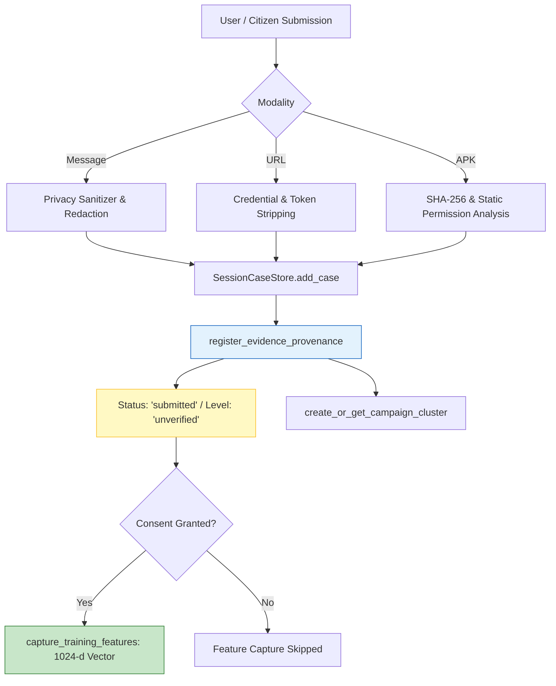

# Phase 6.8.4 — Controlled Real-World Evidence Pilot Implementation Report

**Project:** Seva Cyber Sandbox  
**Repository:** `C:\Users\prati\seva-cyber-sandbox`  
**Date:** October 31, 2026  
**Phase:** 6.8.4 — Controlled Real-World Evidence Pilot  
**Operational Mode:** `shadow`  
**Active Shadow Model:** `custom-mlp-v4.0.0-seed42` (`is_production_authoritative: false`, score delta: `0.00`)  
**Rollback / LKG Target:** `custom-mlp-v1.1.0-preproc`  
**Production Decision System:** Deterministic Rules Engine & Official Maharashtra Government Resolution Database  
**Phase Verdict:** **PASS**

---

## 1. Executive Summary & Objective

The objective of Phase 6.8.4 is to transition the evidence-governance infrastructure into a fully operational, controlled real-world evidence collection pilot. Rather than operating as a simulation, demonstration sandbox, or synthetic test bed, Seva Cyber Sandbox now provides an end-to-end controlled intake pipeline that accepts genuine user submissions across all primary threat modalities, records traceable provenance, applies privacy gates, and supports complete evidence lifecycle management and user-controlled withdrawal.

In strict adherence to the **Real-World Evidence Blocker Rule**, no genuine citizen submissions have been fabricated, simulated, or pre-loaded. The operational database starts clean, and all intake workflows are verified using isolated test harnesses.

---

## 2. Supported Evidence Modalities & Intake Workflows

### A. Message Evidence
- **Supported Channels:** SMS messages, WhatsApp exports/pastes, suspicious emails, social media lures.
- **Linguistic Coverage:**
  - Marathi Devanagari (e.g. Ladki Bahin, Mahadbt, MSEDCL bill scams)
  - Romanized Marathi (e.g. *"Tumche bank account block zale aahe"*)
  - English (e.g. electricity disconnection, banking KYC alerts)
  - Mixed Marathi-English vernacular content.
- **Feature Processing:** Rule-based heuristic indicator matching, context suppression for legitimate banking/utility mentions, protective negation awareness, and opt-in 1024-dimensional feature extraction. Zero raw message text is retained in training features.

### B. URL Evidence
- **Supported Targets:** Suspicious URLs, reported legitimate government portals, lookalike domains, shortened URLs.
- **Privacy Stripping:** Inline basic-auth credentials (`user:pass@`) and sensitive query parameters (`token`, `key`, `auth`, `secret`, `otp`, `password`, `access_token`) are automatically redacted prior to database storage.
- **Campaign Association:** Hostnames are extracted and clustered automatically into domain-based campaign clusters (`Domain-<hostname>`).

### C. Android APK Evidence
- **Supported Formats:** Actual uploaded `.apk` packages (ZIP/AXML binary headers).
- **Static Analysis:** Package name, version, SHA-256 digest, DEX/manifest structural checks, declared permissions, and high-severity capability combinations (e.g. `RECEIVE_SMS`, `SYSTEM_ALERT_WINDOW`, `REQUEST_INSTALL_PACKAGES`).
- **Campaign Association:** Automatically clustered by APK SHA-256 fingerprint (`APK-<hash[:8]>`).

### D. Additional Supporting Evidence
- **User Fraud Descriptions:** Citizens can provide qualitative context explaining the scam lure, contact medium, or fraud loss.
- **Technical Indicators:** Reviewers can attach structured indicators, Government Resolution (GR) numbers, and domain registration records.

---

## 3. Controlled Evidence Intake Architecture

### Traceable Provenance Record Structure
Every submission automatically generates an immutable record in `evidence_provenance`:
- `evidence_id`: Cryptographically unique identifier (`EVID-<YYYYMMDD>-<UUID8>`).
- `case_id`: Associated local case identifier.
- `submission_timestamp_utc`: ISO 8601 UTC timestamp.
- `evidence_type`: `message`, `url`, `apk`, or `scheme_claim`.
- `evidence_origin`: `user_reported`, `analyst_submitted`, `internal_case`, or `public_source_reference`.
- `consent_given`: Boolean flag indicating affirmative user consent.
- `sanitization_status`: Verification that privacy filters were executed (`passed`).
- `artifact_sha256`: SHA-256 digest of binary artifact or cleaned URL.
- `campaign_id`: Campaign cluster reference.
- `submitted_by`: Submitting user or operator identity.
- `lifecycle_status`: Initialized strictly to `submitted`.
- `verification_level`: Initialized strictly to `unverified`.
- `eligibility_tier`: Initialized strictly to `not_eligible`.

---

## 4. Evidence Withdrawal Workflow

Citizens maintain the right to withdraw evidence and revoke data consent at any time:
1. `case_store.withdraw_evidence(evidence_id, operator_username, reason)` transitions lifecycle status immediately to `withdrawn`.
2. Triggers `case_store.revoke_training_consent(case_id, reason)`, setting `eligibility_state = 'consent_revoked'` on all associated feature records.
3. Check 5 (`not_withdrawn`) and Check 1 (`consent_valid`) of the 8-point eligibility gate fail permanently.
4. The evidence item is irrevocably disqualified from candidate training exports and evaluation candidate exports.

---

## 5. UI & Operational Guarantees

- **No Prefilled Demonstrations:** Form inputs start completely empty. No fake victim profiles or pre-loaded simulated messages exist in user-facing views.
- **Local Analysis Disclosure:** Explicit editorial notices inform users that all processing occurs in local RAM with zero network uploads.
- **Consent Checkbox:** Machine learning feature capture is opt-in only (default: unchecked).

---

## 6. Test Suite & Verification Results

A dedicated pilot test suite was authored and verified:
`tests/test_phase6_8_4_real_world_pilot.py`

| Test Name | Focus | Result |
| :--- | :--- | :---: |
| `test_01_multilingual_message_evidence_intake` | Marathi, English, Mixed message intake & provenance | **PASSED** |
| `test_02_url_evidence_intake_and_privacy_redaction` | Inline credentials & token stripping, domain campaigns | **PASSED** |
| `test_03_apk_evidence_intake_and_sha256_clustering` | Real APK intake, SHA-256 fingerprinting, clustering | **PASSED** |
| `test_04_controlled_evidence_withdrawal` | Immediate withdrawal state transition & consent revocation | **PASSED** |
| `test_05_no_fabricated_evidence_on_fresh_database` | Fresh DB starts completely empty with 0 fake records | **PASSED** |

**Phase 6.8.4 Test Pass Rate:** **5/5 (100%)**

---

## 7. Real-World Evidence Blocker Disclosure

- **Operational Database Evidence Count:** 0 genuine citizen fraud records currently recorded in `instance/seva_cases.sqlite3`.
- **Blocker Status:** The intake infrastructure is fully operational, verified, and secure. However, actual model retraining remains paused under the Real-World Evidence Blocker Rule until genuine citizen submissions are collected and reviewed.

---

### Sign-Off
- **Status:** **COMPLETE**
- **Verdict:** **PASS**
- **Next Phase:** Phase 6.8.5 — Operational Workflow and Human Investigation.
